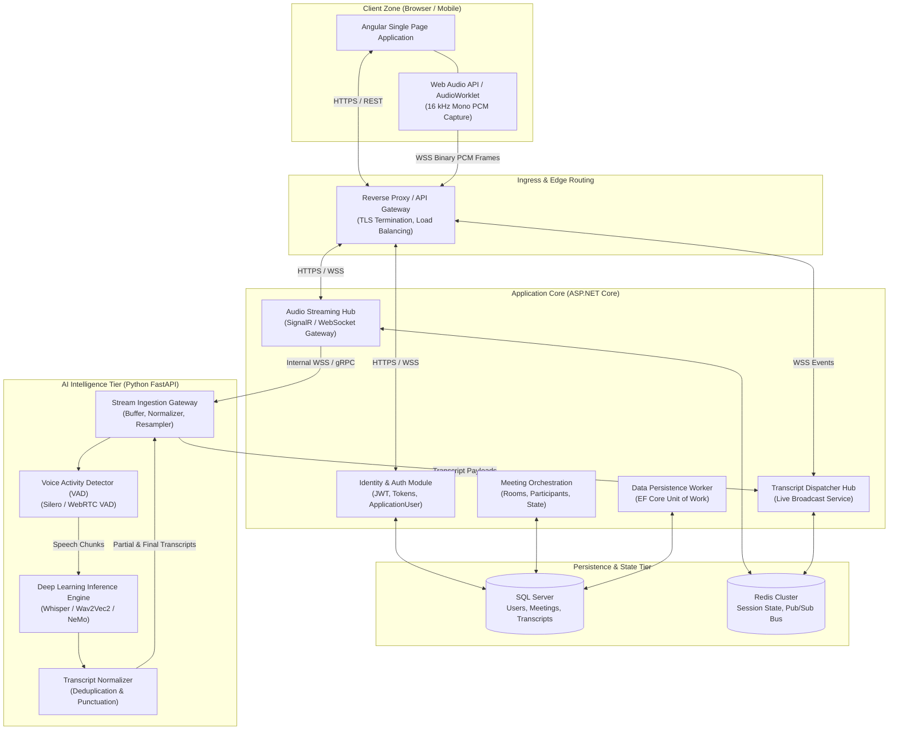
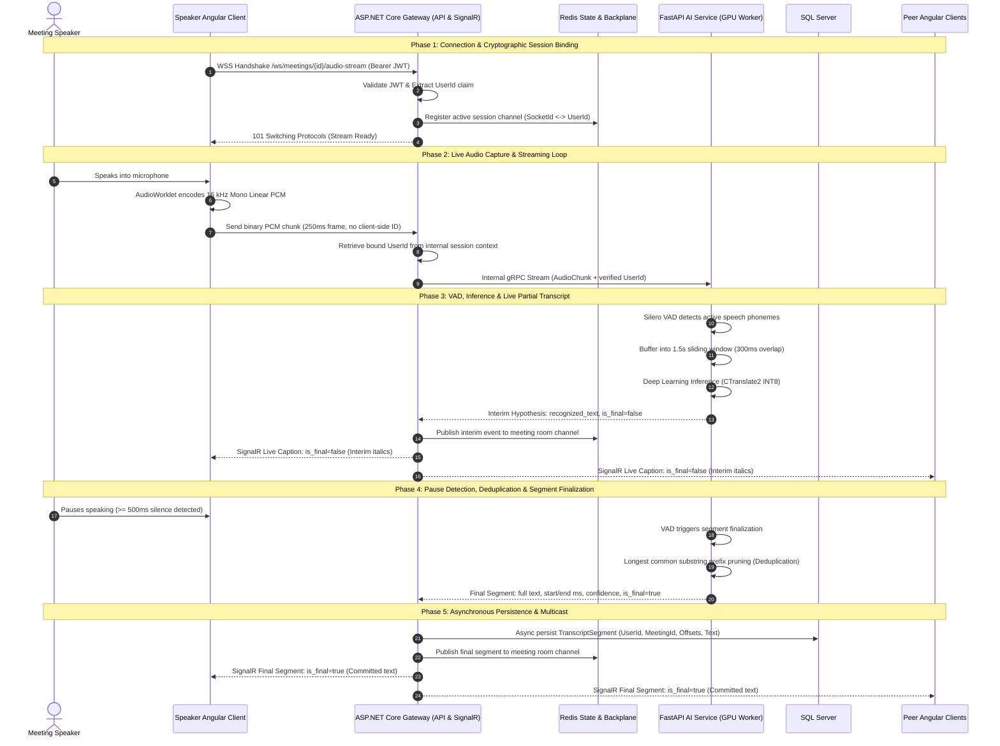

# System Architecture Specification

## 1. High-Level Architectural Vision

AiraMeet is designed as an asynchronous, event-driven, distributed conferencing and AI processing platform. The architecture separates latency-critical interactive media paths (WebRTC audio/video) from compute-intensive batch/streaming deep learning inference pipelines (FastAPI Speech-to-Text).

---

## 2. Tier-by-Tier Architectural Breakdown

### 2.1 Client Tier (Angular 17+)
- **Presentation Components**: Render authenticated routes (`/dashboard`, `/meeting/:id`, `/transcripts/:id`).
- **Reactive State Layer**: Uses Angular Signals and RxJS Subject streams for managing participant connection states, mute/unmute indicators, and live transcript scrolling.
- **Audio Worklet Subsystem**: Bypasses the UI main thread using an `AudioWorkletProcessor` to tap the microphone `MediaStream`. Captures raw 32-bit Float samples, downsamples to 16 kHz 16-bit signed integer linear PCM, and streams chunks every 250ms over a dedicated WebSocket connection.

### 2.2 Application Core Tier (ASP.NET Core Web API)
- **Security Boundary**: Validates Bearer JWT tokens on every REST endpoint and upgrades WebSockets only after validating token claims.
- **Connection Registry**: Maintains active meeting room topologies in Redis memory. When a client opens an audio streaming socket, the server binds the socket connection directly to the authenticated `ApplicationUser.Id` and `MeetingRoom.Id`.
- **Media Ingestion & Forwarding**: Buffers participant audio frames into rolling queues and forwards them to the AI Service Tier via gRPC or persistent WebSocket tunnels.
- **Transcript Broadcast Hub**: Consumes recognized text tokens from the AI tier, validates permissions, persists finalized segments into SQL Server, and multicasts live updates to all meeting room participants.

### 2.3 AI Intelligence Tier (Python FastAPI & PyTorch)
- **Decoupled Compute**: The AI service operates independently of the web application. It can scale horizontally based on GPU availability and meeting concurrency.
- **Voice Activity Detection (VAD)**: Inspects incoming audio frames to classify frames as speech vs. non-speech (silence, background noise). Non-speech frames are discarded before hitting heavy neural network layers.
- **Streaming Audio Buffer**: Implements a circular sliding window (1.0 to 2.0-second context window with 200–400ms overlap).
- **Inference Engine**: Executes forward passes on selected deep learning models (Whisper, Wav2Vec 2.0, or NeMo Conformer). Emits **Partial Transcripts** (interim hypothesis) and **Final Transcripts** (committed text with boundary timestamps).

### 2.4 Data & Persistence Tier
- **SQL Server**: Stores relational entities, transactional audit trails, user identities, meeting attendance logs, and permanent meeting transcripts.
- **Redis**: Provides sub-millisecond ephemeral state tracking, token blocklists, active meeting participant rosters, and cross-node message distribution for multi-instance ASP.NET Core clusters.

---

## 3. End-to-End Real-Time Data Flow

The following sequence diagram and narrative detail the end-to-end data lifecycle from the moment a participant un-mutes and speaks until synchronized, speaker-attributed transcripts are rendered across all room clients and persisted to long-term storage.

### 3.1 Detailed Step-by-Step Flow Description

1. **Cryptographic Handshake & Session Binding (Steps 1–4)**:
   - The Angular client establishes a secure WebSocket connection at `/ws/meetings/{id}/audio-stream`.
   - The ASP.NET Core server verifies the cryptographically signed JWT in the handshake headers, extracts the verified `UserId`, and stores the association in memory and Redis.
   - Binary audio frames transmitted over this socket contain raw PCM bytes only; the backend derives speaker identity exclusively from this connection context.

2. **Client Audio Ingestion (Steps 5–9)**:
   - The client `AudioWorkletProcessor` captures microphone audio off the main browser thread, downsamples it to 16 kHz mono 16-bit linear PCM, and streams binary chunks every 250 milliseconds.
   - ASP.NET Core attaches the authenticated `UserId` and forwards the chunk via high-speed internal gRPC or persistent WebSocket to the FastAPI AI service.

3. **VAD, Sliding Window & Partial Inference (Steps 10–16)**:
   - Silero Voice Activity Detection filters out non-speech frames and static noise.
   - Speech frames are accumulated into a 1.5-second sliding window with a 300ms overlap.
   - The deep learning model emits partial (interim) recognition hypotheses, which are multicasted via SignalR to all meeting attendees to deliver live captions with $< 3.0$ seconds visible latency.

4. **Speech Pause Detection & Overlap Deduplication (Steps 17–20)**:
   - When the speaker pauses ($\ge 500\text{ms}$ of contiguous silence) or reaches the 15-second utterance limit, the AI engine triggers segment boundary commitment.
   - An algorithmic text deduplication filter prunes overlapping tokens from consecutive windows using longest common substring alignment.

5. **Asynchronous Persistence & Client Commit (Steps 21–24)**:
   - The backend persistence worker writes the `TranscriptSegment` entity to SQL Server without blocking the real-time broadcast.
   - A final transcript payload (`is_final: true`) with the speaker's name, avatar URL, start/end millisecond offsets, and text is broadcast via SignalR to all room participants, locking the text into the transcript timeline.

---

## 4. Security & Isolation Safeguards

1. **Authentication Binding**: Audio frames never contain unverified metadata fields like `author_id`. Identity is permanently resolved from the initial cryptographically signed JWT presented during the WebSocket handshake.
2. **Network Isolation**: The AI Service Tier does not expose public endpoints. It resides entirely within a secure internal Docker network or Kubernetes pod overlay, reachable only by authenticated ASP.NET Core backend instances.
3. **Data at Rest & Transit**: All external traffic is TLS 1.3 encrypted (HTTPS/WSS). Audio data buffered in memory is overwritten immediately upon segment transcription to avoid retaining sensitive voice data.
