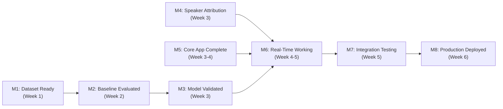
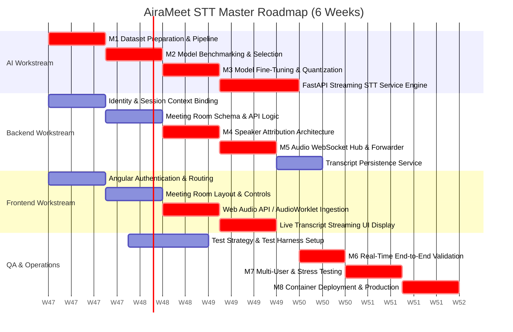

# Master Roadmap: Speech-to-Text Feature

## 1. Executive Roadmap Summary

This document establishes the official master delivery roadmap for the **Speech-to-Text & Speaker Attribution** capability within AiraMeet. The initiative spans six engineering weeks structured into eight core milestones (**M1 through M8**), coordinating three parallel engineering workstreams:
1. **AI / ML Workstream**: Dataset curation, model benchmarking, fine-tuning, and streaming inference optimization.
2. **Backend Engineering Workstream**: ASP.NET Core API expansion, meeting state management, audio WebSocket gateway, and transcript persistence.
3. **Frontend Engineering Workstream**: Angular meeting UI, Web Audio API Worklet, real-time transcript streaming, and speaker attribution components.

---

## 2. Milestone Architecture (M1 – M8)

### Detailed Milestone Criteria

| Milestone | Target Week | Responsible Lead | Gate Acceptance Criteria | Exit Deliverables |
| :--- | :--- | :--- | :--- | :--- |
| **M1: Dataset Ready** | Week 1 (Day 5) | AI Research Lead | - Raw audio inspected and normalized to 16 kHz Mono WAV. - Corrupted and duplicate files eliminated. - Data splits (80/10/10) isolated with zero speaker leakage. | Validated dataset manifest, exploratory analysis report, split directories. |
| **M2: Baseline Model Evaluated** | Week 2 (Day 5) | AI Research Lead | - Zero-shot WER/CER measured on test set for Whisper, Wav2Vec 2.0, and NeMo. - Inference latency and VRAM footprint measured. - Candidate model chosen for fine-tuning. | Comparative evaluation matrix report, model selection sign-off document. |
| **M3: Fine-Tuned Model Validated** | Week 3 (Day 5) | AI Research Lead | - Fine-tuning pipeline executed with checkpointing. - Quantifiable WER/CER reduction achieved over baseline. - Model exported to production-ready runtime (CTranslate2/ONNX). | Exported model weights, training loss/WER curves, evaluation benchmark log. |
| **M4: Speaker Attribution Working** | Week 3 (Day 5) | Backend Tech Lead | - Authenticated session-to-stream binding implemented in ASP.NET Core. - Client claims decoupled from identity verification. - Participant voice state tracking active (Muted vs Active vs Speaking). | Session attribution middleware, unit test suite with 100% security coverage. |
| **M5: Backend & Frontend Core Completed** | Week 4 (Day 3) | Full-Stack Leads | - Complete meeting lifecycle implemented (Create/Join/Leave). - AudioWorklet capturing uncompressed PCM frames. - Responsive Angular meeting room UI layout ready. | Angular meeting room module, ASP.NET Core meeting controllers and EF migrations. |
| **M6: Real-Time Transcription Working** | Week 5 (Day 2) | AI & Backend Leads | - End-to-end streaming latency < 3.0 seconds. - Partial vs Final transcript state correctly rendered in Angular UI. - Overlap deduplication preventing repeated words across chunks. | Live streaming prototype, WebSocket integration test report. |
| **M7: Integration Testing Passed** | Week 5 (Day 5) | QA Lead | - Multi-participant stress tests executed (up to 10 simultaneous speakers). - Network drop recovery verified. - End-to-end regression tests passed with zero critical bugs. | Comprehensive QA verification report, automated test suite execution log. |
| **M8: Deployment Completed** | Week 6 (Day 5) | DevOps Lead | - Containerized deployment running on GPU-accelerated staging/production. - Health probes and Prometheus/OpenTelemetry metrics active. - Verified operational runbook and rollback plan. | Production release package, operational dashboard, sign-off certificate. |

---

## 3. Workstream Dependency Graph & Critical Path

### Critical Path Analysis
The **Critical Path** determines the minimum duration required to deliver the feature. Any slippage on this path directly delays production deployment:
1. **AI Dataset Preparation (Week 1)** $\rightarrow$
2. **AI Model Benchmarking (Week 2)** $\rightarrow$
3. **AI Model Fine-Tuning & Quantization (Week 3)** $\rightarrow$
4. **FastAPI Streaming Engine & AudioWorklet Ingestion (Week 4)** $\rightarrow$
5. **Real-Time Integration & Overlap Deduplication (Week 5)** $\rightarrow$
6. **Multi-User Stress Testing & Production Deployment (Week 6)**.

---

## 4. Key Architectural Assumptions & Governance

1. **[Assumption] Pre-Existing Dataset**: An initial corpus of paired audio recordings and verbatim transcripts is available and accessible for immediate training and evaluation.
2. **[Assumption] GPU Availability**: At least one dedicated NVIDIA GPU (minimum 16 GB VRAM, e.g., RTX 4090, A10G, or T4) is provisioned for fine-tuning and staging inference.
3. **[Governance] Decoupled Delivery**: Frontend and Backend core features proceed in parallel with AI model development using mocked audio/transcript feeds until integration at Week 4/5.
4. **[Review Requirement]**: All PERT time estimates and calendar milestones must be formally reviewed and approved in the sprint planning meeting before execution.
