# Project Timeline & Estimation Model

## 1. Estimation Methodology: Three-Point PERT Standard

To produce objective, scientifically sound engineering schedules, all development effort in the AiraMeet project is estimated using the **Program Evaluation and Review Technique (PERT)**.

For each task, engineers and technical leads define three estimates:
- **Optimistic ($O$)**: The minimum possible duration assuming everything proceeds flawlessly with zero unexpected technical hurdles.
- **Most Likely ($M$)**: The realistic duration required under normal operational conditions, including minor interruptions and routine debugging.
- **Pessimistic ($P$)**: The maximum duration required if severe blockers arise (e.g., third-party library bugs, environment incompatibilities, edge-case regressions).

The **Expected Duration ($E$)** is calculated via the weighted beta distribution:
$$E = \frac{O + 4M + P}{6}$$

The **Standard Deviation ($\sigma$)** and **Variance ($V$)** reflect the technical uncertainty:
$$\sigma = \frac{P - O}{6}, \quad V = \sigma^2$$

### Development Effort vs. Calendar Duration
- **Development Effort (Person-Hours / Person-Days)**: The total sum of individual engineering hours required to build all subcomponents.
- **Calendar Duration (Weeks / Days)**: The wall-clock elapsed time required to reach a milestone, accounting for team concurrency, parallelization, and blockers.
- **Concurrency Rule**: Tasks across distinct departments (e.g., AI Dataset Cleaning vs. Angular Login Form) execute concurrently; their calendar durations are **not** added sequentially.

---

## 2. Six-Week Master Schedule Breakdown

```mermaid
flowchart TD
    subgraph W1["Week 1: Foundations & Pipeline Setup"]
        W1A["AI: Dataset Inspection, Cleaning & Split"]
        W1B["BE: Auth Architecture & Identity Verification"]
        W1C["FE: Auth Pages, Guards & Layout"]
    end

    subgraph W2["Week 2: Benchmarking & Core Domain"]
        W2A["AI: Baseline Evaluation (Whisper / Wav2Vec / NeMo)"]
        W2B["BE: Meeting Room API, Domain Models & DB Schema"]
        W2C["FE: Dashboard, Meeting Creation & Room UI"]
    end

    subgraph W3["Week 3: Fine-Tuning & Attribution Binding"]
        W3A["AI: Model Fine-Tuning & Hyperparam Optimization"]
        W3B["BE: Authenticated Stream-to-Speaker Binding"]
        W3C["FE: Web Audio API & AudioWorklet Ingestion"]
    end

    subgraph W4["Week 4: Streaming Architecture & Export"]
        W4A["AI: Quantization (CTranslate2) & Streaming Worker"]
        W4B["BE: Audio WebSocket Hub & Forwarding Relay"]
        W4C["FE: Live Transcript Reactive Stream & Speaker Tags"]
    end

    subgraph W5["Week 5: End-to-End Integration & Stress Testing"]
        W5A["AI + BE + FE: End-to-End Real-Time Pipeline Integration"]
        W5B["QA: Multi-User Concurrency & Audio Quality Tests"]
        W5C["QA: Network Drop, Reconnect & Deduplication Verification"]
    end

    subgraph W6["Week 6: Deployment, Hardening & Sign-Off"]
        W6A["DevOps: Docker GPU Staging & Production Deployment"]
        W6B["DevOps: Metrics, Logging & Prometheus Dashboards"]
        W6C["Stakeholders: Final Acceptance & Production Release"]
    end

    W1 --> W2 --> W3 --> W4 --> W5 --> W6
```

---

## 3. Detailed Weekly Breakdown & Deliverables

### Week 1: Foundations & Ingestion Setup
- **Sprint Objective**: Deliver clean, leak-free training/validation/test datasets and complete foundational authentication systems across client and server.
- **AI Focus**: Execute data validation, silence trimming, 16 kHz format conversion, audio-transcript alignment check, and strict 80/10/10 split isolation.
- **Backend Focus**: Review existing ASP.NET Core Identity; implement token refresh rotation tests and verify user context extraction.
- **Frontend Focus**: Build Angular authentication views, form validation, and route authentication guards.
- **Exit Gate**: All datasets validated; user authentication operating smoothly on both sides.

### Week 2: Benchmarking & Core Domain Architecture
- **Sprint Objective**: Complete baseline zero-shot evaluation of candidate speech models and finalize meeting room domain services.
- **AI Focus**: Run test set evaluation on OpenAI Whisper, Wav2Vec 2.0, and NVIDIA NeMo. Measure WER, CER, VRAM, and RTF (Real-Time Factor). Select fine-tuning candidate.
- **Backend Focus**: Implement EF Core meeting room entities, participant tracking tables, and CRUD APIs.
- **Frontend Focus**: Develop meeting dashboard, room creation modal, and meeting room grid layout.
- **Exit Gate**: Model Selection Sign-off Document published; meeting room endpoints operational.

### Week 3: Model Fine-Tuning & Identity Attribution Binding
- **Sprint Objective**: Fine-tune selected STT model on custom corpus; implement deterministic backend speaker attribution.
- **AI Focus**: Execute PyTorch fine-tuning runs with Hugging Face Trainer / Accelerate. Monitor validation loss and WER. Save best checkpoints.
- **Backend Focus**: Implement authenticated audio streaming endpoint. Ensure speaker attribution is bound to server session identity, not frontend parameters.
- **Frontend Focus**: Implement `AudioWorkletProcessor` in Angular to capture microphone audio at 16 kHz mono PCM.
- **Exit Gate**: Fine-tuned checkpoint outperforming baseline; server identity-binding unit tests passing.

### Week 4: Streaming Architecture & Real-Time Engine
- **Sprint Objective**: Convert fine-tuned model into low-latency streaming inference service; establish bidirectional audio/transcript WebSockets.
- **AI Focus**: Export model to CTranslate2 / ONNX; build FastAPI streaming worker with sliding window buffer and Silero VAD.
- **Backend Focus**: Construct ASP.NET Core audio routing hub that forwards incoming PCM frames to FastAPI and redistributes recognized text.
- **Frontend Focus**: Build real-time transcript display component with partial/final states and speaker attribution badges.
- **Exit Gate**: Local end-to-end streaming test transcribing audio under 3 seconds.

### Week 5: Integration, Deduplication & Quality Assurance
- **Sprint Objective**: Validate end-to-end pipeline under stress, varying acoustic conditions, and network instability.
- **AI Focus**: Optimize boundary deduplication logic (longest common substring alignment) to eliminate repeated words.
- **Backend Focus**: Persist final transcript chunks into SQL Server with millisecond timestamps; optimize memory queues.
- **Frontend Focus**: Implement graceful reconnects, microphone mute handling, and error states.
- **QA Focus**: Execute automated test matrix (latency benchmarks, multi-speaker concurrency, network packet loss).
- **Exit Gate**: Zero critical or high-severity bugs open in QA tracker; end-to-end latency verified < 3.0s.

### Week 6: Production Deployment & Release Sign-Off
- **Sprint Objective**: Deploy containerized stack to GPU-enabled infrastructure; conduct final sign-off.
- **DevOps Focus**: Deploy Docker Compose / Helm charts with NVIDIA Container Toolkit; configure health checks and memory limits.
- **Observability Focus**: Set up Prometheus metrics for WER monitoring, RTF, GPU memory consumption, and WebSocket connection drops.
- **Exit Gate**: Production deployment verified; rollback mechanisms tested; documentation completed.

---

## 4. Overall Effort vs. Duration Summary

| Department | Total Development Effort (Person-Days) | Team Size | Calendar Duration (Weeks) |
| :--- | :--- | :--- | :--- |
| **AI / ML Engineering** | 32 Person-Days | 2 Engineers | 6 Weeks (Parallel) |
| **Backend Engineering** | 28 Person-Days | 2 Engineers | 6 Weeks (Parallel) |
| **Frontend Engineering** | 24 Person-Days | 2 Engineers | 6 Weeks (Parallel) |
| **QA & DevOps** | 18 Person-Days | 1-2 Engineers | 6 Weeks (Parallel) |
| **Total Cumulative** | **102 Person-Days** | **7 Engineers** | **6 Calendar Weeks** |

> [!NOTE]
> All estimates represent preliminary baseline calculations. Department leads will refine estimates during initial sprint backlog grooming.
