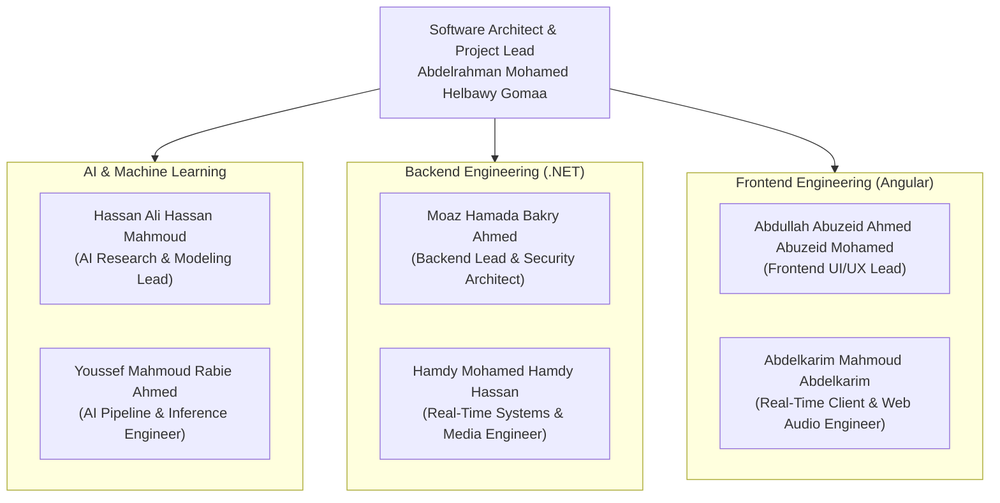

# Team Assignments & RACI Governance Matrix

## 1. Project Organization Structure

AiraMeet is engineered by a cross-functional technical team organized into four synchronized disciplines. Every member is assigned clear ownership over architectural components, development tasks, and operational deliverables.

---

## 2. Department Roles & Individual Responsibilities

| Team Member | Primary Engineering Role | Assigned Department | Key Functional Areas & Deliverables |
| :--- | :--- | :--- | :--- |
| **Abdelrahman Mohamed Helbawy Gomaa** | Principal Architect & Tech Lead | Systems Architecture / Governance | Overall system design, API contracts, cross-team integration, documentation standards, and milestone gate approval. |
| **Hassan Ali Hassan Mahmoud** | AI Research & Modeling Lead | AI / ML Engineering | Dataset validation and cleaning pipelines, baseline zero-shot benchmarking, model selection, fine-tuning scripts, and WER/CER evaluation. |
| **Youssef Mahmoud Rabie Ahmed** | AI Pipeline & Inference Engineer | AI / ML Engineering | Model quantization (CTranslate2/ONNX), Voice Activity Detection (VAD), chunk sliding-window implementation, FastAPI inference worker, and text deduplication. |
| **Moaz Hamada Bakry Ahmed** | Backend Lead & Security Architect | Backend Engineering (.NET) | ASP.NET Core Clean Architecture, Identity system, JWT token lifecycle, SQL Server EF Core migrations, and authenticated session context derivation. |
| **Hamdy Mohamed Hamdy Hassan** | Real-Time Systems & Media Engineer | Backend Engineering (.NET) | WebSocket / SignalR audio streaming gateway, Redis pub/sub backplane, gRPC forwarder to FastAPI, and persistent transcript storage. |
| **Abdullah Abuzeid Ahmed Abuzeid Mohamed** | Frontend UI/UX Lead | Frontend Engineering (Angular) | Angular 17+ architecture, responsive layout, auth views, meeting room participant grid, dashboard, and design system integration. |
| **Abdelkarim Mahmoud Abdelkarim** | Real-Time Client & Audio Engineer | Frontend Engineering (Angular) | Web Audio API / AudioWorklet 16 kHz capture, client-side WebSocket streaming manager, live transcript renderer, and speaker badge components. |

---

## 3. RACI Governance Matrix

The RACI framework defines team accountability across all project milestones:
- **R (Responsible)**: The person who conducts the work to achieve the deliverable.
- **A (Accountable)**: The sole person with final decision-making power and delivery sign-off.
- **C (Consulted)**: Subject matter experts providing input and technical critique.
- **I (Informed)**: Individuals kept updated on progress and outcomes.

| Project Milestone / Activity | Architecture (Abdelrahman) | AI Lead (Hassan) | AI Eng (Youssef) | BE Lead (Moaz) | BE Eng (Hamdy) | FE Lead (Abdullah) | FE Eng (Abdelkarim) |
| :--- | :---: | :---: | :---: | :---: | :---: | :---: | :---: |
| **M1: Dataset Preparation & Validation** | A | R | R | I | I | I | I |
| **M2: Baseline Benchmarking & Selection** | A | R | R | C | C | I | I |
| **M3: Model Fine-Tuning & Quantization** | A | R | R | I | C | I | I |
| **M4: Authenticated Speaker Attribution** | A | C | I | R | R | C | C |
| **M5: Core Backend & Frontend Platform** | A | I | I | R | R | R | R |
| **M6: Real-Time Audio Streaming & STT** | A | C | R | C | R | C | R |
| **M7: Integration & Quality Assurance** | A | R | R | R | R | R | R |
| **M8: Production Deployment & Monitoring** | A | C | R | R | R | C | I |

---

## 4. Communication Cadence & Review Gates

1. **Daily Standup (15 Minutes)**:
   - What was accomplished yesterday?
   - What is planned for today?
   - Are there any architectural or technical blockers?
2. **Weekly Sprint Planning & Review (Every Monday)**:
   - Review PERT estimates against actual effort.
   - Formal sign-off on previous week's milestone deliverables.
   - Unblock inter-departmental dependencies.
3. **Architecture Review Board (Bi-Weekly)**:
   - Address open architectural questions marked as `[To Be Decided - TBD]`.
   - Review performance, security, and scalability metrics.
