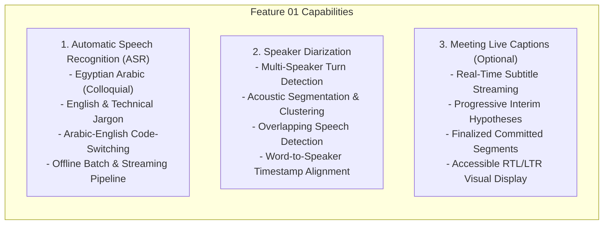

# 01. Planning & Design — Feature Overview

## 1. Feature Purpose & Value Proposition

AiraMeet is an enterprise-grade AI video conferencing platform designed to transform spoken meetings into actionable, searchable, and structured institutional knowledge. 

**Feature 01: Speech-to-Text (ASR), Speaker Diarization, and Meeting Live Captions** serves as the foundational sensory layer of AiraMeet. It captures live spoken dialogue, accurately transcribes speech across dialectal Arabic and English code-switching, attributes utterances to specific participants, and optionally streams real-time subtitles into the meeting interface.

---

## 2. Core Capabilities

The feature delivers three distinct technical capabilities:

### A. Automatic Speech Recognition (ASR)
- **Target Linguistic Scope**:
  - **Egyptian Arabic (Colloquial - العامية المصرية)**: The predominant conversational Arabic dialect used in business and academic contexts in Egypt and the region.
  - **English**: Fluent spoken English across native and non-native accents.
  - **Arabic-English Code-Switching**: Seamless switching between Arabic grammar and English technical terminology within the same sentence (e.g., *"وهي إنها بتطلّع Layer أو طبقة جديدة"* or *"لازم نعمل Deploy للـ Backend"*).
- **Delivery Strategy**: Build, validate, and benchmark a reliable offline ASR pipeline before integrating streaming endpoints into the live meeting runtime.

### B. Speaker Diarization
- **Purpose**: Answer the question *"Who spoke when?"* across multi-party conversations.
- **Architectural Scope**:
  - Separate acoustic modeling problem from speech-to-text transcription.
  - Detect speaker changes, extract acoustic voiceprints (embeddings), and cluster speakers across the meeting timeline.
  - Synchronize speaker intervals with ASR word tokens to output structured, speaker-attributed transcript segments.
  - Handle multi-speaker environments and overlapping speech intervals without degrading transcription accuracy.

### C. Live Captions (Optional Enhancement)
- **Purpose**: Real-time meeting accessibility and visual reinforcement.
- **Expected Behavior**:
  - Captures microphone audio during active calls without blocking the UI.
  - Displays progressive, interim transcription hypotheses (in italics) within $< 3.0$ seconds of speech.
  - Commits finalized segments into an auto-scrolling subtitle timeline upon speech pause ($\ge 500\text{ms}$ silence).
  - Displays speaker names and avatars alongside captions when diarization or session attribution is active.
- **Execution Rule**: Planned and developed as an independent phase, ensuring the core offline ASR pipeline is verified first without blocking core milestones.

---

## 3. Scope Boundaries & Assumptions

### In-Scope
- Fine-tuning a multilingual speech recognition foundation model (OpenAI Whisper) on paired Egyptian Arabic and English datasets.
- Integrating a modular speaker diarization engine (PyAnnote.audio 3.1) operating on continuous meeting audio.
- Text normalization pipeline preserving Latin-script English technical terms.
- ASP.NET Core session-bound identity gateway preventing client-side speaker spoofing.
- Angular 17+ `AudioWorklet` capturing uncompressed 16 kHz Mono linear PCM audio.
- SignalR real-time broadcast and SQL Server durable persistence.

### Out-of-Scope (Deferred to Later Features)
- Real-time speech translation across languages.
- Post-meeting generative AI summarization, decision extraction, and action item assignment (Feature 02).
- Voice biometrics for permanent user identification across different meetings (users are identified by authenticated session login).
- Raw audio permanent retention (audio is processed transiently in memory to uphold privacy standards).

---

## 4. User Outcomes & Acceptance Gates

1. **For Meeting Participants**: Follow live discussions with high-accuracy subtitles in Egyptian Arabic and English, even during rapid code-switching.
2. **For Meeting Hosts & Reviewers**: Access complete, chronological, speaker-attributed transcripts with millisecond offsets immediately after a meeting concludes.
3. **For Downstream AI Services**: Consume clean, structured JSON transcript payloads with verified speaker IDs and word timestamps for downstream meeting summarization and action extraction.

---

## 5. Prerequisites & Governance

- **Corpus Access**: Ground-truth paired audio/text dataset with preserved relative paths.
- **GPU Infrastructure**: At least one dedicated NVIDIA GPU (minimum 16 GB VRAM, e.g., RTX 4090 or A10G) for fine-tuning and inference profiling.
- **Zero-Trust Security**: Audio streams contain binary bytes only; user identity is derived strictly from verified JWT tokens on the backend.
- **Gate Governance**: Model progression from baseline to fine-tuned export requires meeting quantitative acceptance gates ($\ge 15\%$ relative WER improvement).
