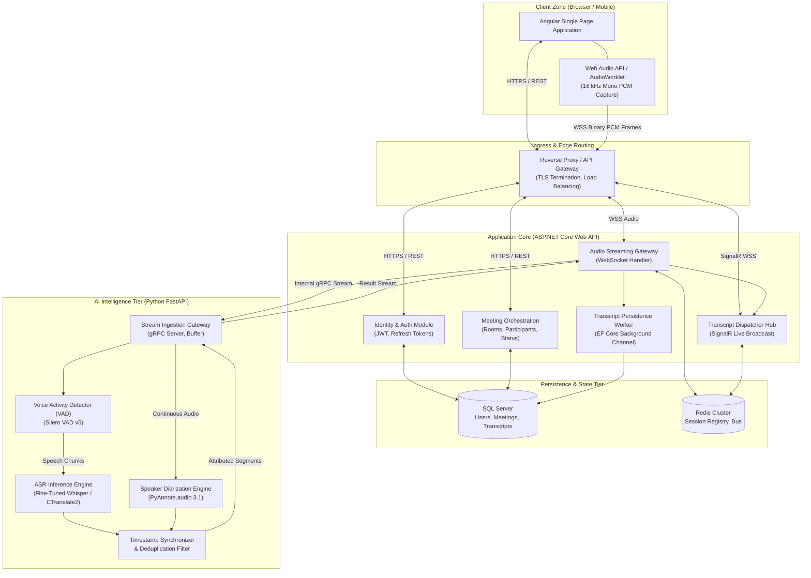
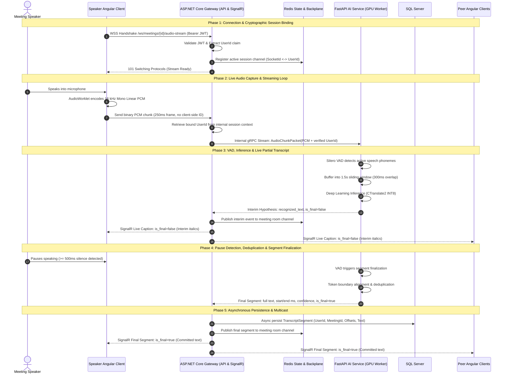

# 01. Planning & Design — System Architecture

## 1. High-Level Architectural Vision

AiraMeet employs a decoupled, asynchronous, distributed microservice architecture. The platform cleanly isolates low-latency interactive media paths (WebRTC audio/video conferencing) from deep learning inference pipelines (FastAPI Speech-to-Text & Speaker Diarization).

---

## 2. Tier-by-Tier Architectural Breakdown

### 2.1 Client Tier (Angular 17+ Standalone)
- **Audio Worklet Subsystem**: Bypasses the UI main thread using an `AudioWorkletProcessor` to tap the microphone `MediaStream`. Captures raw 32-bit Float samples, downsamples to 16 kHz 16-bit signed integer linear PCM, and streams chunks every 250ms over a dedicated WebSocket connection.
- **Reactive State Layer**: Uses Angular Signals and RxJS Subject streams for managing participant connection states, mute/unmute indicators, and live transcript scrolling.
- **Dual-Track Audio**: Conferencing voice is routed via WebRTC SFU; transcription audio is captured directly via the AudioWorklet and transmitted to ASP.NET Core.

### 2.2 Application Core Tier (ASP.NET Core Web API)
- **Security Boundary**: Validates Bearer JWT tokens on every REST endpoint and upgrades WebSockets only after validating token claims and active meeting room participation.
- **Connection Registry**: Maintains active meeting room topologies in Redis memory. When a client opens an audio streaming socket, the server binds the socket connection directly to the authenticated `ApplicationUser.Id` and `MeetingRoom.Id`.
- **Media Ingestion & Forwarding**: Buffers participant audio frames into rolling queues and forwards them to the AI Service Tier via high-speed internal gRPC streams.
- **Transcript Broadcast Hub**: Consumes recognized text tokens from the AI tier, validates permissions, persists finalized segments into SQL Server, and multicasts live updates to all meeting room participants via SignalR.

### 2.3 AI Intelligence Tier (Python FastAPI & PyTorch)
- **Decoupled Compute**: The AI service operates independently of the web application, scaling horizontally based on GPU availability.
- **Voice Activity Detection (VAD)**: Inspects incoming audio frames using Silero VAD v5 to classify frames as speech vs. non-speech (silence, background noise). Non-speech frames are discarded before hitting heavy neural network layers.
- **Streaming Audio Buffer**: Implements a circular sliding window (1.5-second context window with 300ms overlap).
- **Inference Engine**: Executes forward passes on fine-tuned Whisper-Medium using CTranslate2 INT8 quantization on NVIDIA GPUs. Emits **Partial Transcripts** (interim hypothesis) and **Final Transcripts** (committed text with boundary timestamps).
- **Speaker Diarization Engine**: Runs PyAnnote.audio 3.1 on continuous meeting audio to extract speaker change boundaries and cluster voiceprints, aligning speaker IDs to recognized words.

### 2.4 Data & Persistence Tier
- **SQL Server**: Stores relational entities, transactional audit trails, user identities, meeting attendance logs, and permanent meeting transcripts.
- **Redis**: Provides sub-millisecond ephemeral state tracking, token blocklists, active meeting participant rosters, and cross-node message distribution for multi-instance ASP.NET Core clusters.

---

## 3. End-to-End Real-Time Data Flow

---

## 4. End-to-End Latency Budget

To deliver responsive real-time transcription, the total visible transcription latency must remain strictly within **2.0 to 3.0 seconds**.

| Processing Stage | Nominal Latency | Upper Bound (p95) | Technical Optimization |
| :--- | :---: | :---: | :--- |
| **Audio Capture & AudioWorklet** | 250 ms | 300 ms | 250ms periodic buffer dispatch in worker thread. |
| **Client-to-Server Network Transit** | 40 ms | 120 ms | WSS over optimized TCP/TLS socket. |
| **Server Ingestion & VAD Analysis** | 30 ms | 60 ms | Silero VAD running in C++ / TorchScript ONNX. |
| **Sliding Window Accumulation** | 1,200 ms | 1,500 ms | Target window duration for phoneme recognition. |
| **Deep Learning Forward Pass** | 200 ms | 450 ms | CTranslate2 INT8 quantization on NVIDIA GPU. |
| **Deduplication & Alignment** | 15 ms | 35 ms | Longest common substring prefix pruning in Python. |
| **Server-to-Client Broadcast** | 40 ms | 100 ms | ASP.NET Core SignalR hub broadcasting JSON. |
| **Client UI Render & Virtual Scroll** | 10 ms | 30 ms | Angular Reactive Signals with `OnPush` change detection. |
| **Total Cumulative Latency** | **1,785 ms (~1.8s)** | **2,595 ms (~2.6s)** | **Strictly within 3.0s SLA Budget** |
