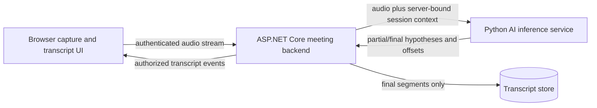

# 01. Planning & Design — System Architecture

## Purpose and status

Describe the proposed end-to-end design and boundaries. **Status: Proposed**, except the security constraint that participant attribution must come from authenticated backend session context. No transport, model runtime, sample rate, chunk size, schema or topology is recorded here as formally approved.

## Scope

Audio capture, secure ingestion, recognition, attribution, live delivery and persistence. Meeting creation/media conferencing and downstream summarization remain owned by their respective systems.

## Prerequisites

Approved requirements and privacy policy; confirmed meeting membership/auth interfaces; model evaluation results; agreed client-to-backend and backend-to-AI schemas.

## Proposed component flow

1. Client captures only after permission and product enablement. Capture format and framing are negotiated as an interface decision.
2. Backend authenticates the connection and checks active meeting membership. It binds connection to participant and meeting IDs obtained from trusted claims/state.
3. Backend forwards audio and server-derived context to an internal AI service. Client-supplied identity fields are ignored/rejected.
4. AI returns hypotheses with stream/segment identity and time offsets. Backend validates the response context, applies authorization, emits updates and persists finalized records.
5. Client renders partials as replaceable and finals as stable records; retrieval is paginated and authorization checked.

## Ownership boundaries

| Area | AI | Backend | Frontend |
|---|---|---|---|
| Audio/model | VAD decision, recognition, model runtime, model evaluation and inference timestamps. | Internal AI transport, bounded queues, timeout/circuit behavior. | Microphone permission, capture lifecycle, agreed encoding/framing and mute controls. |
| Identity | Accepts opaque server-derived context; does not authenticate participants. | Sole authority for JWT validation, meeting authorization and speaker binding. | Does not submit a trusted speaker ID. |
| Transcript | Produces hypotheses and segment timing; documents confidence/format semantics. | Validates, orders, broadcasts, persists finals and serves history. | Renders partial/final revisions, attribution, timestamps, errors and reconnect state. |
| Operations | Model health/readiness and model-level metrics. | Authentication, authorization, routing, persistence and event service health. | Client capture/connection diagnostics without exposing transcript/audio secrets. |

## Technical approach and interface invariants

- Keep raw audio transient unless an explicit recording feature and policy authorize storage.
- Enforce per-stream ordering and bounded buffering. Apply backpressure rather than silently allowing unbounded memory growth.
- Carry server-generated `meeting_id`, `participant_id`, `stream_id`, sequence and timing metadata internally; exact field names/schema are TBD.
- Treat partial events as mutable updates keyed to a segment; finalized events are idempotent and persisted once.
- Separate audio capture from the conferencing media path where platform constraints require it; the existing source proposes a parallel capture path alongside WebRTC, subject to browser and product review.
- A 16 kHz mono PCM stream, 250 ms client frames, 1.5 s windows and 300 ms overlap are experimental starting points only. Confirm compatibility with the selected model and measured end-to-end latency.

## Tools and technologies

Source documents identify Angular 17+, Web Audio/AudioWorklet, ASP.NET Core, SignalR, SQL Server/EF Core and Python/FastAPI as candidate stack components. gRPC or persistent WebSocket, VAD implementation, inference runtime, broker/backplane and hosting topology remain open until reviewed.

## Deliverables

Approved component diagram; versioned audio and transcript interface schemas; persistence design; threat/privacy review; failure-mode behavior; deployment topology and observability plan.

## Acceptance criteria

Every trust boundary and owner is explicit; interfaces define ordering, timestamps, partial/final semantics, size limits, errors and authorization; architecture decisions cite measured model/runtime evidence where applicable; no unverified performance assertion is treated as achieved.

## Dependencies

[Requirements](requirements.md), [streaming contract](../04-system-integration/streaming-contract.md), [speaker attribution](../04-system-integration/speaker-attribution.md), model selection and platform security standards.

## Open questions

Transport and wire schema; audio codec/sample format and resampling ownership; timestamps and clock synchronization; AI service authentication; storage schema/retention; event ordering and replay; scaling and queue policy; regional deployment and GPU availability.
