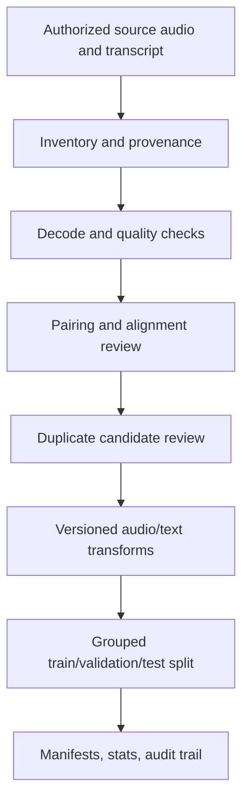

# 02. Data Engineering — Dataset Pipeline

## Purpose

Specify a traceable, reproducible pipeline that turns authorized audio/transcript pairs into model-ready manifests and leakage-resistant evaluation splits for Egyptian Arabic, English and Arabic-English code-switching.

## Scope

Inventory, governance, validation, normalization, duplicate review, alignment, splitting, statistics and artifact versioning. Dataset contents, corpus size and quality are currently **unknown**; example counts from earlier drafts were illustrative and are not project results.

## Prerequisites

Documented data provenance and usage rights; participant consent/notice and retention rules; transcript schema with speaker/session identifiers; language and transcription conventions; secure storage; approved access for the data team.

## Technical approach

1. Inventory files and manifest fields; record stable sample, session and speaker keys without exposing direct identifiers in training artifacts.
2. Validate decode, duration, channel count, sample rate, finite samples, clipping and audibility. Quarantine failures with reason codes; never silently drop them.
3. Preserve original audio. Produce derived model inputs using a documented resampling/downmix path only after candidate model input requirements are known. A prior proposal used mono 16 kHz PCM; do not apply it blindly to all candidates.
4. Validate audio/text pairing. Duration and character-rate rules are triage signals, not sufficient proof of alignment. Review outliers and use forced alignment only where the aligner supports the language/script and its outputs are manually sampled.
5. Detect exact duplicates with hashes; near-duplicate audio/text similarity creates review candidates. Do not discard on a similarity threshold alone without documented disposition.
6. Normalize text conservatively: Unicode NFC and whitespace cleanup are safe baseline operations. Keep raw transcript and normalized text separately. Arabic hamza/taa marbuta/alif maqsura folding, diacritic removal, digit expansion and punctuation filtering can change references; define separate scoring/training policies with linguistic review. Preserve Latin and Arabic tokens in code-switched utterances.
7. Assign splits by group (at minimum speaker; also session/source where leakage is possible) before training. Keep test data inaccessible to model selection and tuning. Aim for representative language, dialect, environment and device coverage; exact ratios depend on corpus size and group counts.
8. Generate immutable manifests, processing version/config, rejection ledger, split membership and aggregate statistics. Restrict access to identity mapping.

## Candidate quality checks (tune from the corpus)

Earlier planning proposed checking decode completeness, NaN/Inf, clipping, SNR, leading/trailing silence and speech duration. Example triage values were duration 1–20 seconds, SNR below 8 dB, clipping above 0.5%, silence trim threshold around -45 dBFS with 100 ms padding, and transcript character-rate outliers below 3 or above 35 characters/second. These are **heuristics to validate**, not approved rejection rules: short acknowledgements are legitimate meeting speech, SNR estimation is method-dependent, and character rate is not a reliable alignment test by itself. Prefer quarantine/review and stratified analysis over automatic deletion. Earlier proposed -20 dBFS peak normalization also needs review; peak normalization can amplify noise and should not replace loudness/clipping checks.

## Proposed pipeline

## Implementation steps

1. Build a read-only inventory command and schema validator; report missing files/fields and unknown speakers.
2. Implement checks and quarantine output with deterministic reason codes; make reruns idempotent.
3. Add configurable audio transforms and text normalization with unit fixtures for Arabic, Latin, numerals and mixed-script cases.
4. Add duplicate candidate reports and manual disposition workflow.
5. Implement grouped split assignment with a fixed recorded seed and assertions that groups do not cross splits.
6. Emit `dataset_stats.json` and split manifests. Suggested fields: raw/accepted/rejected sample counts, duration totals, language/dialect labels where known, reason counts, speaker/session counts per split, audio format distribution, transform version and split seed. All values must be computed from the actual run.
7. Review a sample from each language/acoustic stratum and sign off the dataset release.

## Tools and technologies

Existing draft references Python, `soundfile`, `torchaudio`/`librosa`, NumPy, pandas, scikit-learn grouped splitting, JSONL/Parquet and Hugging Face Datasets. Select and pin dependencies after environment review. Avoid treating Chromaprint, AcoustID or a specific forced aligner as selected tooling.

## Deliverables

Dataset inventory; versioned pipeline code/config; quarantine/review ledger; immutable train/validation/test manifests; aggregate statistics; data card documenting provenance, consent, language coverage, known limitations and allowed uses.

## Acceptance criteria

- Every accepted record resolves to authorized audio and transcript with stable non-identifying keys.
- Every rejected or manually retained outlier has an auditable reason/disposition.
- No speaker/session group leaks across splits; automated checks fail closed when IDs are missing or overlap.
- Transforms are reproducible and preserve a link to the source; raw audio is not overwritten.
- Code-switch and Arabic normalization behavior is documented and reviewed; test split remains held out.

## Dependencies

Corpus access and policy, transcription conventions, candidate-model input requirements and [evaluation protocol](../03-model-development/evaluation.md).

## Open questions

Corpus inventory/size; verified language/dialect labels; consent and deletion workflows; reliable speaker/session IDs; split ratios feasible for group counts; whether to retain noisy/short utterances; text normalization/scoring policy; data storage and artifact access controls.
