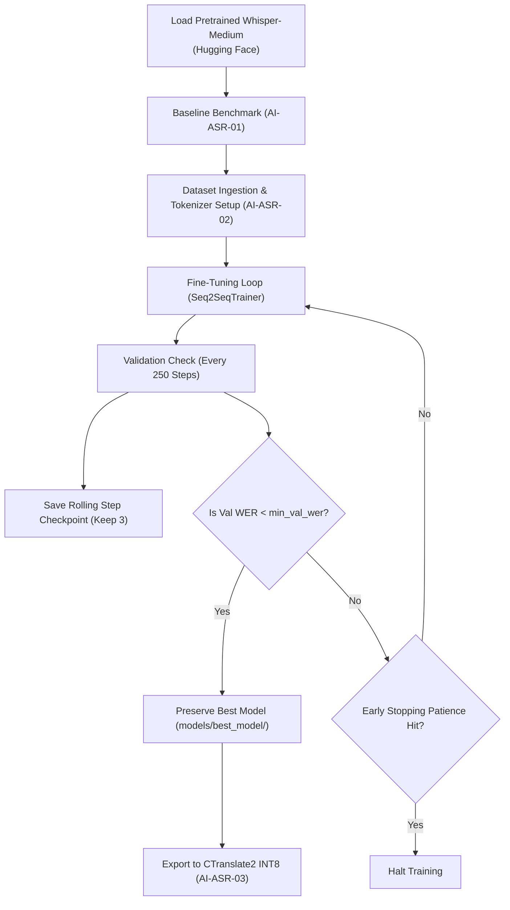

# 02. Model Development — Training, Checkpointing & Model Export

## 1. Overview & Workflow

This document details the fine-tuning procedure for OpenAI Whisper-Medium on the curated Egyptian Arabic and English dataset, the checkpointing architecture, and the export to CTranslate2 INT8 for production serving.

---

## 2. Engineering Tasks & Subtasks Breakdown

---

### Task `AI-ASR-02`: ASR Model Fine-Tuning Pipeline & Checkpointing Loop

| Attribute | Specification |
| :--- | :--- |
| **Task ID** | `AI-ASR-02` |
| **Task Name** | ASR Model Fine-Tuning Pipeline & Checkpointing Loop |
| **Phase** | AI Phase 3: Model Development & Training |
| **Priority / Owner** | `Critical` / AI Engineering Team |
| **Dependencies** | `AI-ASR-01` (Baseline Evaluation), `AI-DS-03` (Split Manifests) |
| **Checkpoint** | **Yes** — Ephemeral Rolling Step Checkpoints (Keep 3) + Permanent Best Model Artifact (`models/best_model/`) |

#### Objective & Scope
Train `openai/whisper-medium` on the curated Egyptian Arabic and English code-switching dataset using Hugging Face `Seq2SeqTrainer`. Implement continuous 250-step validation cycles, rolling checkpoint management to prevent disk saturation, and automated best-model decoupling.

#### Subtasks Breakdown

| Subtask ID | Subtask Name | Actionable Steps & Implementation Scope | Output & Acceptance Criteria |
| :--- | :--- | :--- | :--- |
| `AI-ASR-02.1` | Data Ingestion & Tokenizer Pipeline | Build `src/asr/dataset_loader.py` to stream through `train.jsonl` and `val.jsonl`, generating 80 mel-frequency filterbank features at 16 kHz using `WhisperFeatureExtractor` and encoding target text with `WhisperTokenizer`. | Dynamic dataset loader yielding aligned mel-spectrogram tensors and token labels. |
| `AI-ASR-02.2` | Hyperparameter & Trainer Configuration | Author `configs/training_config.yaml` specifying AdamW optimizer, learning rate `1e-5`, cosine learning rate decay, 10% linear warmup, weight decay `0.01`, mixed precision (`fp16`/`bf16`), and an effective batch size of 32 (batch size 8 $\times$ 4 gradient accumulation steps). | Validated YAML configuration file governing all training parameters. |
| `AI-ASR-02.3` | Training Loop Implementation | Construct `scripts/run_training.py` wrapping Hugging Face `Seq2SeqTrainer` with custom data collator for dynamic audio padding. | Executable training script handling distributed GPU training and metric computation. |
| `AI-ASR-02.4` | Periodic Validation & Rolling Checkpoints | Implement validation callback executing every 250 steps to track validation loss and Word Error Rate (WER). Configure `save_total_limit: 3` to retain only the 3 latest snapshots in `models/checkpoints/` and prune older ones. | Rolling checkpoints saved every 250 steps; older snapshots automatically pruned. |
| `AI-ASR-02.5` | Best-Model Decoupling & Auto-Resume | Implement callback that copies weights, tokenizer, and config to `models/best_model/` whenever validation WER reaches a new global minimum. Configure `--resume_from_checkpoint auto` to support recovery from interruptions. | Isolated `models/best_model/` directory updated strictly on global minimum validation WER. |

#### Expected Deliverables & Acceptance Criteria
- **Source Code**: `src/asr/dataset_loader.py`, `scripts/run_training.py`, `configs/training_config.yaml`.
- **Training Artifacts**: TensorBoard telemetry logs, `models/best_model/` directory containing complete weights and tokenizer files.
- **Acceptance Gate**: Monotonic decrease in training/validation loss; achieves a relative WER reduction $\ge 15.0\%$ over the zero-shot baseline on the held-out validation set.

#### Checkpoint Specification
- **Checkpoint Required**: **Yes** (Two-tiered strategy).
- **Tier 1 (Ephemeral Training Checkpoints)**: `models/checkpoints/checkpoint-{step}/` saved every 250 steps; contains weights, optimizer momentum, scheduler states, and RNG seeds. Retains last 3 snapshots only.
- **Tier 2 (Durable Best Model Checkpoint - Gate M3)**: `models/best_model/` containing full model weights, tokenizer, processor, and `evaluation_summary.json`. Retained permanently.

---

### Task `AI-ASR-03`: Best Model Selection, Validation & CTranslate2 INT8 Export

| Attribute | Specification |
| :--- | :--- |
| **Task ID** | `AI-ASR-03` |
| **Task Name** | Best Model Selection, Validation & CTranslate2 INT8 Export |
| **Phase** | AI Phase 3 / Phase 4 (Export & Serving Optimization) |
| **Priority / Owner** | `Critical` / AI Engineering Team |
| **Dependencies** | `AI-ASR-02` (Fine-Tuning Loop) |
| **Checkpoint** | **Yes** — Gate M3 Production Export Artifact (`models/exported/whisper_medium_ct2/`) |

#### Objective & Scope
Validate the best fine-tuned checkpoint against the held-out test split, convert model weights to the high-performance **CTranslate2** runtime using **INT8 quantization**, reduce GPU VRAM consumption by $> 50\%$, and achieve a 3–4x inference speedup for production real-time serving.

#### Subtasks Breakdown

| Subtask ID | Subtask Name | Actionable Steps & Implementation Scope | Output & Acceptance Criteria |
| :--- | :--- | :--- | :--- |
| `AI-ASR-03.1` | Best Model Verification | Inspect `models/best_model/` to verify structural completeness of model weights (`model.safetensors`), `tokenizer.json`, and `preprocessor_config.json`. | Verified model artifact completeness; throws error if any tokenizer/weight file missing. |
| `AI-ASR-03.2` | CTranslate2 Quantization Conversion | Implement `scripts/run_export.py` using `ct2-transformers-converter` with `--quantization int8_float16` to generate optimized CTranslate2 binary weights in `models/exported/whisper_medium_ct2/`. | Converted model binaries (`model.bin`) and quantized vocabulary in target export directory. |
| `AI-ASR-03.3` | CTranslate2 Inference Engine Wrapper | Implement `src/asr/ctranslate2_engine.py` wrapping `ctranslate2.models.Whisper` for asynchronous batched execution. | High-performance Python wrapper providing async transcription and word-level timestamps. |
| `AI-ASR-03.4` | Accuracy Parity Benchmarking & Hashing | Benchmark the exported INT8 model on sample test audio to confirm that WER degradation is $< 0.3\%$ compared to unquantized weights. Compute SHA256 hashes and save to `CHECKSUMS.sha256`. | Verified accuracy parity ($\Delta \text{WER} < 0.3\%$); immutable SHA256 hash manifest. |

#### Expected Deliverables & Acceptance Criteria
- **Exported Model Directory**: `models/exported/whisper_medium_ct2/` (`model.bin`, `vocabulary.json`, `config.json`).
- **Inference Module**: `src/asr/ctranslate2_engine.py`.
- **Conversion Tooling**: `scripts/run_export.py`, `models/exported/whisper_medium_ct2/CHECKSUMS.sha256`.
- **Acceptance Gate**:
  - Peak GPU VRAM footprint $\le 2.5\text{ GB}$.
  - Real-Time Factor (RTF) $\le 0.15$ on target GPU (processing 1.5s audio chunk in $< 225\text{ms}$).
  - Character and word error rates within 0.3% of unquantized baseline.

#### Checkpoint Specification
- **Checkpoint Required**: **Yes** (Gate M3 Milestone).
- **Checkpoint Type**: Production Export Checkpoint (`asr-ct2-int8-v1.0`).
- **Contents**: Quantized model binaries, vocabulary files, feature extractor configs, and SHA256 checksums.
- **Retention**: Permanent.
