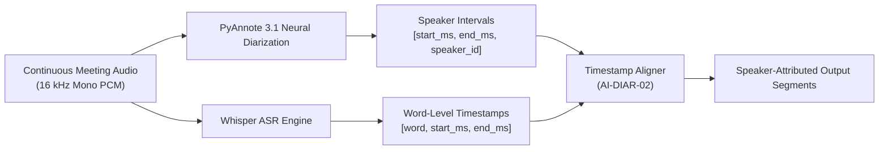

# 03. Model Development — Speaker Diarization

## 1. Overview & Architecture

Speaker Diarization answers the question *"Who spoke when?"* independently of the speech content. This document defines the implementation tasks for **PyAnnote.audio 3.1**, the temporal synchronization algorithm linking word timestamps to speaker turns, and the RTTM validation process.

---

## 2. Audio Scope: Continuous Meeting Audio vs. ASR Chunks

### Fundamental Technical Constraint
**Speaker Diarization MUST operate on the continuous meeting audio stream (or a long rolling multi-minute context buffer), NEVER on isolated 1.5-second ASR sliding window chunks.**

### Technical Rationale
1. **Voiceprint Consistency**: Acoustic speaker embeddings require sufficient duration ($\ge 2.0\text{ seconds}$ of speech) to capture unique vocal tract features.
2. **Cross-Turn Clustering**: To assign the same label `"speaker_1"` to a participant who spoke at minute 1 and speaks again at minute 5, the clustering algorithm must compare embeddings across the conversation history. If diarization is executed on isolated 1.5-second chunks, every chunk is treated as a separate micro-universe, resulting in fragmented, meaningless speaker labels (`speaker_A`, `speaker_B`, `speaker_C` for the same person).
3. **Execution Model**:
   - In offline meeting transcription: Diarization runs across the full meeting audio file to generate the global speaker timeline.
   - In live streaming: Diarization maintains a rolling speaker-embedding memory buffer in Python, updating speaker cluster assignments progressively.

---

## 3. Engineering Tasks & Subtasks Breakdown

---

### Task `AI-DIAR-01`: PyAnnote Diarization Pipeline Integration & Buffer Management

| Attribute | Specification |
| :--- | :--- |
| **Task ID** | `AI-DIAR-01` |
| **Task Name** | PyAnnote Diarization Pipeline Integration & Buffer Management |
| **Phase** | AI Phase 5: Speaker Diarization |
| **Priority / Owner** | `High` / AI Engineering Team |
| **Dependencies** | `AI-ASR-03` (ASR Model Export) |
| **Checkpoint** | **No** (Uses pretrained foundation weights) |

#### Objective & Scope
Integrate `pyannote/speaker-diarization-3.1` into the AI service. Manage continuous meeting audio processing and rolling multi-turn context buffers (30–60s) to guarantee consistent speaker voiceprints across conversation turns. Enable neural overlapping speech detection.

#### Subtasks Breakdown

| Subtask ID | Subtask Name | Actionable Steps & Implementation Scope | Output & Acceptance Criteria |
| :--- | :--- | :--- | :--- |
| `AI-DIAR-01.1` | PyAnnote Engine Wrapper Implementation | Create `src/diarization/pyannote_engine.py` wrapping `pyannote.audio.Pipeline` with device management (`.to("cuda")`). | Initialized PyAnnote pipeline running on GPU with configurable parameters. |
| `AI-DIAR-01.2` | Clustering & Segmentation Tuning | Configure agglomerative clustering distance thresholds and segmentation parameters in `configs/diarization_config.yaml`. | Tuned configuration file balancing over-segmentation vs speaker confusion. |
| `AI-DIAR-01.3` | Continuous Audio Buffer Management | Implement streaming audio buffer in Python maintaining a rolling window of recent audio for ongoing voiceprint comparisons. | Resilient rolling audio context buffer retaining cross-turn speaker identities. |
| `AI-DIAR-01.4` | Interval & Overlap Extraction | Parse PyAnnote `Annotation` objects to extract turn intervals `[speaker_id, start_offset_ms, end_offset_ms]` and identify overlapping speech segments. | Clean Python list of speaker interval objects with millisecond start/end boundaries. |

#### Expected Deliverables & Acceptance Criteria
- **Engine Module**: `src/diarization/pyannote_engine.py`.
- **Configuration**: `configs/diarization_config.yaml`.
- **Unit Tests**: `tests/unit/test_diarization_engine.py`.
- **Acceptance Gate**: Accurately extracts speaker turn intervals and handles multi-speaker dialogue without pipeline exceptions.

#### Checkpoint Specification
- **Checkpoint Required**: **No**. Pretrained PyAnnote 3.1 weights are utilized zero-shot.

---

### Task `AI-DIAR-02`: ASR Word-to-Speaker Timestamp Synchronization Algorithm

| Attribute | Specification |
| :--- | :--- |
| **Task ID** | `AI-DIAR-02` |
| **Task Name** | ASR Word-to-Speaker Timestamp Synchronization Algorithm |
| **Phase** | AI Phase 5: Speaker Diarization Alignment |
| **Priority / Owner** | `High` / AI Engineering Team |
| **Dependencies** | `AI-DIAR-01` (Diarization Pipeline) |
| **Checkpoint** | **Yes** — Gate M5 Diarization Validation Milestone |

#### Objective & Scope
Build and validate the temporal alignment algorithm that synchronizes word-level timestamps emitted by Whisper (`word_timestamps=True`) with speaker turn intervals emitted by PyAnnote. Group consecutive words into speaker-attributed sentences and flag overlapping speech intervals.

#### Subtasks Breakdown

| Subtask ID | Subtask Name | Actionable Steps & Implementation Scope | Output & Acceptance Criteria |
| :--- | :--- | :--- | :--- |
| `AI-DIAR-02.1` | Word-Level Timestamp Extraction Setup | Configure Whisper inference engine to output word tokens with explicit boundary timestamps: $W_j = (w_j, t_{start}^{w_j}, t_{end}^{w_j})$. | Whisper word token objects with millisecond precision start/end timestamps. |
| `AI-DIAR-02.2` | Intersection Overlap Algorithm | Implement `src/diarization/timestamp_aligner.py` calculating temporal overlap between each recognized word and diarization speaker intervals: $$\text{Speaker}(W_j) = \arg\max_{S_k} \left( \max(0, \min(t_{end}^{W_j}, t_{end}^{S_k}) - \max(t_{start}^{W_j}, t_{start}^{S_k})) \right)$$ | Accurate attribution of each recognized word to the maximal overlapping speaker interval. |
| `AI-DIAR-02.3` | Sentence Aggregation & Speaker Merging | Merge consecutive words belonging to the same speaker into cohesive sentence-level transcript segments (`TranscriptSegment`). | Natural sentence-level segments without fragmented single-word splits. |
| `AI-DIAR-02.4` | Overlapping Speech Flagging & Output Formatting | When overlapping intervals are detected, attribute words to the dominant speaker, attach secondary candidate metadata, flag `is_overlap: true`, and format the canonical JSON response. | Canonical structured JSON output adhering to schema with overlap metadata. |

#### Expected Deliverables & Acceptance Criteria
- **Alignment Module**: `src/diarization/timestamp_aligner.py`.
- **Test Suite**: `tests/unit/test_timestamp_aligner.py` using synthetic audio fixtures.
- **Acceptance Gate**:
  - $\ge 95\%$ temporal alignment accuracy between words and ground-truth speaker intervals.
  - Zero dropped or duplicated words during segment aggregation.

#### Checkpoint Specification
- **Checkpoint Required**: **Yes** (Gate M5 Milestone).
- **Checkpoint Type**: Diarization Integration Checkpoint (`diarization-align-v1.0`).
- **Contents**: Synchronization algorithm code, test fixtures, and alignment benchmark report.
- **Retention**: Permanent.
