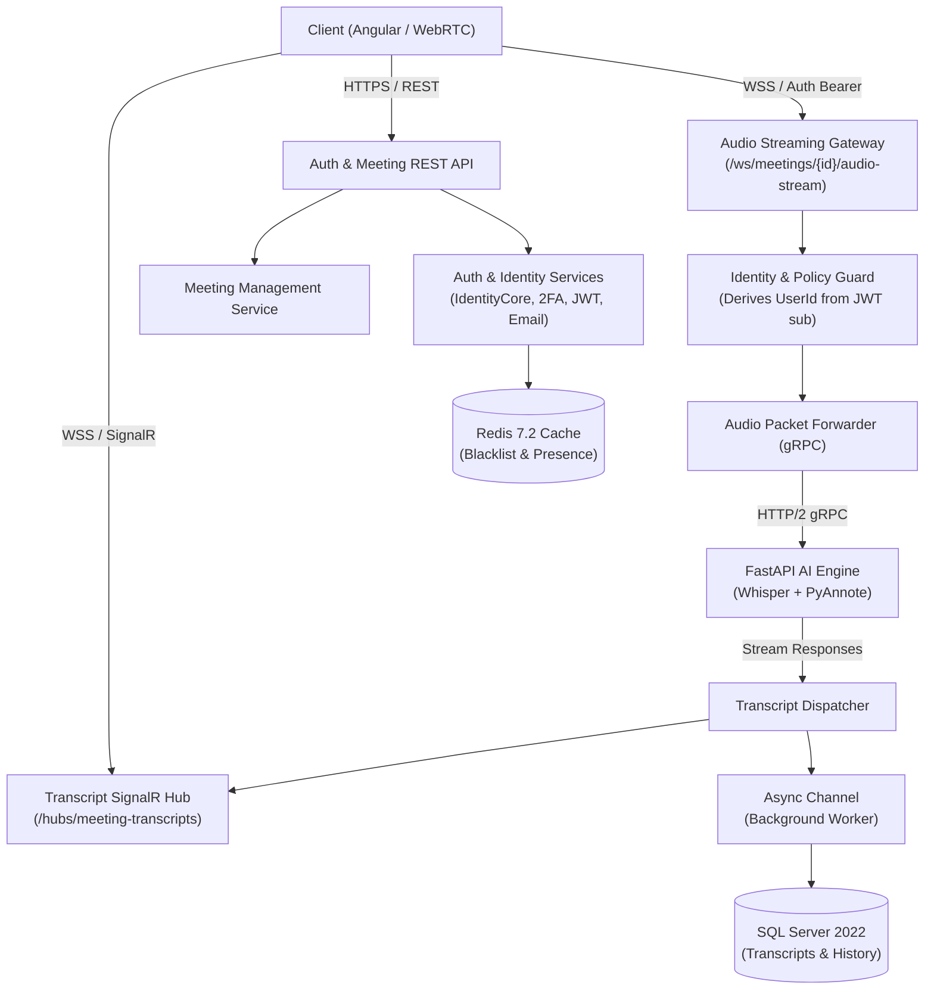

# 04. System Integration — Backend Ownership & Tasks

## 1. Overview & Clean Architecture Boundary

The Backend is built in **ASP.NET Core 8.0/9.0** following **Clean Architecture** principles across `AiraMeet.Domain`, `AiraMeet.Application`, `AiraMeet.Infrastructure`, and `AiraMeet.Api`.

The backend is the sole authority for participant identity, enterprise authentication, room authorization, real-time audio routing to the AI service, transcript broadcasting via SignalR, and persistent storage in SQL Server.

---

## 2. Engineering Tasks & Subtasks Breakdown

---

### Task `BE-AUTH-01`: User Registration & Email Verification Infrastructure

| Attribute | Specification |
| :--- | :--- |
| **Task ID** | `BE-AUTH-01` |
| **Task Name** | User Registration & Email Verification Infrastructure |
| **Phase** | Backend Phase 1: Authentication & Identity |
| **Priority / Owner** | `Critical` / Backend Engineering Team |
| **Dependencies** | None |
| **Checkpoint** | **No** (Foundational infrastructure task) |

#### Objective & Scope
Configure ASP.NET Core Identity with custom `ApplicationUser` using `Guid` primary keys. Implement user registration (`POST /api/auth/register`), cryptographic email verification token generation, email dispatching, resend verification email (`POST /api/auth/resend-verification-email`), and email confirmation (`GET /api/auth/confirm-email`). Prevent duplicate registrations, enforce password complexity rules, and protect endpoints with IP-based rate limiting.

#### Subtasks Breakdown

| Subtask ID | Subtask Name | Actionable Steps & Implementation Scope | Output & Acceptance Criteria |
| :--- | :--- | :--- | :--- |
| `BE-AUTH-01.1` | Identity Core & Custom User Entity | Configure `AddIdentityCore<ApplicationUser>` in `AiraMeet.Infrastructure`. Extend `ApplicationUser` with `FirstName`, `LastName`, `ProfilePictureUrl`, `IsEmailConfirmed`, `TwoFactorEnabled`, and `CreatedAtUtc`. | `ApplicationUser.cs` entity mapped to `AspNetUsers` in SQL Server with EF Core. |
| `BE-AUTH-01.2` | Registration Command & Validation | Implement `RegisterUserCommand` in `AiraMeet.Application` using MediatR and FluentValidation. Validate email format, password complexity (min 8 chars, uppercase, lowercase, digit, special symbol), and assert non-existence of email. | Robust command handler; duplicate email returns HTTP 409 Conflict with descriptive message. |
| `BE-AUTH-01.3` | Email Verification Token Generation | Implement token issuance using ASP.NET Core `UserManager.GenerateEmailConfirmationTokenAsync`. Base64-encode the token and construct verification callback URL: `https://airameet.com/auth/confirm-email?userId={id}&token={token}`. | Cryptographically signed single-use verification tokens tied to user identity. |
| `BE-AUTH-01.4` | Send & Resend Verification Endpoints | Implement `POST /api/auth/send-verification-email` and `POST /api/auth/resend-verification-email` with rate limiting (max 3 resends per 15 minutes per IP/email) using Redis distributed counter. | Rate-limited endpoints invoking `IEmailService` asynchronously. |
| `BE-AUTH-01.5` | Email Confirmation Endpoint | Implement `GET /api/auth/confirm-email` verifying token via `UserManager.ConfirmEmailAsync`. Transition user state to `EmailConfirmed = true` and return confirmation success response. | HTTP 200 OK on valid token; HTTP 400 Bad Request on invalid/expired tokens. |

#### Expected Deliverables & Acceptance Criteria
- **Entities & Schemas**: `ApplicationUser.cs`, `ApplicationDbContext.cs`.
- **Command Handlers**: `RegisterUserCommandHandler.cs`, `ConfirmEmailCommandHandler.cs`, `ResendVerificationEmailCommandHandler.cs`.
- **API Controller**: `AuthController.cs` exposing registration and confirmation endpoints.
- **Acceptance Gate**: 100% test coverage on registration validation, duplicate email prevention, token lifecycle, and email confirmation status transitions.

#### Checkpoint Specification
- **Checkpoint Required**: **No**. Verified via automated unit and integration tests.

---

### Task `BE-AUTH-02`: Credential Login & Two-Factor Authentication (2FA)

| Attribute | Specification |
| :--- | :--- |
| **Task ID** | `BE-AUTH-02` |
| **Task Name** | Credential Login & Two-Factor Authentication (2FA) |
| **Phase** | Backend Phase 1: Authentication & Identity |
| **Priority / Owner** | `Critical` / Backend Engineering Team |
| **Dependencies** | `BE-AUTH-01` (Identity Setup), `BE-AUTH-05` (Email Service) |
| **Checkpoint** | **Yes** — Gate M4 Authentication Milestone |

#### Objective & Scope
Implement secure credential authentication (`POST /api/auth/login`) with brute-force lockout protection (5 failed attempts locks account for 15 minutes). Implement full Two-Factor Authentication (2FA): TOTP setup with QR code generation (`POST /api/auth/2fa/enable`, `POST /api/auth/2fa/verify-setup`), 2FA verification (`POST /api/auth/2fa/verify-code`), backup recovery codes generation, and transactional Email OTP fallback (`POST /api/auth/2fa/send-email-otp`).

#### Subtasks Breakdown

| Subtask ID | Subtask Name | Actionable Steps & Implementation Scope | Output & Acceptance Criteria |
| :--- | :--- | :--- | :--- |
| `BE-AUTH-02.1` | Credential Authentication & Lockout | Implement `LoginCommand` validating credentials via `UserManager.CheckPasswordAsync`. Enforce account lockout upon 5 consecutive failed attempts, recording failed access counts in SQL Server. | Returns HTTP 200 with tokens if 2FA disabled, or HTTP 200 with `requires2Fa: true` and ephemeral `twoFactorToken` if 2FA enabled. |
| `BE-AUTH-02.2` | TOTP Setup & QR Code Generator | Implement `POST /api/auth/2fa/enable` generating 160-bit TOTP secret key using `UserManager.GetAuthenticatorKeyAsync`. Generate `otpauth://` URI and author `QrCodeGenerator.cs` emitting PNG/SVG QR codes for Google/Microsoft Authenticator. | Base64 QR code image and raw manual setup key returned to client. |
| `BE-AUTH-02.3` | TOTP Setup Verification & Emergency Codes | Implement `POST /api/auth/2fa/verify-setup` verifying initial 6-digit TOTP code. Upon success, set `TwoFactorEnabled = true` and generate 10 single-use 8-character alphanumeric recovery codes stored hashed in database. | 2FA activated; returns array of hashed emergency recovery backup codes. |
| `BE-AUTH-02.4` | Two-Factor Code Verification Endpoint | Implement `POST /api/auth/2fa/verify-code` accepting `twoFactorToken` and 6-digit TOTP code (or recovery code). Validate code within $\pm 1$ time-step window (30 seconds drift tolerance). Issue full JWT access and refresh tokens upon success. | Full JWT and Refresh Token returned upon valid TOTP or recovery code. |
| `BE-AUTH-02.5` | Email OTP 2FA Fallback | Implement `POST /api/auth/2fa/send-email-otp` generating a secure 6-digit numeric OTP with 5-minute expiration stored in Redis (`2fa:email_otp:{userId}`). Dispatch OTP via `IEmailService`. | Email OTP delivered to user; validated at `/api/auth/2fa/verify-code`. |
| `BE-AUTH-02.6` | Disable 2FA Endpoint | Implement authenticated `POST /api/auth/2fa/disable` requiring current password and valid TOTP code to prevent unauthorized security degradation. | `TwoFactorEnabled` set to false, secret key cleared. |

#### Expected Deliverables & Acceptance Criteria
- **Services & Commands**: `LoginCommandHandler.cs`, `TwoFactorAuthService.cs`, `QrCodeGenerator.cs`.
- **API Endpoints**: `POST /api/auth/login`, `POST /api/auth/2fa/enable`, `POST /api/auth/2fa/verify-setup`, `POST /api/auth/2fa/verify-code`, `POST /api/auth/2fa/send-email-otp`, `POST /api/auth/2fa/disable`.
- **Acceptance Gate**: Valid credentials yield tokens or trigger 2FA challenge; lockout triggered on 5th failed password; valid TOTP/recovery codes successfully authenticate; invalid codes rejected with HTTP 401 Unauthorized.

#### Checkpoint Specification
- **Checkpoint Required**: **Yes** (Gate M4 Milestone).
- **Checkpoint Type**: Authentication Security Checkpoint (`auth-login-2fa-v1.0`).
- **Contents**: Login and 2FA codebase, TOTP validator unit tests, lockout integration tests.
- **Retention**: Permanent.

---

### Task `BE-AUTH-03`: Cryptographic JWT Token Service & Refresh Token Rotation

| Attribute | Specification |
| :--- | :--- |
| **Task ID** | `BE-AUTH-03` |
| **Task Name** | Cryptographic JWT Token Service & Refresh Token Rotation |
| **Phase** | Backend Phase 1: Authentication & Security |
| **Priority / Owner** | `Critical` / Backend Engineering Team |
| **Dependencies** | `BE-AUTH-01` (Identity Setup) |
| **Checkpoint** | **Yes** — Gate M4 Token Infrastructure Milestone |

#### Objective & Scope
Build the cryptographic JSON Web Token (JWT) service emitting short-lived access tokens (15-minute expiration, HMAC-SHA256). Implement rotating refresh tokens (cryptographic 64-byte random tokens stored in SQL Server with 7-day expiration). Enforce automatic rotation on every refresh request, detect token reuse (anti-replay attack protection: revoke entire token family if a previously used token is presented), and support secure token refresh (`POST /api/auth/refresh`).

#### Subtasks Breakdown

| Subtask ID | Subtask Name | Actionable Steps & Implementation Scope | Output & Acceptance Criteria |
| :--- | :--- | :--- | :--- |
| `BE-AUTH-03.1` | RefreshToken Domain Entity & Persistence | Create `RefreshToken` entity in `AiraMeet.Domain` with properties: `Id`, `UserId`, `TokenHash`, `ExpiresAtUtc`, `CreatedAtUtc`, `CreatedByIp`, `RevokedAtUtc`, `RevokedByIp`, `ReplacedByTokenId`. Configure unique index on `TokenHash`. | EF Core mapping and migration `AddRefreshTokenSchema`. |
| `BE-AUTH-03.2` | JWT Token Generation Engine | Implement `JwtTokenService.cs` using `System.IdentityModel.Tokens.Jwt`. Sign tokens with 256-bit secret key using HMAC-SHA256 (`SecurityAlgorithms.HmacSha256`). Embed claims: `sub` (`UserId`), `email`, `jti` (`Guid`), `name`, and user `roles`. | Deterministic 15-minute expiration JWT access tokens. |
| `BE-AUTH-03.3` | Cryptographic Refresh Token Generator | Implement secure random token generator using `RandomNumberGenerator.GetBytes(64)` encoded in Base64URL. Store SHA-256 hash of token in SQL Server to protect against database leakage. | High-entropy 64-byte refresh tokens with SHA-256 hashed persistence. |
| `BE-AUTH-03.4` | Token Rotation & Replay Attack Detection | Implement `POST /api/auth/refresh` validating presented refresh token. If a token is already marked as `Revoked`, detect replay attack: immediately revoke all active refresh tokens for that user account. If valid, revoke current token, link `ReplacedByTokenId`, and issue new access token + new refresh token. | Strict 1-to-1 token rotation; replay attacks immediately neutralize compromised token family. |

#### Expected Deliverables & Acceptance Criteria
- **Services**: `JwtTokenService.cs`, `RefreshTokenService.cs`.
- **Domain Entities**: `RefreshToken.cs`.
- **API Endpoint**: `POST /api/auth/refresh`.
- **Acceptance Gate**: Generates valid signed JWTs verifiable via public key; successfully rotates refresh tokens upon invocation; immediately revokes token hierarchy upon detected reuse.

#### Checkpoint Specification
- **Checkpoint Required**: **Yes** (Gate M4 Milestone).
- **Checkpoint Type**: Token Infrastructure Checkpoint (`jwt-token-rotation-v1.0`).
- **Contents**: Token generator code, replay attack regression tests, migration files.
- **Retention**: Permanent.

---

### Task `BE-AUTH-04`: Password Lifecycle Management (Forgot, Reset, Resend & Change)

| Attribute | Specification |
| :--- | :--- |
| **Task ID** | `BE-AUTH-04` |
| **Task Name** | Password Lifecycle Management (Forgot, Reset, Resend & Change) |
| **Phase** | Backend Phase 1: Authentication & User Management |
| **Priority / Owner** | `Critical` / Backend Engineering Team |
| **Dependencies** | `BE-AUTH-01` (Identity), `BE-AUTH-05` (Email Service) |
| **Checkpoint** | **No** (Standard credential lifecycle) |

#### Objective & Scope
Implement the end-to-end self-service password recovery and modification lifecycle. Provide `POST /api/auth/forgot-password` (initiates password reset and dispatches reset email), `POST /api/auth/resend-reset-password-email` (resends reset email with anti-enumeration protection), `POST /api/auth/reset-password` (consumes cryptographic reset token and updates password), and authenticated `POST /api/auth/change-password` (requires current password and terminates existing active sessions).

#### Subtasks Breakdown

| Subtask ID | Subtask Name | Actionable Steps & Implementation Scope | Output & Acceptance Criteria |
| :--- | :--- | :--- | :--- |
| `BE-AUTH-04.1` | Forgot Password Request & Anti-Enumeration | Implement `POST /api/auth/forgot-password`. If user exists, generate password reset token via `UserManager.GeneratePasswordResetTokenAsync` with 1-hour expiration. Always return HTTP 200 OK regardless of whether email exists to prevent user enumeration attacks. | Reset token generated and queued for email delivery; uniform HTTP response timing. |
| `BE-AUTH-04.2` | Resend Password Reset Email | Implement `POST /api/auth/resend-reset-password-email` enforcing strict Redis-backed cooldown (minimum 2 minutes between dispatch requests, max 5 per day per IP/email). | Prevents email bombing/flooding while allowing legitimate user retries. |
| `BE-AUTH-04.3` | Reset Password Execution | Implement `POST /api/auth/reset-password` accepting `email`, `token`, and `newPassword`. Validate token via `UserManager.ResetPasswordAsync`. Enforce password history (prevent reusing last 3 passwords). Upon success, revoke all active refresh tokens for the user. | Password updated in database; all existing sessions revoked; password changed confirmation email sent. |
| `BE-AUTH-04.4` | Authenticated Change Password Endpoint | Implement `POST /api/auth/change-password` requiring Bearer JWT authorization, `currentPassword`, and `newPassword`. Verify current credentials via `UserManager.ChangePasswordAsync`. Invalidate all refresh tokens except the current session. | Secure password update for logged-in users with credential validation. |

#### Expected Deliverables & Acceptance Criteria
- **Commands & Handlers**: `ForgotPasswordCommandHandler.cs`, `ResetPasswordCommandHandler.cs`, `ChangePasswordCommandHandler.cs`.
- **API Endpoints**: `POST /api/auth/forgot-password`, `POST /api/auth/resend-reset-password-email`, `POST /api/auth/reset-password`, `POST /api/auth/change-password`.
- **Acceptance Gate**: Password reset token is single-use and expires after 60 minutes; reset successfully alters password hash; all prior refresh tokens revoked upon reset; anti-enumeration timing resistance confirmed.

#### Checkpoint Specification
- **Checkpoint Required**: **No**. Verified via automated password lifecycle test suite.

---

### Task `BE-AUTH-05`: Transactional Email Dispatcher Infrastructure

| Attribute | Specification |
| :--- | :--- |
| **Task ID** | `BE-AUTH-05` |
| **Task Name** | Transactional Email Dispatcher Infrastructure |
| **Phase** | Backend Phase 1: Communication Infrastructure |
| **Priority / Owner** | `High` / Backend Engineering Team |
| **Dependencies** | None |
| **Checkpoint** | **No** (Infrastructure messaging component) |

#### Objective & Scope
Construct a high-reliability, asynchronous transactional email delivery service (`IEmailService`). Implement modular provider adapters for SMTP (local development / Mailkit) and cloud providers (SendGrid / AWS SES for staging and production). Build an asynchronous background channel queue (`EmailQueueWorker`) to prevent blocking API requests, implement exponential backoff retries via Polly, and author responsive HTML email templates.

#### Subtasks Breakdown

| Subtask ID | Subtask Name | Actionable Steps & Implementation Scope | Output & Acceptance Criteria |
| :--- | :--- | :--- | :--- |
| `BE-AUTH-05.1` | Email Service Abstraction & Providers | Define `IEmailService` in `AiraMeet.Application`. Implement `MailkitSmtpEmailService.cs` for local development and `SendGridEmailService.cs` for production in `AiraMeet.Infrastructure`. Configure via `EmailSettings` in `appsettings.json`. | Pluggable email provider architecture switchable via configuration. |
| `BE-AUTH-05.2` | Asynchronous Channel Worker & Polly Retries | Implement `EmailBackgroundQueue.cs` using bounded `System.Threading.Channels.Channel<EmailMessage>` and hosted background service `EmailQueueWorker.cs`. Wrap provider execution in Polly retry policy (3 retries with exponential backoff: 2s, 4s, 8s). | Zero HTTP request thread blocking; resilient background delivery with error logging. |
| `BE-AUTH-05.3` | HTML Email Templates & Rendering Engine | Implement Scriban / Fluid HTML template renderer. Author branded, responsive email templates: `EmailVerification.html`, `TwoFactorOtp.html`, `PasswordReset.html`, and `SecurityAlert.html`. Support bidirectional RTL/LTR layout for Arabic and English. | Beautiful, mobile-responsive HTML templates with dynamic placeholder injection. |
| `BE-AUTH-05.4` | Direct Send Email Utility Endpoint | Implement internal developer test endpoint `POST /api/internal/email/test` (guarded by Admin policy) to verify SMTP/SendGrid credentials and outbound delivery pipeline during staging deployment. | Verified outbound delivery capability to real inbox. |

#### Expected Deliverables & Acceptance Criteria
- **Interfaces & Services**: `IEmailService.cs`, `SendGridEmailService.cs`, `MailkitSmtpEmailService.cs`, `EmailQueueWorker.cs`.
- **Templates**: `Templates/Emails/*.html`.
- **Acceptance Gate**: Background queue processes 50 emails/second without dropping messages; network failure triggers Polly retry; templates render cleanly in Outlook, Gmail, and Apple Mail.

#### Checkpoint Specification
- **Checkpoint Required**: **No**. Verified via provider integration tests.

---

### Task `BE-AUTH-06`: Current User Profile & Secure Session Revocation (Logout & Me)

| Attribute | Specification |
| :--- | :--- |
| **Task ID** | `BE-AUTH-06` |
| **Task Name** | Current User Profile & Secure Session Revocation (Logout & Me) |
| **Phase** | Backend Phase 1: Authentication & User Profile |
| **Priority / Owner** | `High` / Backend Engineering Team |
| **Dependencies** | `BE-AUTH-02` (Login), `BE-AUTH-03` (JWT & Refresh Token) |
| **Checkpoint** | **No** (Standard session management) |

#### Objective & Scope
Implement the authenticated profile endpoint `GET /api/auth/me` returning user identity, verified email status, active roles, 2FA status, and profile metadata. Implement profile modification `PUT /api/auth/profile`. Implement secure logout `POST /api/auth/logout` revoking the active refresh token in SQL Server and storing the JWT token's `jti` in a distributed Redis blacklist with TTL matching the token's remaining lifespan.

#### Subtasks Breakdown

| Subtask ID | Subtask Name | Actionable Steps & Implementation Scope | Output & Acceptance Criteria |
| :--- | :--- | :--- | :--- |
| `BE-AUTH-06.1` | Current User Profile Query Handler | Implement MediatR `GetCurrentUserQuery` in `AiraMeet.Application`. Resolve user from `IUserContext` (claims principal), fetching profile details, roles, permissions, and active device sessions. | Returns `UserProfileDto` containing id, email, names, avatar, and 2FA status. |
| `BE-AUTH-06.2` | Profile Update Command Handler | Implement `UpdateUserProfileCommand` allowing users to update `FirstName`, `LastName`, and `ProfilePictureUrl`. Author validation rules preventing empty names or malformed URLs. | Profile attributes updated in SQL Server; returns updated profile DTO. |
| `BE-AUTH-06.3` | Secure Logout & Refresh Token Invalidation | Implement `POST /api/auth/logout`. Locate caller's refresh token from cookie or request body, set `RevokedAtUtc = DateTime.UtcNow`, and commit to SQL Server. | Refresh token immediately rendered unusable for future token generation. |
| `BE-AUTH-06.4` | Redis Distributed JWT Blacklist | In `POST /api/auth/logout`, extract `jti` and `exp` claims from the active Bearer JWT. Write key `blacklist:jwt:{jti}` to Redis with TTL set to remaining seconds until token expiry. Author `JwtBlacklistMiddleware.cs` checking incoming requests against Redis. | Blacklisted JWT immediately rejected with HTTP 401 Unauthorized across all cluster instances. |

#### Expected Deliverables & Acceptance Criteria
- **Queries & Handlers**: `GetCurrentUserQueryHandler.cs`, `UpdateUserProfileCommandHandler.cs`, `LogoutCommandHandler.cs`.
- **Middleware**: `JwtBlacklistMiddleware.cs`.
- **API Endpoints**: `GET /api/auth/me`, `PUT /api/auth/profile`, `POST /api/auth/logout`.
- **Acceptance Gate**: `GET /api/auth/me` reflects current claims; `POST /api/auth/logout` invalidates refresh token and blocks further use of the current JWT before expiration.

#### Checkpoint Specification
- **Checkpoint Required**: **No**. Verified via automated session integration tests.

---

### Task `BE-AUTHZ-01`: Meeting Room Authorization & Role-Based Access Control

| Attribute | Specification |
| :--- | :--- |
| **Task ID** | `BE-AUTHZ-01` |
| **Task Name** | Meeting Room Authorization & Role-Based Access Control |
| **Phase** | Backend Phase 2: Authorization & Security Policies |
| **Priority / Owner** | `Critical` / Backend Engineering Team |
| **Dependencies** | `BE-AUTH-02` (Login), `BE-MEET-01` (Meeting Entities) |
| **Checkpoint** | **Yes** — Gate M4 Security & Authorization Milestone |

#### Objective & Scope
Construct the comprehensive authorization policy engine governing all meeting interactions and speech-to-text operations for Feature 01. Enforce fine-grained roles (`Host`, `CoHost`, `Participant`, `Guest`). Author custom ASP.NET Core `AuthorizationHandler` components enforcing room lifecycle rules, waiting room admissions, audio stream ingestion authorization, and transcript access control.

#### Subtasks Breakdown

| Subtask ID | Subtask Name | Actionable Steps & Implementation Scope | Output & Acceptance Criteria |
| :--- | :--- | :--- | :--- |
| `BE-AUTHZ-01.1` | Role & Permission Matrix Definitions | Define domain enums and permission constants: `MeetingRole` (`Host`, `CoHost`, `Participant`, `Guest`), `MeetingPermissions` (`CreateMeeting`, `StartMeeting`, `EndMeeting`, `AdmitParticipant`, `KickParticipant`, `StreamAudio`, `ViewLiveCaptions`, `AccessTranscript`). | Standardized domain roles and claims catalog in `AiraMeet.Domain`. |
| `BE-AUTHZ-01.2` | Meeting Access Requirement & Handler | Implement `MeetingAccessRequirement.cs` and `MeetingAccessHandler.cs` inheriting from `AuthorizationHandler`. Extract `meetingId` from route or query parameters; verify user is active participant or host in SQL Server / Redis room cache. | Rejects unauthorized access with HTTP 403 Forbidden; permits authorized attendees. |
| `BE-AUTHZ-01.3` | Host & Co-Host Privilege Enforcement | Implement `HostOnlyPolicy` and `HostOrCoHostPolicy` guarding administrative room endpoints (`POST /api/meetings/{id}/end`, `POST /api/meetings/{id}/admit`, `POST /api/meetings/{id}/lock`). | Guarantees that only meeting organizers can modify room lifecycle states. |
| `BE-AUTHZ-01.4` | WebSocket Audio Stream Ingestion Guard | Author `WebSocketStreamAuthorizationFilter.cs`. Intercept connection handshakes at `/ws/meetings/{id}/audio-stream`, extract Bearer JWT, verify `sub` claim against active `MeetingParticipant` record, and verify `IsMuted = false` and `ConnectionState = Active`. | Unauthenticated connections or non-members rejected during handshake with HTTP 401/403. |
| `BE-AUTHZ-01.5` | Transcript Access Control Policy | Implement `TranscriptAccessPolicy` guarding `GET /api/meetings/{id}/transcripts`. Permit access only if: (a) caller is room Host/CoHost, or (b) caller was an authenticated participant who attended the meeting session. Block non-attendees. | Strict confidentiality of meeting transcription records enforced. |

#### Expected Deliverables & Acceptance Criteria
- **Handlers & Policies**: `MeetingAccessHandler.cs`, `MeetingAuthorizationPolicies.cs`, `WebSocketStreamAuthorizationFilter.cs`.
- **Acceptance Gate**: Non-participants cannot view room data or stream audio; participants cannot execute host actions; WebSocket connections without valid JWT are terminated before audio processing; transcript API enforces attendee-only access.

#### Checkpoint Specification
- **Checkpoint Required**: **Yes** (Gate M4 Milestone).
- **Checkpoint Type**: Security & Authorization Checkpoint (`room-authz-policies-v1.0`).
- **Contents**: Authorization handlers, security regression suite, and permission matrix tests.
- **Retention**: Permanent.

---

### Task `BE-MEET-01`: Meeting Lifecycle Entities & Unique Room Code Generator

| Attribute | Specification |
| :--- | :--- |
| **Task ID** | `BE-MEET-01` |
| **Task Name** | Meeting Lifecycle Entities & Unique Room Code Generator |
| **Phase** | Backend Phase 2: Meeting Management |
| **Priority / Owner** | `Critical` / Backend Engineering Team |
| **Dependencies** | `BE-AUTH-01` (Identity Setup) |
| **Checkpoint** | **No** (Database schema setup) |

#### Objective & Scope
Design and scaffold relational database entities for meetings and participant attendance sessions (`Meeting` and `MeetingParticipant`). Build an alphanumeric collision-resistant 10-character room code generator (`air-xxx-xxx`). Enforce strict meeting status transitions (`Scheduled`, `Active`, `Completed`, `Cancelled`).

#### Subtasks Breakdown

| Subtask ID | Subtask Name | Actionable Steps & Implementation Scope | Output & Acceptance Criteria |
| :--- | :--- | :--- | :--- |
| `BE-MEET-01.1` | Meeting Domain Entity Scaffolding | Create `Meeting` entity in `AiraMeet.Domain` with properties: `HostId`, `MeetingCode`, `Title`, `Description`, `Status`, `ScheduledStartTimeUtc`, `ActualStartTimeUtc`, `ActualEndTimeUtc`. | Domain entity with encapsulated state transition business logic methods. |
| `BE-MEET-01.2` | MeetingParticipant Entity Scaffolding | Create `MeetingParticipant` entity with properties: `MeetingId`, `UserId`, `Role`, `JoinedAtUtc`, `LeftAtUtc`, `ConnectionState`, `IsMuted`. | Relational entity tracking user attendance history, audio status, and assigned roles. |
| `BE-MEET-01.3` | Room Code Generator Implementation | Implement `MeetingCodeGenerator.cs` generating formatted string `air-\w{3}-\w{3}` with retry collision checks against database. | Collision-resistant room codes formatted as `air-abc-xyz`. |
| `BE-MEET-01.4` | EF Core Configuration & Migration | Define entity mappings and unique indexes in `ApplicationDbContext`; apply migration `AddMeetingAndParticipantSchema`. | SQL Server tables `Meetings` and `MeetingParticipants` created with indexes and constraints. |

#### Expected Deliverables & Acceptance Criteria
- **Domain Entities**: `Meeting.cs`, `MeetingParticipant.cs`, `MeetingStatus.cs`.
- **Generator Utility**: `MeetingCodeGenerator.cs`.
- **Database Schema**: Migration applied to SQL Server with unique index on `MeetingCode`.
- **Acceptance Gate**: Generates unique meeting codes without collision; relational constraints and status transitions verified via tests.

#### Checkpoint Specification
- **Checkpoint Required**: **No**. Entity configurations verified via integration tests.

---

### Task `BE-MEET-02`: Meeting Management Endpoints (Create, Join, Leave, End)

| Attribute | Specification |
| :--- | :--- |
| **Task ID** | `BE-MEET-02` |
| **Task Name** | Meeting Management Endpoints (Create, Join, Leave, End) |
| **Phase** | Backend Phase 2: Meeting Management |
| **Priority / Owner** | `Critical` / Backend Engineering Team |
| **Dependencies** | `BE-MEET-01` (Meeting Entities), `BE-AUTHZ-01` (Authorization) |
| **Checkpoint** | **Yes** — Gate M5 Meeting Core Milestone |

#### Objective & Scope
Implement RESTful API endpoints governing the complete meeting lifecycle. Allow authenticated users to create rooms, join via unique code, leave active meetings, and allow hosts to formally end meetings.

#### Subtasks Breakdown

| Subtask ID | Subtask Name | Actionable Steps & Implementation Scope | Output & Acceptance Criteria |
| :--- | :--- | :--- | :--- |
| `BE-MEET-02.1` | Create Meeting Endpoint | Implement `POST /api/meetings` generating room code, persisting meeting entity, and registering caller as Host. | Returns HTTP 201 Created with meeting DTO and unique room code. |
| `BE-MEET-02.2` | Meeting Lookup Endpoint | Implement `GET /api/meetings/{idOrCode}` resolving room details and active attendee counts by GUID or meeting code. | Resolves meeting metadata, host details, and current status. |
| `BE-MEET-02.3` | Join Meeting Endpoint | Implement `POST /api/meetings/{idOrCode}/join` verifying that meeting is not `Completed`, creating attendance record, and returning join authorization ticket. | Participant registered in meeting; returns session token and room configuration. |
| `BE-MEET-02.4` | Leave Meeting Endpoint | Implement `POST /api/meetings/{id}/leave` updating departure timestamp and marking connection state as `Disconnected`. | Participant session closed; updates departure time in database. |
| `BE-MEET-02.5` | End Meeting Endpoint | Implement `POST /api/meetings/{id}/end` enforcing host authorization and transitioning meeting status to `Completed`. | Meeting terminated; all attendee connections closed; triggers final transcript assembly. |

#### Expected Deliverables & Acceptance Criteria
- **Controller & Service**: `MeetingsController.cs`, `MeetingService.cs`.
- **Acceptance Gate**: Full meeting lifecycle transitions (Scheduled $\rightarrow$ Active $\rightarrow$ Completed) verified via automated integration tests.

#### Checkpoint Specification
- **Checkpoint Required**: **Yes** (Gate M5 Milestone).
- **Checkpoint Type**: Backend Core Checkpoint (`meeting-lifecycle-v1.0`).
- **Contents**: Meeting API codebase and automated lifecycle test suite.
- **Retention**: Permanent.

---

### Task `BE-SIG-01`: WebRTC Signaling Hub & Participant Presence in Redis

| Attribute | Specification |
| :--- | :--- |
| **Task ID** | `BE-SIG-01` |
| **Task Name** | WebRTC Signaling Hub & Participant Presence in Redis |
| **Phase** | Backend Phase 3: Real-Time Communication |
| **Priority / Owner** | `Medium` / Backend Engineering Team |
| **Dependencies** | `BE-MEET-02` (Meeting Lifecycle) |
| **Checkpoint** | **No** (Conferencing signaling infrastructure) |

#### Objective & Scope
Construct a real-time SignalR Hub for WebRTC peer signaling (relaying SDP Offers/Answers and ICE Candidates). Track real-time participant presence and mute states in Redis to maintain cross-instance state synchronization.

#### Subtasks Breakdown

| Subtask ID | Subtask Name | Actionable Steps & Implementation Scope | Output & Acceptance Criteria |
| :--- | :--- | :--- | :--- |
| `BE-SIG-01.1` | Hub Setup & Group Management | Implement `MeetingSignalingHub.cs` at `/hubs/meeting-signaling` managing room group memberships via SignalR groups. | Real-time signaling hub route with group joining and departure handling. |
| `BE-SIG-01.2` | SDP Offer/Answer Relay | Implement signaling methods `SendOffer` and `SendAnswer` forwarding SDP payloads between peer endpoints. | Low-latency relaying of WebRTC session descriptions between peers. |
| `BE-SIG-01.3` | ICE Candidate Trickling | Implement `SendIceCandidate` method relaying network candidates for peer connection establishment. | Seamless trickling of ICE candidates between clients. |
| `BE-SIG-01.4` | Redis Presence & Voice State | Use Redis Sets to track active room attendees and broadcast `MuteStateChanged` and `CameraStateChanged` events. | Distributed presence tracking; synchronized attendee rosters across server nodes. |

#### Expected Deliverables & Acceptance Criteria
- **Hub & Service**: `MeetingSignalingHub.cs`, `RedisPresenceService.cs`.
- **Acceptance Gate**: WebRTC signaling tokens relayed between peers with $< 50\text{ms}$ transit latency; Redis presence state reflects room joins/leaves immediately.

#### Checkpoint Specification
- **Checkpoint Required**: **No**. Validated through real-time communication tests.

---

### Task `BE-STR-01`: Authenticated Audio Streaming Gateway (WebSocket Ingestion)

| Attribute | Specification |
| :--- | :--- |
| **Task ID** | `BE-STR-01` |
| **Task Name** | Authenticated Audio Streaming Gateway (WebSocket Ingestion) |
| **Phase** | Backend Phase 4: Audio Gateway & AI Ingestion |
| **Priority / Owner** | `Critical` / Backend Engineering Team |
| **Dependencies** | `BE-MEET-02` (Meeting Lifecycle), `BE-AUTHZ-01` (Authorization) |
| **Checkpoint** | **Yes** — Gate M4 Attribution Gateway Checkpoint |

#### Objective & Scope
Build the incoming audio WebSocket gateway at `/ws/meetings/{id}/audio-stream`. Authenticate callers via Bearer JWT, verify active meeting membership, and bind the WebSocket connection strictly to the verified `UserId`. Receive raw 250ms binary PCM chunks and prevent client-side speaker spoofing.

#### Subtasks Breakdown

| Subtask ID | Subtask Name | Actionable Steps & Implementation Scope | Output & Acceptance Criteria |
| :--- | :--- | :--- | :--- |
| `BE-STR-01.1` | WebSocket Route Middleware | Implement `AudioStreamingMiddleware.cs` listening on `/ws/meetings/{meetingId}/audio-stream`. | High-throughput WebSocket server endpoint accepting binary streaming payloads. |
| `BE-STR-01.2` | Handshake Security & Room Authorization | Extract Bearer JWT from handshake headers, validate claims, and verify that caller is an active participant in `meetingId`. | Unauthorized callers immediately disconnected with HTTP 401/403. |
| `BE-STR-01.3` | Server-Bound Identity Mapping | Bind the connection ID to verified `UserId` and `MeetingId` in `AudioSessionRegistry.cs` without trusting client-supplied author metadata. | Connection session mapped to verified identity; client spoofing physically impossible. |
| `BE-STR-01.4` | Binary Frame Ingestion & Queue Buffer | Stream raw 16 kHz Mono 16-bit linear PCM frames (8,000 bytes) every 250ms into bounded participant channels with backpressure limits. | Sustained 4 packets/second ingestion per participant without memory leaks. |

#### Expected Deliverables & Acceptance Criteria
- **Middleware & Registry**: `AudioStreamingMiddleware.cs`, `AudioSessionRegistry.cs`.
- **Acceptance Gate**: Rejects unauthenticated or non-member connections with HTTP 401/403; receives 4 frames/second per participant without frame loss; spoofed client identity claims completely ignored.

#### Checkpoint Specification
- **Checkpoint Required**: **Yes** (Gate M4 Milestone).
- **Checkpoint Type**: Security Gateway Checkpoint (`audio-gateway-v1.0`).
- **Contents**: Gateway middleware code, session registry, and spoofing vulnerability tests.
- **Retention**: Permanent.

---

### Task `BE-AI-01`: gRPC Audio Forwarder & AI Response Client

| Attribute | Specification |
| :--- | :--- |
| **Task ID** | `BE-AI-01` |
| **Task Name** | gRPC Audio Forwarder & AI Response Client |
| **Phase** | Backend Phase 4: AI Service Integration |
| **Priority / Owner** | `Critical` / Backend Engineering Team |
| **Dependencies** | `BE-STR-01` (Audio Gateway) |
| **Checkpoint** | **No** (Coupled with Milestone M6) |

#### Objective & Scope
Build a high-performance gRPC client streaming audio chunks to the FastAPI AI service over HTTP/2. Forward verified `user_id` metadata alongside PCM audio packets, consume reverse `TranscriptionResultPacket` streams, and implement resilient retries using Polly.

#### Subtasks Breakdown

| Subtask ID | Subtask Name | Actionable Steps & Implementation Scope | Output & Acceptance Criteria |
| :--- | :--- | :--- | :--- |
| `BE-AI-01.1` | Protobuf Code Generation | Compile `Protos/audio_streaming.proto` into C# stubs via `Grpc.Tools`. | Strongly-typed C# client stubs for bidirectional gRPC communication. |
| `BE-AI-01.2` | gRPC Client Channel Setup | Implement `AiStreamingClient.cs` managing persistent HTTP/2 gRPC streaming channels with keep-alive pings. | Persistent, low-overhead HTTP/2 streaming connection to AI service. |
| `BE-AI-01.3` | Audio Packet Streaming | Wrap incoming PCM bytes into `AudioChunkPacket` embedding verified `user_id`, `sequence_number`, and timestamp offsets. | Serialized protobuf packets forwarded with $< 40\text{ms}$ network transit latency. |
| `BE-AI-01.4` | Stream Response Consumer & Fault Tolerance | Consume `TranscriptionResultPacket` stream, route results to internal broadcast channels, and apply Polly retry and circuit breaker policies. | Real-time response stream consumption with automatic reconnection upon AI service restart. |

#### Expected Deliverables & Acceptance Criteria
- **Protobuf & Client**: `Protos/audio_streaming.proto`, `AiStreamingClient.cs`.
- **Acceptance Gate**: Sustained bidirectional streaming with $< 40\text{ms}$ network transit latency to AI service; automatic reconnection upon service restart.

#### Checkpoint Specification
- **Checkpoint Required**: **No**. Verified as part of Gate M6 integration testing.

---

### Task `BE-CAP-01`: SignalR Live Caption Broadcast Hub

| Attribute | Specification |
| :--- | :--- |
| **Task ID** | `BE-CAP-01` |
| **Task Name** | SignalR Live Caption Broadcast Hub |
| **Phase** | Backend Phase 5: Live Captions |
| **Priority / Owner** | `High` / Backend Engineering Team |
| **Dependencies** | `BE-AI-01` (AI Forwarder) |
| **Checkpoint** | **No** (Real-time broadcast layer) |

#### Objective & Scope
Construct the SignalR broadcast hub at `/hubs/meeting-transcripts`. Multicast live caption events strictly to authorized meeting room groups (`Meeting_{meetingId}`), delivering partial hypotheses and committed final text with verified speaker profiles.

#### Subtasks Breakdown

| Subtask ID | Subtask Name | Actionable Steps & Implementation Scope | Output & Acceptance Criteria |
| :--- | :--- | :--- | :--- |
| `BE-CAP-01.1` | Hub Setup & Group Isolation | Implement `TranscriptHub.cs` requiring Bearer JWT authorization and assigning callers to `Meeting_{meetingId}` groups. | SignalR hub enforcing room boundary isolation; cross-room eavesdropping impossible. |
| `BE-CAP-01.2` | Transcript Dispatcher Service | Implement `TranscriptDispatcher.cs` consuming AI responses and multicasting `ReceiveTranscriptSegment`. | Real-time multicast dispatching to active room participants with $< 100\text{ms}$ latency. |
| `BE-CAP-01.3` | Speaker Profile Resolution | Attach verified participant display names and avatar URLs from database to outgoing caption payloads. | Enriched payload containing participant full name, avatar, and role. |
| `BE-CAP-01.4` | Voice Activity Broadcasting | Broadcast `ReceiveParticipantVoiceState` events when participant speech starts or pauses. | Real-time visual voice indicator events received by clients. |

#### Expected Deliverables & Acceptance Criteria
- **Hub & Dispatcher**: `TranscriptHub.cs`, `TranscriptDispatcher.cs`.
- **Acceptance Gate**: Live caption events multicasted to room participants with $< 100\text{ms}$ latency; zero cross-room leakage.

#### Checkpoint Specification
- **Checkpoint Required**: **No**. Real-time distribution verified during load testing.

---

### Task `BE-DB-01`: Background Transcript Persistence Worker & History API

| Attribute | Specification |
| :--- | :--- |
| **Task ID** | `BE-DB-01` |
| **Task Name** | Background Transcript Persistence Worker & History API |
| **Phase** | Backend Phase 4: Data Persistence |
| **Priority / Owner** | `High` / Backend Engineering Team |
| **Dependencies** | `BE-MEET-02` (Meeting Lifecycle), `BE-AI-01` (AI Forwarder), `BE-AUTHZ-01` (Authorization) |
| **Checkpoint** | **Yes** — Gate M6 Persistence Verification Milestone |

#### Objective & Scope
Build a hosted background channel worker (`TranscriptPersistenceWorker`) to asynchronously persist finalized transcript segments (`isFinal: true`) to SQL Server without blocking the streaming pipeline. Implement a paginated REST API to query historical transcripts guarded by attendee authorization policies.

#### Subtasks Breakdown

| Subtask ID | Subtask Name | Actionable Steps & Implementation Scope | Output & Acceptance Criteria |
| :--- | :--- | :--- | :--- |
| `BE-DB-01.1` | Entity Mapping & Chronological Indexing | Configure `TranscriptSegment` entity in EF Core with performance index (`IX_TranscriptSegments_MeetingId_SequenceNumber`). | Database table `TranscriptSegments` with composite indexing for rapid chronological queries. |
| `BE-DB-01.2` | Asynchronous Channel Consumer | Implement `TranscriptPersistenceWorker.cs` consuming `Channel<TranscriptSegment>` to execute batch bulk-inserts into SQL Server. | Non-blocking database insertion executing in batches of up to 50 segments or every 1 second. |
| `BE-DB-01.3` | Paginated History Query Handler | Implement MediatR query `GetMeetingTranscriptsQuery` supporting `page` and `pageSize` pagination with attendee authorization check. | Query handler returning ordered list of transcript segments with total count. |
| `BE-DB-01.4` | API Endpoint Exposure | Expose `GET /api/meetings/{id}/transcripts` in `TranscriptsController.cs`. | RESTful endpoint returning paginated transcript history with millisecond timestamps. |

#### Expected Deliverables & Acceptance Criteria
- **Persistence Worker**: `TranscriptPersistenceWorker.cs`.
- **API Controller**: `TranscriptsController.cs`.
- **Acceptance Gate**: 100% of final segments durably persisted to SQL Server; historical API returns chronologically ordered transcripts with millisecond timestamps.

#### Checkpoint Specification
- **Checkpoint Required**: **Yes** (Gate M6 Milestone).
- **Checkpoint Type**: Persistence Verification Checkpoint (`transcripts-persistence-v1.0`).
- **Contents**: Worker code, EF Core mapping, and historical query test suite.
- **Retention**: Permanent.
