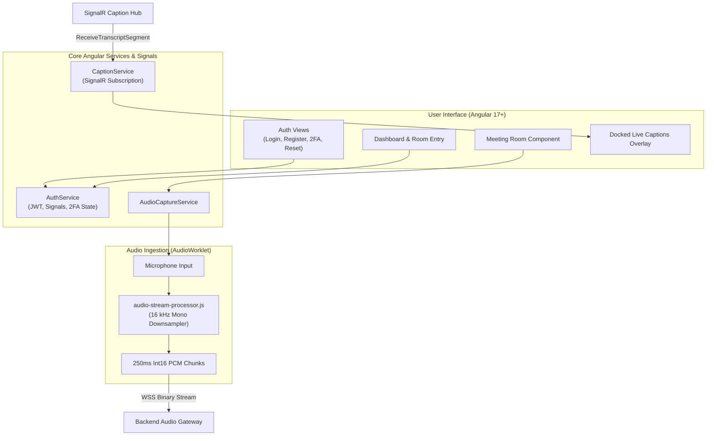

# 04. System Integration — Frontend Ownership & Tasks

## 1. Overview & Angular 17+ Architecture

The Frontend is built in **Angular 17+** using **Standalone Components**, TypeScript 5.3+, **Reactive Signals**, RxJS, and Tailwind CSS. The team is dedicated to implementing the approved UI/UX designs, capturing audio off the UI thread via `AudioWorklet`, managing user authentication and two-factor challenges, and consuming live caption streams.

---

## 2. Engineering Tasks & Subtasks Breakdown

---

### Task `FE-SET-01`: Project Architecture, Reactive Signals & Core Services

| Attribute | Specification |
| :--- | :--- |
| **Task ID** | `FE-SET-01` |
| **Task Name** | Project Architecture, Reactive Signals & Core Services |
| **Phase** | Frontend Phase 1: Project Setup |
| **Priority / Owner** | `High` / Frontend Engineering Team |
| **Dependencies** | `BE-AUTH-01` (Backend Identity Setup) |
| **Checkpoint** | **No** (Foundational frontend architecture) |

#### Objective & Scope
Scaffold the Angular 17+ application architecture using Standalone Components and Tailwind CSS. Establish reactive state management via Angular Signals (`signal`, `computed`). Implement core API communication services (`AuthService`, `MeetingService`, `AudioCaptureService`, `CaptionService`) and configure `AuthInterceptor` for automatic JWT injection and token refresh.

#### Subtasks Breakdown

| Subtask ID | Subtask Name | Actionable Steps & Implementation Scope | Output & Acceptance Criteria |
| :--- | :--- | :--- | :--- |
| `FE-SET-01.1` | Standalone Architecture & Tailwind Setup | Configure Angular 17+ standalone component configuration, setup Tailwind CSS, and embed Cairo and Inter typography. | Verified application shell with Tailwind configuration and typography loaded. |
| `FE-SET-01.2` | Reactive Signals State Scaffolding | Implement global state signals (`currentUser`, `isAuthenticated`, `activeMeeting`, `requires2Fa`) in `AuthService.ts`. | Central reactive signal store providing fine-grained state updates. |
| `FE-SET-01.3` | HTTP Interceptor & Token Refresh | Implement `AuthInterceptor.ts` injecting Bearer JWT tokens and intercepting 401 Unauthorized responses to invoke token refresh. | Automatic JWT injection on outgoing requests; seamless transparent token refresh on 401. |
| `FE-SET-01.4` | Route Guards Implementation | Construct `AuthGuard.ts` for authenticated routes and `MeetingAccessGuard.ts` for valid meeting sessions. | Unauthenticated navigation blocked and redirected to `/login`. |

#### Expected Deliverables & Acceptance Criteria
- **Architecture Setup**: `src/app/core/`, `src/app/services/`.
- **Core Services**: `AuthService.ts`, `AuthInterceptor.ts`, `AuthGuard.ts`.
- **Acceptance Gate**: Clean build with zero compilation errors; interceptor injects valid tokens; unauthorized route navigation blocked.

#### Checkpoint Specification
- **Checkpoint Required**: **No**. Verified via unit tests.

---

### Task `FE-AUTH-01`: Enterprise Authentication Views (Login, Register, 2FA & Password Recovery)

| Attribute | Specification |
| :--- | :--- |
| **Task ID** | `FE-AUTH-01` |
| **Task Name** | Enterprise Authentication Views (Login, Register, 2FA & Password Recovery) |
| **Phase** | Frontend Phase 3: Authentication Pages |
| **Priority / Owner** | `High` / Frontend Engineering Team |
| **Dependencies** | `FE-SET-01` (Project Setup), `BE-AUTH-01`, `BE-AUTH-02`, `BE-AUTH-04` (Backend Auth) |
| **Checkpoint** | **No** (UI component implementation) |

#### Objective & Scope
Implement the full user authentication and security views in strict accordance with the approved Figma design system. Build Login (`LoginComponent`), Registration (`RegisterComponent`), Two-Factor Authentication Modal (`TwoFactorModalComponent`), Forgot Password (`ForgotPasswordComponent`), and Reset Password (`ResetPasswordComponent`). Enforce reactive form validation, handle loading and error states, and manage secure client-side token persistence.

#### Subtasks Breakdown

| Subtask ID | Subtask Name | Actionable Steps & Implementation Scope | Output & Acceptance Criteria |
| :--- | :--- | :--- | :--- |
| `FE-AUTH-01.1` | Login Component & 2FA Challenge Trigger | Build `login.component.html` and `.ts` with reactive forms, email/password validation, and "Remember Me" toggle. Connect to `POST /api/auth/login`. If backend returns `requires2Fa: true`, trigger 2FA challenge modal. | Working login view; transitions directly to dashboard or opens 2FA verification dialog. |
| `FE-AUTH-01.2` | Registration Component & Password Meter | Build `register.component.html` and `.ts` with name, email, password strength meter, and password confirmation validation. Connect to `POST /api/auth/register` and display email verification prompt banner. | Reactive registration form with client-side password strength evaluation. |
| `FE-AUTH-01.3` | Two-Factor Authentication Verification Modal | Implement `two-factor-modal.component.ts` featuring 6-digit auto-advancing OTP input fields. Support switching between Authenticator app TOTP code, Email OTP code request (`POST /api/auth/2fa/send-email-otp`), and emergency recovery code input. | Responsive 2FA challenge modal submitting verified code to `/api/auth/2fa/verify-code`. |
| `FE-AUTH-01.4` | Forgot & Reset Password Flow | Implement `forgot-password.component.ts` requesting email to trigger reset link (`POST /api/auth/forgot-password`). Implement `reset-password.component.ts` reading token from URL query params and allowing user to submit new password. | Complete self-service password recovery flow with success toast alerts. |
| `FE-AUTH-01.5` | Error Handling & Loading State Management | Implement animated loading indicators, field-level validation errors, and alert banners for bad credentials, locked accounts, and expired tokens. | Polished error handling matching Figma design guidelines. |

#### Expected Deliverables & Acceptance Criteria
- **Components**: `login.component.ts`, `register.component.ts`, `two-factor-modal.component.ts`, `forgot-password.component.ts`, `reset-password.component.ts`.
- **Services**: Extended `AuthService.ts` supporting 2FA and password recovery methods.
- **Acceptance Gate**: Complete, functional user authentication flow connecting to backend API with validation feedback, 2FA challenge resolution, and secure token storage.

#### Checkpoint Specification
- **Checkpoint Required**: **No**. Verified through component test suites.

---

### Task `FE-DASH-01`: Home Dashboard & Room Join/Create UX

| Attribute | Specification |
| :--- | :--- |
| **Task ID** | `FE-DASH-01` |
| **Task Name** | Home Dashboard & Room Join/Create UX |
| **Phase** | Frontend Phase 2: Home Dashboard |
| **Priority / Owner** | `High` / Frontend Engineering Team |
| **Dependencies** | `FE-SET-01` (Project Setup), `BE-MEET-02` (Meeting Endpoints) |
| **Checkpoint** | **No** (Dashboard feature view) |

#### Objective & Scope
Build the primary authenticated dashboard (`DashboardComponent`). Implement the modal dialog to create new meetings (`CreateMeetingDialog`), the room code join card (`JoinMeetingCard`) with input validation (`air-xxx-xxx`), and display past meeting history with transcript links.

#### Subtasks Breakdown

| Subtask ID | Subtask Name | Actionable Steps & Implementation Scope | Output & Acceptance Criteria |
| :--- | :--- | :--- | :--- |
| `FE-DASH-01.1` | Dashboard Layout & Header | Construct `dashboard.component.html` featuring header, user profile dropdown, and quick-action cards. | Responsive dashboard shell with authenticated user navigation bar. |
| `FE-DASH-01.2` | Create Meeting Dialog | Implement modal component invoking `POST /api/meetings` to generate an instant meeting room. | Modal dialog creating room and redirecting host to `/meeting/:code`. |
| `FE-DASH-01.3` | Join Meeting Card with Regex Mask | Implement code input component enforcing regular expression `air-\w{3}-\w{3}` with real-time format masking. | Formatted code input preventing invalid room code entries. |
| `FE-DASH-01.4` | Recent Meetings & Transcript Navigation | Fetch and render past meeting attendance cards with direct links to transcripts, routing joined users to `/meeting/:code`. | History list rendering past meetings with clickable transcript viewer routes. |

#### Expected Deliverables & Acceptance Criteria
- **Dashboard Views**: `dashboard.component.ts`, `create-meeting-dialog.component.ts`, `join-meeting-card.component.ts`.
- **Acceptance Gate**: Instant meeting creation redirects to room with generated code; valid code inputs successfully navigate to meeting.

#### Checkpoint Specification
- **Checkpoint Required**: **No**. Verified via end-to-end user flow tests.

---

### Task `FE-ROOM-01`: Meeting Room Layout, Media Controls & Participant Roster

| Attribute | Specification |
| :--- | :--- |
| **Task ID** | `FE-ROOM-01` |
| **Task Name** | Meeting Room Layout, Media Controls & Participant Roster |
| **Phase** | Frontend Phase 4: Meeting Interface |
| **Priority / Owner** | `High` / Frontend Engineering Team |
| **Dependencies** | `FE-DASH-01` (Dashboard), `BE-SIG-01` (Signaling Hub), `BE-AUTHZ-01` (Authorization) |
| **Checkpoint** | **No** (Coupled with Milestone M5) |

#### Objective & Scope
Construct the responsive meeting room interface (`MeetingRoomComponent`). Layout the top header bar, remote video track grid, collapsible participant sidebar with live voice indicators, and the bottom media control bar.

#### Subtasks Breakdown

| Subtask ID | Subtask Name | Actionable Steps & Implementation Scope | Output & Acceptance Criteria |
| :--- | :--- | :--- | :--- |
| `FE-ROOM-01.1` | Responsive Room Grid | Construct responsive layout in `meeting-room.component.html` adapting to variable participant counts. | Dynamically adapting video/avatar grid accommodating 1 to 20+ attendees. |
| `FE-ROOM-01.2` | Bottom Media Control Bar | Implement controls for microphone mute, camera toggle, live caption toggle, and leave meeting. | Interactive control bar triggering hardware media track changes. |
| `FE-ROOM-01.3` | Reactive State Binding | Wire controls to Angular Signals (`isMuted`, `isCameraOn`, `isCaptionsVisible`). | Real-time UI indicator updates bound directly to reactive state signals. |
| `FE-ROOM-01.4` | Participant Sidebar & Teardown | Render attendee list updated in real time via SignalR presence events; clean up tracks and connections upon room exit. | Collapsible sidebar showing participant names, roles, and speaking states. |

#### Expected Deliverables & Acceptance Criteria
- **Room Components**: `meeting-room.component.ts`, `media-controls.component.ts`, `participant-list.component.ts`.
- **Acceptance Gate**: Responsive video grid adapts to participant counts; clicking mic/cam triggers immediate UI state changes without DOM lag.

#### Checkpoint Specification
- **Checkpoint Required**: **No**. Coupled with Milestone M5 audio ingestion verification.

---

### Task `FE-AUD-01`: AudioWorklet Ingestion Pipeline (16 kHz Mono PCM Capture)

| Attribute | Specification |
| :--- | :--- |
| **Task ID** | `FE-AUD-01` |
| **Task Name** | AudioWorklet Ingestion Pipeline (16 kHz Mono PCM Capture) |
| **Phase** | Frontend Phase 4: Audio Capture Subsystem |
| **Priority / Owner** | `Critical` / Frontend Engineering Team |
| **Dependencies** | `FE-ROOM-01` (Meeting Room UI), `BE-STR-01` (Audio Gateway) |
| **Checkpoint** | **Yes** — Gate M5 Client Audio Ingestion Gate |

#### Objective & Scope
Implement browser microphone capture using a dedicated `AudioWorkletProcessor` running on the audio rendering thread (decoupled from the UI main thread). Downsample hardware audio (44.1/48 kHz) to **16,000 Hz Mono 16-bit linear PCM**. Transmit binary chunks every **250 milliseconds** (8,000 bytes per frame) over WebSocket to the backend. Immediately cease transmission upon microphone mute.

#### Subtasks Breakdown

| Subtask ID | Subtask Name | Actionable Steps & Implementation Scope | Output & Acceptance Criteria |
| :--- | :--- | :--- | :--- |
| `FE-AUD-01.1` | AudioWorklet Processor Script | Author `public/audio-stream-processor.js` extending `AudioWorkletProcessor` with custom downsampling logic. | Separate thread processor executing audio DSP independently of UI thread. |
| `FE-AUD-01.2` | Polyphase Downsampling Implementation | Implement polyphase linear interpolation downsampling incoming Float32 samples to 16,000 Hz. | Clean downsampled audio stream without high-frequency aliasing artifacts. |
| `FE-AUD-01.3` | Int16 Linear PCM Conversion | Quantize downsampled Float32 values (-1.0 to 1.0) into 16-bit signed integer PCM (`Int16Array`). | Linear 16-bit signed integer byte buffer matching backend audio specification. |
| `FE-AUD-01.4` | AudioCaptureService & WebSocket Streaming | Implement `AudioCaptureService.ts` managing `AudioContext` and streaming 250ms binary `ArrayBuffer` chunks over WSS. | Steady 4 frames/second WebSocket transmission to `/ws/meetings/{id}/audio-stream`. |
| `FE-AUD-01.5` | Mute & Lifecycle Teardown | Stop buffer dispatch immediately upon mute or meeting exit, releasing microphone tracks. | Zero packets transmitted when muted; microphone hardware released cleanly on leave. |

#### Expected Deliverables & Acceptance Criteria
- **Worklet Script**: `public/audio-stream-processor.js`.
- **Capture Service**: `src/app/services/AudioCaptureService.ts`.
- **Acceptance Gate**:
  - Captures and transmits 16 kHz Mono PCM at exact 250ms intervals (4 packets/sec).
  - Zero main-thread frame drops during UI animations or scrolling.
  - Zero bytes transmitted when microphone is muted.

#### Checkpoint Specification
- **Checkpoint Required**: **Yes** (Gate M5 Milestone).
- **Checkpoint Type**: Audio Ingestion Verification Checkpoint (`client-audio-v1.0`).
- **Contents**: AudioWorklet script, capture service, and browser streaming test report.
- **Retention**: Permanent.

---

### Task `FE-CAP-01`: Live Captions Subtitle Component (Docked RTL/LTR Display)

| Attribute | Specification |
| :--- | :--- |
| **Task ID** | `FE-CAP-01` |
| **Task Name** | Live Captions Subtitle Component (Docked RTL/LTR Display) |
| **Phase** | Frontend Phase 5: Live Captions |
| **Priority / Owner** | `High` / Frontend Engineering Team |
| **Dependencies** | `FE-AUD-01` (Audio Capture), `BE-CAP-01` (Caption Hub) |
| **Checkpoint** | **Yes** — Gate M6 Real-Time Integration Milestone |

#### Objective & Scope
Construct the real-time caption subtitle overlay (`LiveCaptionsComponent`) docked at the bottom of the meeting window. Subscribe to SignalR `ReceiveTranscriptSegment` events, render interim hypotheses in italics, commit finalized segments, support bidirectional text rendering (RTL Arabic and LTR English), and implement DOM virtual scrolling to support long meetings.

#### Subtasks Breakdown

| Subtask ID | Subtask Name | Actionable Steps & Implementation Scope | Output & Acceptance Criteria |
| :--- | :--- | :--- | :--- |
| `FE-CAP-01.1` | Subtitle Overlay Component Layout | Construct `live-captions.component.html` and `.ts` with semi-transparent subtitle styling docked above the media controls. | Floating/docked caption container matching Figma design styling. |
| `FE-CAP-01.2` | SignalR Stream Subscription | Implement `CaptionService.ts` subscribing to `ReceiveTranscriptSegment` on `/hubs/meeting-transcripts`. | Reactive RxJS stream delivering incoming partial and final transcript segments. |
| `FE-CAP-01.3` | Interim Hypothesis In-Place Updating | When `isFinal: false`, update active speaker's subtitle bubble in-place with italicized text. | Smooth live typing effect without creating duplicate DOM lines. |
| `FE-CAP-01.4` | Finalized Segment Commitment & Auto-Scrolling | When `isFinal: true`, lock text into chronological history, clear interim bubble, and auto-scroll to latest position. | Durably committed transcript lines with speaker badge, avatar, and timestamp. |
| `FE-CAP-01.5` | Bidirectional RTL/LTR Support & Virtual Scrolling | Apply Tailwind CSS with `dir="auto"` for mixed code-switching; retain latest 200 segments in DOM using virtual scrolling. | Natural bidirectional rendering without punctuation flip; smooth 60 FPS scrolling. |

#### Expected Deliverables & Acceptance Criteria
- **Caption Views**: `live-captions.component.ts`, `live-captions.component.html`.
- **Caption Service**: `src/app/services/CaptionService.ts`.
- **Acceptance Gate**:
  - Captions render within 3.0 seconds of speech inception.
  - Interim hypotheses smoothly replace in-place without duplicate words.
  - Bidirectional text renders cleanly without reversed punctuation or disjointed characters.

#### Checkpoint Specification
- **Checkpoint Required**: **Yes** (Gate M6 Milestone).
- **Checkpoint Type**: Full Integration Checkpoint (`live-captions-v1.0`).
- **Contents**: Caption component code, SignalR stream consumer, and visual regression test recordings.
- **Retention**: Permanent.
