# 04. System Integration — Speaker Attribution & Security Model

## 1. Overview & Threat Model

In a collaborative video conferencing system, correctly attributing speech to the actual speaker is critical for accountability, privacy, and downstream intelligence (such as meeting minutes and action items).

This document specifies the **Session-Bound Speaker Attribution Model** implemented by AiraMeet, contrasts it with acoustic diarization, and establishes the zero-trust security controls protecting participant identity.

---

## 2. Two Paradigms: Session-Bound Attribution vs. Acoustic Diarization

AiraMeet distinguishes between two complementary speaker attribution mechanisms:

```mermaid
flowchart TD
    subgraph TrackLevel["Paradigm A: Session-Bound Attribution (Default Multi-Device Meetings)"]
        UserA["Participant A (Browser)"] -->|Auth Stream A| SockA["WebSocket A (Bound to User A GUID)"]
        UserB["Participant B (Browser)"] -->|Auth Stream B| SockB["WebSocket B (Bound to User B GUID)"]
        SockA --> BackendAuth["Backend Gateway: Identity Derived Strictly from JWT"]
        SockB --> BackendAuth
        BackendAuth --> AttributedOut["100% Deterministic Attribution to Verified User"]
    end

    subgraph AcousticLevel["Paradigm B: Acoustic Speaker Diarization (Shared Mic / Meeting Room)"]
        SharedMic["Single Conference Room Microphone<br/>(Multiple In-Person Speakers)"] --> SingleStream["Single Mixed Audio Stream"]
        SingleStream --> PyAnnote["PyAnnote.audio 3.1 Neural Diarization"]
        PyAnnote --> AcousticClusters["Acoustic Voiceprint Clustering<br/>(Speaker_1, Speaker_2, Speaker_3)"]
        AcousticClusters --> Aligner["ASR Word-to-Speaker Alignment"]
    end
```

| Dimension | Paradigm A: Session-Bound Attribution | Paradigm B: Acoustic Speaker Diarization |
| :--- | :--- | :--- |
| **Meeting Environment** | Standard remote meeting: each participant joins from their own browser/device with their own microphone. | Physical conference room: multiple participants share a single microphone, or audio is an uploaded recording. |
| **Identity Authority** | **Cryptographic**: Identity is established by the backend via JWT claims. | **Acoustic**: Identity is established by clustering voice frequencies and pitch. |
| **Accuracy** | **100% Deterministic**: Zero risk of confusing speaker identities. | **Statistical**: Subject to acoustic Diarization Error Rate (DER target $\le 18.0\%$). |
| **Overlapping Speech** | Naturally isolated: concurrent speakers are captured on independent WebSocket audio streams. | Requires neural overlap detection to separate colliding speech frames. |
| **Implementation** | ASP.NET Core WebSocket Gateway session context mapping. | Python PyAnnote.audio 3.1 neural pipeline. |

---

## 3. Session-Bound Attribution Security Architecture

### Zero-Trust Client Metadata Policy
1. **No Client Claims**: Audio frames transmitted by the Angular client contain **raw binary PCM bytes only**.
2. **Forbidden Fields**: The client is prohibited from submitting metadata fields such as `user_id`, `speaker_name`, or `email` inside audio packets.
3. **Server-Derived Identity**:
   - During the WebSocket handshake (`/ws/meetings/{meetingId}/audio-stream`), the client transmits its Bearer JWT.
   - ASP.NET Core validates token cryptographic signature, issuer, audience, and expiration.
   - ASP.NET Core extracts the `sub` claim (`UserId`) and verifies against SQL Server/Redis that this user is currently admitted to `meetingId`.
   - The connection ID is bound in an in-memory session registry (`AudioSessionRegistry`) to the verified `UserId`.
   - When forwarding audio chunks to the AI service over gRPC, the backend injects the server-verified `UserId`. The AI service never accepts client-provided speaker identifiers.

---

## 4. Threat Model & Mitigation Matrix

| Threat Scenario | Attack Vector | Technical Safeguard / System Behavior |
| :--- | :--- | :--- |
| **Identity Spoofing** | Malicious client alters JavaScript to send another user's GUID in the audio stream. | **Blocked**: The server ignores all client-supplied identity parameters; identity is bound strictly to the authenticated socket connection context. |
| **Cross-Meeting Audio Injection** | Attacker attempts to stream audio into a meeting room they are not invited to. | **Blocked**: During handshake, backend validates caller's room participation; non-members are rejected with HTTP 403 Forbidden. |
| **Token Expiration During Call** | User's 15-minute access token expires while speaking. | **Handled**: The active WebSocket remains valid for the duration of the established media session; background token rotation maintains REST and SignalR session validity. |
| **Replay Attacks** | Intercepted audio packets retransmitted by an adversary. | **Blocked**: WSS uses TLS 1.3 encryption; backend enforces strictly increasing monotonically sequenced chunk packets (`sequenceNumber`). |
| **Ghost Streams After Leave** | Client disconnects abruptly without cleanly un-muting. | **Handled**: WebSocket disconnect handler automatically cleans up the session registry, sends stream-end to AI, and sets participant status to `Disconnected`. |

---

## 5. Data Privacy Safeguards

- **Transient Processing**: Audio data buffered in ASP.NET Core and Python memory is overwritten immediately after ASR inference and finalization.
- **Zero Raw Audio Storage**: Raw WAV/PCM frames are **never persisted to disk, database, or logs** under standard operational mode.
- **Audit Logging**: Application logs record meeting ID, segment sequence numbers, word counts, and latency metrics; audio payloads and raw text transcripts are strictly excluded from infrastructure log sinks.
