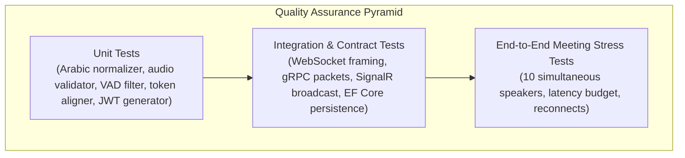

# 05. Quality & Delivery — Quality Assurance Strategy & Test Plans

## 1. Overview & Quality Mandate

Quality assurance for Feature 01 spans unit testing of mathematical and text normalization modules, integration testing of inter-service gRPC and WebSocket bridges, and end-to-end multi-user stress testing under real-world meeting network conditions.

---

## 2. Test Strategy Matrix

| Test Level | Scope & Framework | Execution Cadence | Acceptance Gate |
| :--- | :--- | :--- | :--- |
| **Unit Tests** | Python `pytest`, .NET `xUnit`, Angular `Vitest` / `Jasmine`. | Every commit (CI). | 100% pass rate; $\ge 85\%$ code coverage on core business logic. |
| **Integration Tests** | `TestServer` in ASP.NET Core, Python gRPC channel tests, SignalR client mocks. | Nightly / PR merge. | Zero contract drift; all Protobuf and JSON schemas valid. |
| **Load & Stress Tests**| Automated `k6` WebSocket load generator + synthetic PCM audio feeds. | Milestone M7. | 10 concurrent active streams with p95 visible latency $\le 3.0\text{s}$. |
| **Acoustic Regression**| Held-out bilingual audio test split. | Pre-release. | Fine-tuned model achieves relative WER reduction $\ge 15.0\%$. |

---

## 3. Dedicated Test Suites & Scenarios

### 3.1 Audio Streaming Test Harness (QA-STT-001)
- **Objective**: Verify that the audio ingestion pipeline handles variable network chunking without dropping audio frames or causing jitter.
- **Methodology**:
  - Load a clean 60-second reference speech WAV file.
  - Slice audio into 250ms chunks (4,000 samples = 8,000 bytes).
  - Transmit chunks over WSS to `/ws/meetings/{id}/audio-stream` using a synthetic Python test client.
  - Verify that the total number of audio samples received by the backend matches the reference audio file length exactly ($4,000 \times 240 = 960,000$ samples).

---

### 3.2 Chunk Boundary Regression & Deduplication (QA-STT-004)
- **Objective**: Verify that overlapping sliding windows do not emit repeated words or drop words at boundary seams.
- **Methodology**:
  - Test phrases with repeated phonetic sequences (e.g., *"كل سنة أو كل موسم"*).
  - Verify that longest common substring token alignment correctly identifies the overlapping prefix and deduplicates text.
  - **Acceptance Criteria**: Concatenated finalized transcript must match the continuous ground truth verbatim with zero inserted duplicate words.

---

### 3.3 Multi-User Concurrency & Load Testing (QA-STT-002)
- **Objective**: Validate system behavior and latency when multiple participants speak concurrently in different meeting rooms.
- **Methodology**:
  - Launch 10 simultaneous virtual meeting participants across 3 distinct meeting rooms.
  - Stream continuous 16 kHz PCM speech into each stream simultaneously.
  - Monitor GPU VRAM, CPU utilization, and visible subtitle delivery latency.
  - **Acceptance Criteria**:
    - Average Real-Time Factor (RTF) $\le 0.15$.
    - p95 end-to-end visible latency $\le 3.0$ seconds.
    - Zero server 500 errors or unhandled task cancellations.

---

### 3.4 Network Resilience & Disconnection Recovery (QA-STT-005)
- **Objective**: Verify client and server stability during transient network dropouts.
- **Methodology**:
  - Stream audio from client for 15 seconds.
  - Simulate network drop by killing the client TCP socket for 5 seconds.
  - Restore network connection, re-authenticate, and resume streaming.
  - **Acceptance Criteria**:
    - Backend cleans up the terminated stream without memory leaks or ghost threads.
    - Reconnected stream creates a new valid session.
    - Historical transcript retains all speech emitted prior to the drop; zero duplicated sentences in database.

---

## 4. Acceptance Sign-Off Checklist (Milestone M7)

Before the feature is certified for production deployment, the QA Lead and Architecture Leads must sign off on the following:

- [ ] 100% of unit tests pass across AI, Backend, and Frontend repositories.
- [ ] Overall Word Error Rate (WER) on the held-out test split is $\le 18.0\%$.
- [ ] Code-Switching WER on mixed Arabic-English speech is $\le 22.0\%$.
- [ ] Diarization Error Rate (DER) on Egyptian Arabic RTTM validation audio is $\le 18.0\%$.
- [ ] End-to-end latency p95 is $\le 3.0$ seconds under 10 concurrent streams.
- [ ] Security test proves that client-supplied identity claims in audio frames are completely ignored and cannot cause attribution spoofing.
- [ ] Disconnect and reconnect flow recovers cleanly without duplicating transcript records.
