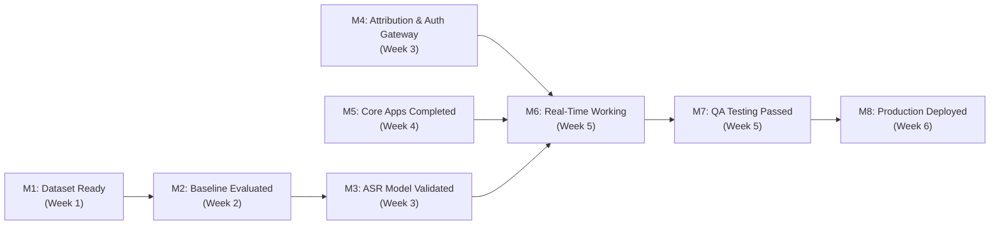

# 06. Project Management — Master Delivery Plan & Work Breakdown Structure (WBS)

## 1. Executive Delivery Summary

This document establishes the official master work breakdown structure (WBS), task catalog, execution schedule, and risk management register for **Feature 01: Speech-to-Text, Speaker Diarization, and Meeting Live Captions**.

The engineering initiative is structured across three synchronized workstreams (AI/ML, Backend, and Frontend) coordinated across eight delivery gates (**M1 through M8**) over a six-week execution schedule.

All tasks strictly adhere to the standardized schema:
1. **Task ID & Task Name**
2. **Metadata Specification Table**
3. **Objective & Scope**
4. **Subtasks Breakdown formatted as a structured Markdown table**
5. **Expected Deliverables & Acceptance Criteria**
6. **Explicit Checkpoint Specification**

---

## 2. Milestone Architecture (Gates M1 – M8)

| Milestone | Target Week | Responsible Lead | Gate Acceptance Criteria | Exit Deliverables |
| :--- | :---: | :--- | :--- | :--- |
| **M1: Dataset Ready** | Week 1 | AI Research Lead | - Raw audio inspected and normalized to 16 kHz Mono WAV. - Corrupted and duplicate files eliminated. - Data splits (80/10/10) isolated with zero speaker leakage. | Validated dataset manifests (`train.jsonl`, `val.jsonl`, `test.jsonl`), `dataset_stats.json`. |
| **M2: Baseline Model Evaluated** | Week 2 | AI Research Lead | - Zero-shot WER/CER measured on test set for Whisper-Medium. - Inference latency and VRAM footprint measured. - Candidate model chosen for fine-tuning. | `baseline_scorecard.json`, model selection sign-off document. |
| **M3: Fine-Tuned Model Validated**| Week 3 | AI Research Lead | - Fine-tuning pipeline executed with checkpointing. - Quantifiable WER/CER reduction ($\ge 15\%$) achieved over baseline. - Model exported to production-ready CTranslate2 INT8 runtime. | `models/best_model/`, `models/exported/whisper_medium_ct2/`, training loss/WER curves. |
| **M4: Attribution & Auth Gateway**| Week 3 | Backend Tech Lead | - Enterprise Auth suite completed (Register, Login, 2FA, Password lifecycle, Email service). - Authenticated session-to-stream binding implemented in ASP.NET Core. - Client claims decoupled from server-verified identity. | Auth controllers, session attribution middleware, security test suite with 100% coverage. |
| **M5: Core Apps Completed**| Week 4 | Full-Stack Leads | - Complete meeting lifecycle implemented (Create/Join/Leave). - AudioWorklet capturing uncompressed PCM frames without UI lag. - Responsive Angular meeting room UI layout ready. | Angular meeting room module, ASP.NET Core meeting controllers, EF migrations. |
| **M6: Real-Time Transcription Working**| Week 5 | AI & Backend Leads | - End-to-end streaming visible latency $\le 3.0$ seconds. - Partial vs Final transcript state correctly rendered in Angular UI. - Overlap deduplication preventing repeated words across chunks. | Live streaming prototype, WebSocket and gRPC integration test report. |
| **M7: Integration Testing Passed** | Week 5 | QA Lead | - Multi-participant stress tests executed (10 simultaneous speakers). - Network drop recovery verified. - End-to-end regression tests passed with zero critical bugs. | Comprehensive QA verification report, automated test suite execution log. |
| **M8: Production Deployed** | Week 6 | DevOps Lead | - Containerized deployment running on GPU-accelerated staging/production. - Health probes and Prometheus/OpenTelemetry metrics active. - Verified operational runbook and rollback plan. | Production release package, operational dashboard, sign-off certificate. |

---

## 3. Master Task Register & Detailed Subtask Breakdown

---

### AI Workstream Tasks

---

#### Task `AI-DS-01`: Dataset Inspection, Audio Format Harmonization & Quality Audit

| Attribute | Specification |
| :--- | :--- |
| **Task ID** | `AI-DS-01` |
| **Task Name** | Dataset Inspection, Audio Format Harmonization & Quality Audit |
| **Phase / Workstream**| AI Phase 2: Dataset Engineering |
| **Priority / Owner** | `Critical` / AI Engineering Team |
| **Dependencies** | None |
| **Checkpoint** | **Yes** — Gate M1 Data Audit Checkpoint (`reports/inspection_report.json`) |

##### Objective & Scope
Audit all audio recordings and CSV metadata. Standardize audio sample rates to 16,000 Hz Mono WAV (16-bit PCM). Detect and quarantine corrupted, unreadable, or duplicate files. Enforce duration limits ($0.5	ext{s} \le 	ext{duration} \le 30.0	ext{s}$) to prevent Whisper memory allocation faults, and isolate noisy samples via WADA-SNR analysis.

##### Subtasks Breakdown

| Subtask ID | Subtask Name | Actionable Steps & Implementation Scope | Output & Acceptance Criteria |
| :--- | :--- | :--- | :--- |
| `AI-DS-01.1` | Schema & Path Integrity Validation | Implement CSV parser in `src/dataset/audio_validator.py` verifying columns (`meeting,speaker,audio_path,text,start,end,duration`) and checking that relative audio paths exist on disk. | Validated CSV records; throws explicit error on missing audio paths or malformed columns. |
| `AI-DS-01.2` | Audio Decoding & Format Conversion | Read audio using `soundfile` and `torchaudio`. Convert stereo or non-standard audio to uncompressed 16,000 Hz Mono 16-bit linear PCM and save to `data/processed/`. | Standardized 16 kHz Mono 16-bit PCM WAV files saved to `data/processed/`. |
| `AI-DS-01.3` | Duration & Acoustic Quality Filtering | Check for NaN/Inf sample values, digital clipping ($> 0.99$ saturation), compute WADA-SNR, and discard utterances $< 0.5	ext{s}$ or $> 30.0	ext{s}$. Apply peak normalization to -1.0 dBFS. | Corrupted/clipped audio isolated; duration strictly bounded between 0.5s and 30.0s. |
| `AI-DS-01.4` | Quarantine Ledger & Audit Report Generation | Author `scripts/run_inspection.py` to process the entire corpus and generate `reports/inspection_report.json` detailing valid, quarantined, and discarded files with explicit reason codes. | Comprehensive audit report `reports/inspection_report.json` and quarantine ledger. |

##### Expected Deliverables & Acceptance Criteria
- **Inspection Tooling**: `src/dataset/audio_validator.py`, `scripts/run_inspection.py`.
- **Harmonized Audio**: `data/processed/*.wav` (16 kHz Mono PCM).
- **Audit Ledger**: `reports/inspection_report.json` detailing valid, quarantined, and discarded files.
- **Acceptance Gate**: 100% of accepted files successfully decode without exceptions; all corrupted files quarantined with explicit reason codes.

##### Checkpoint Specification
- **Checkpoint Required**: **Yes** (Gate M1 Milestone).
- **Checkpoint Type**: Data Audit Checkpoint (`data-audit-v1.0`).
- **Contents**: `inspection_report.json` + quarantine ledger.
- **Retention**: Permanent.

---

#### Task `AI-DS-02`: Arabic & English Code-Switching Text Normalization

| Attribute | Specification |
| :--- | :--- |
| **Task ID** | `AI-DS-02` |
| **Task Name** | Arabic & English Code-Switching Text Normalization |
| **Phase / Workstream**| AI Phase 2: Dataset Engineering |
| **Priority / Owner** | `Critical` / AI Engineering Team |
| **Dependencies** | `AI-DS-01` (Harmonized Audio) |
| **Checkpoint** | **No** (Intermediate transformation) |

##### Objective & Scope
Construct a dual-script text normalization pipeline for colloquial Egyptian Arabic mixed with English technical jargon. Clean and standardize Arabic orthography while strictly preserving English words, character casing, and alphanumeric technical terms without phonetic transliteration.

##### Subtasks Breakdown

| Subtask ID | Subtask Name | Actionable Steps & Implementation Scope | Output & Acceptance Criteria |
| :--- | :--- | :--- | :--- |
| `AI-DS-02.1` | Unicode Canonicalization & Whitespace Cleanup | Implement Unicode NFC normalization (`unicodedata.normalize('NFC', text)`) and collapse redundant spaces and control characters in `src/dataset/text_normalizer.py`. | Standardized UTF-8 strings without hidden formatting or control bytes. |
| `AI-DS-02.2` | Arabic Diacritic & Orthographic Standardization | Strip all Arabic Tashkeel (`[ً-ْ]`, Harakat & Tanween), fold Alef variations (`[أ, إ, آ, ٱ]` $
ightarrow$ `ا`), map Alif Maqsura (`ى` $
ightarrow$ `ي`), standardize Taa Marbuta (`ة` $
ightarrow$ `ه`), and delete Tatweel (`ـ`). | Canonical Arabic text with uniform letter forms and stripped vocalization diacritics. |
| `AI-DS-02.3` | Code-Switching Protection & Punctuation Filtering | Preserve all Latin alphanumeric sequences (`[A-Za-z0-9]+`) with exact casing (e.g., `"Layer"`, `"Stranger Things"`). Strip non-syntactic brackets and quotes. | English technical vocabulary preserved intact without transliteration or case distortion. |
| `AI-DS-02.4` | Unit Regression Suite & Cleaned Manifest Export | Author `tests/unit/test_text_normalizer.py` verifying 50 bilingual fixtures; export normalized dataset to `data/cleaned_metadata.csv`. | 100% passing tests for bilingual fixtures; exported clean metadata CSV. |

##### Expected Deliverables & Acceptance Criteria
- **Normalizer Module**: `src/dataset/text_normalizer.py`.
- **Cleaned Dataset**: `data/cleaned_metadata.csv`.
- **Regression Tests**: `tests/unit/test_text_normalizer.py`.
- **Acceptance Gate**: 100% pass rate across bilingual test fixtures; zero dropped English technical terms.

##### Checkpoint Specification
- **Checkpoint Required**: **No**. Intermediate pipeline output verified via unit test assertions.

---

#### Task `AI-DS-03`: Leak-Free Stratified Group Splitting & Manifest Generation

| Attribute | Specification |
| :--- | :--- |
| **Task ID** | `AI-DS-03` |
| **Task Name** | Leak-Free Stratified Group Splitting & Manifest Generation |
| **Phase / Workstream**| AI Phase 2: Dataset Engineering |
| **Priority / Owner** | `Critical` / AI Engineering Team |
| **Dependencies** | `AI-DS-02` (Normalized Transcripts) |
| **Checkpoint** | **Yes** — Gate M1 Data Release Milestone (`data/manifests/CHECKSUMS.sha256`) |

##### Objective & Scope
Partition the cleaned dataset into Training (80%), Validation (10%), and Test (10%) splits. Strictly enforce grouped splitting by recording session / meeting ID to prevent acoustic leakage between partitions. Generate immutable JSONL manifests and SHA256 cryptographic checksums.

##### Subtasks Breakdown

| Subtask ID | Subtask Name | Actionable Steps & Implementation Scope | Output & Acceptance Criteria |
| :--- | :--- | :--- | :--- |
| `AI-DS-03.1` | Recording Session Grouping | Implement `src/dataset/manifest_builder.py` reading `data/cleaned_metadata.csv` and aggregating utterances by `meeting` identifier. | Grouped dictionary mapping meeting IDs to all child audio segments. |
| `AI-DS-03.2` | Stratified 80/10/10 Split Partitioning | Execute group-based splitting via `sklearn.model_selection.GroupShuffleSplit` with fixed pseudo-random seed `42`. | Deterministic 80% train, 10% validation, 10% test split partitions. |
| `AI-DS-03.3` | Leakage Assertion Verification | Assert programmatically that the set intersection of recording session IDs between train and test is strictly empty ($\emptyset$). | Automated assertion confirming zero acoustic leakage across splits. |
| `AI-DS-03.4` | Manifest & Checksum Generation | Write JSONL files (`train.jsonl`, `val.jsonl`, `test.jsonl`), calculate SHA256 hashes into `data/manifests/CHECKSUMS.sha256`, and author `scripts/generate_stats.py` to emit `reports/dataset_stats.json`. | Immutable `train.jsonl`, `val.jsonl`, `test.jsonl` manifests, checksums, and dataset stats report. |

##### Expected Deliverables & Acceptance Criteria
- **Manifest Files**: `data/manifests/train.jsonl`, `data/manifests/val.jsonl`, `data/manifests/test.jsonl`.
- **Checksums**: `data/manifests/CHECKSUMS.sha256`.
- **Statistics Report**: `reports/dataset_stats.json` (hours per split, duration distributions, vocabulary counts).
- **Acceptance Gate**: Zero overlapping recording sessions between splits; immutable SHA256 hashes generated.

##### Checkpoint Specification
- **Checkpoint Required**: **Yes** (Gate M1 Milestone).
- **Checkpoint Type**: Data Partitioning Release Checkpoint (`data-v1.0`).
- **Contents**: Manifest files, SHA256 digests, and dataset statistics report.
- **Retention**: Permanent.

---

#### Task `AI-ASR-01`: Candidate Baseline Evaluation & Architecture Benchmark

| Attribute | Specification |
| :--- | :--- |
| **Task ID** | `AI-ASR-01` |
| **Task Name** | Candidate Baseline Evaluation & Architecture Benchmark |
| **Phase / Workstream**| AI Phase 1 / Phase 3 (Model Selection & Baseline) |
| **Priority / Owner** | `High` / AI Engineering Team |
| **Dependencies** | `AI-DS-03` (Leak-Free Test Split Manifest) |
| **Checkpoint** | **Yes** — Gate M2 Baseline Artifact (`reports/baseline_scorecard.json`) |

##### Objective & Scope
Perform a rigorous zero-shot baseline evaluation of `openai/whisper-medium` on the isolated held-out test split (`test.jsonl`). Establish ground-truth baseline Word Error Rate (WER) and Character Error Rate (CER) broken down across pure Arabic, pure English, and code-switched audio. Measure baseline inference speed (RTF) and peak VRAM consumption on target GPU hardware prior to fine-tuning.

##### Subtasks Breakdown

| Subtask ID | Subtask Name | Actionable Steps & Implementation Scope | Output & Acceptance Criteria |
| :--- | :--- | :--- | :--- |
| `AI-ASR-01.1` | Environment & Dependencies Setup | Install PyTorch 2.2+, CUDA 12.x, `transformers`, `torchaudio`, and `jiwer`. Initialize raw `openai/whisper-medium` weights on dedicated GPU hardware. | Verified GPU PyTorch runtime; downloaded foundation Whisper-Medium checkpoint. |
| `AI-ASR-01.2` | Evaluation Harness Implementation | Implement `scripts/run_baseline_eval.py` to stream through `data/manifests/test.jsonl` using standardized greedy decoding parameters (`temperature=0.0`, `language="ar"`). | Working evaluation harness script with progress tracking and batch execution. |
| `AI-ASR-01.3` | Stratified Scoring & Normalization | Apply standardized bilingual text normalization (`src/dataset/text_normalizer.py`) to both hypotheses and references. Compute overall WER, CER, pure Egyptian Arabic WER, pure English WER, and code-switching WER. | Stratified error metrics computed using `jiwer` without script or casing bias. |
| `AI-ASR-01.4` | Hardware Profiling & Scorecard Persistence | Measure peak GPU VRAM via `torch.cuda.max_memory_allocated()`, calculate average Real-Time Factor (RTF), and persist output to `reports/baseline_scorecard.json`. | Structured JSON scorecard containing all baseline accuracy and compute metrics. |

##### Expected Deliverables & Acceptance Criteria
- **Evaluation Script**: `scripts/run_baseline_eval.py`.
- **Scorecard Report**: `reports/baseline_scorecard.json` containing detailed error rates per language stratum and compute metrics.
- **Acceptance Gate**: Baseline performance quantitatively documented on identical test partition (expected baseline WER: ~25%–30% on colloquial Egyptian speech) as a reference point for fine-tuning validation.

##### Checkpoint Specification
- **Checkpoint Required**: **Yes** (Gate M2 Milestone).
- **Checkpoint Type**: Permanent Evaluation Record (`asr-baseline-eval`).
- **Contents**: `baseline_scorecard.json` + raw hypothesis text dump + commit SHA hash.
- **Retention**: Permanent.

---

#### Task `AI-ASR-01B`: Diarization Zero-Shot Baseline Validation on Multi-Speaker Data

| Attribute | Specification |
| :--- | :--- |
| **Task ID** | `AI-ASR-01B` |
| **Task Name** | Diarization Zero-Shot Baseline Validation on Multi-Speaker Data |
| **Phase / Workstream**| AI Phase 1 / Phase 5 (Speaker Diarization Research) |
| **Priority / Owner** | `Medium` / AI Engineering Team |
| **Dependencies** | None |
| **Checkpoint** | **No** (Exploratory validation step) |

##### Objective & Scope
Verify the out-of-the-box zero-shot performance of `pyannote/speaker-diarization-3.1` on multi-speaker meeting recordings. Measure initial Diarization Error Rate (DER) to validate that pretrained voiceprint embeddings can distinguish speaker turns before coupling with ASR.

##### Subtasks Breakdown

| Subtask ID | Subtask Name | Actionable Steps & Implementation Scope | Output & Acceptance Criteria |
| :--- | :--- | :--- | :--- |
| `AI-ASR-01B.1` | PyAnnote Initialization & Token Authentication | Install `pyannote.audio` and configure Hugging Face token authentication to download pretrained segmentation and embedding models. | Authenticated environment with PyAnnote 3.1 weights initialized on CUDA device. |
| `AI-ASR-01B.2` | Multi-Speaker Sample Assembly | Assemble 5 sample meeting audio recordings (3–5 concurrent speakers) with corresponding ground-truth RTTM annotation files. | Curated RTTM ground-truth dataset and corresponding 16 kHz audio files. |
| `AI-ASR-01B.3` | Zero-Shot Benchmark & DER Scoring | Implement `scripts/run_diarization_eval.py` to run segmentation, embedding extraction, and clustering, scoring DER, Missed Speech, and False Alarm rates via `pyannote.metrics`. | Baseline diarization scorecard `reports/diarization_baseline.json` with DER score. |

##### Expected Deliverables & Acceptance Criteria
- **Evaluation Script**: `scripts/run_diarization_eval.py`.
- **Benchmark Output**: `reports/diarization_baseline.json`.
- **Acceptance Gate**: Diarization Error Rate (DER) $\le 18.0\%$ achieved on multi-speaker validation audio.

##### Checkpoint Specification
- **Checkpoint Required**: **No**. Internal verification result documented directly in evaluation report.

---

#### Task `AI-ASR-02`: ASR Model Fine-Tuning Pipeline & Checkpointing Loop

| Attribute | Specification |
| :--- | :--- |
| **Task ID** | `AI-ASR-02` |
| **Task Name** | ASR Model Fine-Tuning Pipeline & Checkpointing Loop |
| **Phase / Workstream**| AI Phase 3: Model Development & Training |
| **Priority / Owner** | `Critical` / AI Engineering Team |
| **Dependencies** | `AI-ASR-01` (Baseline Evaluation), `AI-DS-03` (Split Manifests) |
| **Checkpoint** | **Yes** — Ephemeral Rolling Step Checkpoints (Keep 3) + Permanent Best Model Artifact (`models/best_model/`) |

##### Objective & Scope
Train `openai/whisper-medium` on the curated Egyptian Arabic and English code-switching dataset using Hugging Face `Seq2SeqTrainer`. Implement continuous 250-step validation cycles, rolling checkpoint management to prevent disk saturation, and automated best-model decoupling.

##### Subtasks Breakdown

| Subtask ID | Subtask Name | Actionable Steps & Implementation Scope | Output & Acceptance Criteria |
| :--- | :--- | :--- | :--- |
| `AI-ASR-02.1` | Data Ingestion & Tokenizer Pipeline | Build `src/asr/dataset_loader.py` to stream through `train.jsonl` and `val.jsonl`, generating 80 mel-frequency filterbank features at 16 kHz using `WhisperFeatureExtractor` and encoding target text with `WhisperTokenizer`. | Dynamic dataset loader yielding aligned mel-spectrogram tensors and token labels. |
| `AI-ASR-02.2` | Hyperparameter & Trainer Configuration | Author `configs/training_config.yaml` specifying AdamW optimizer, learning rate `1e-5`, cosine learning rate decay, 10% linear warmup, weight decay `0.01`, mixed precision (`fp16`/`bf16`), and an effective batch size of 32 (batch size 8 $	imes$ 4 gradient accumulation steps). | Validated YAML configuration file governing all training parameters. |
| `AI-ASR-02.3` | Training Loop Implementation | Construct `scripts/run_training.py` wrapping Hugging Face `Seq2SeqTrainer` with custom data collator for dynamic audio padding. | Executable training script handling distributed GPU training and metric computation. |
| `AI-ASR-02.4` | Periodic Validation & Rolling Checkpoints | Implement validation callback executing every 250 steps to track validation loss and Word Error Rate (WER). Configure `save_total_limit: 3` to retain only the 3 latest snapshots in `models/checkpoints/` and prune older ones. | Rolling checkpoints saved every 250 steps; older snapshots automatically pruned. |
| `AI-ASR-02.5` | Best-Model Decoupling & Auto-Resume | Implement callback that copies weights, tokenizer, and config to `models/best_model/` whenever validation WER reaches a new global minimum. Configure `--resume_from_checkpoint auto` to support recovery from interruptions. | Isolated `models/best_model/` directory updated strictly on global minimum validation WER. |

##### Expected Deliverables & Acceptance Criteria
- **Source Code**: `src/asr/dataset_loader.py`, `scripts/run_training.py`, `configs/training_config.yaml`.
- **Training Artifacts**: TensorBoard telemetry logs, `models/best_model/` directory containing complete weights and tokenizer files.
- **Acceptance Gate**: Monotonic decrease in training/validation loss; achieves a relative WER reduction $\ge 15.0\%$ over the zero-shot baseline on the held-out validation set.

##### Checkpoint Specification
- **Checkpoint Required**: **Yes** (Two-tiered strategy).
- **Tier 1 (Ephemeral Training Checkpoints)**: `models/checkpoints/checkpoint-{step}/` saved every 250 steps; contains weights, optimizer momentum, scheduler states, and RNG seeds. Retains last 3 snapshots only.
- **Tier 2 (Durable Best Model Checkpoint - Gate M3)**: `models/best_model/` containing full model weights, tokenizer, processor, and `evaluation_summary.json`. Retained permanently.

---

#### Task `AI-ASR-03`: Best Model Selection, Validation & CTranslate2 INT8 Export

| Attribute | Specification |
| :--- | :--- |
| **Task ID** | `AI-ASR-03` |
| **Task Name** | Best Model Selection, Validation & CTranslate2 INT8 Export |
| **Phase / Workstream**| AI Phase 3 / Phase 4 (Export & Serving Optimization) |
| **Priority / Owner** | `Critical` / AI Engineering Team |
| **Dependencies** | `AI-ASR-02` (Fine-Tuning Loop) |
| **Checkpoint** | **Yes** — Gate M3 Production Export Artifact (`models/exported/whisper_medium_ct2/`) |

##### Objective & Scope
Validate the best fine-tuned checkpoint against the held-out test split, convert model weights to the high-performance **CTranslate2** runtime using **INT8 quantization**, reduce GPU VRAM consumption by $> 50\%$, and achieve a 3–4x inference speedup for production real-time serving.

##### Subtasks Breakdown

| Subtask ID | Subtask Name | Actionable Steps & Implementation Scope | Output & Acceptance Criteria |
| :--- | :--- | :--- | :--- |
| `AI-ASR-03.1` | Best Model Verification | Inspect `models/best_model/` to verify structural completeness of model weights (`model.safetensors`), `tokenizer.json`, and `preprocessor_config.json`. | Verified model artifact completeness; throws error if any tokenizer/weight file missing. |
| `AI-ASR-03.2` | CTranslate2 Quantization Conversion | Implement `scripts/run_export.py` using `ct2-transformers-converter` with `--quantization int8_float16` to generate optimized CTranslate2 binary weights in `models/exported/whisper_medium_ct2/`. | Converted model binaries (`model.bin`) and quantized vocabulary in target export directory. |
| `AI-ASR-03.3` | CTranslate2 Inference Engine Wrapper | Implement `src/asr/ctranslate2_engine.py` wrapping `ctranslate2.models.Whisper` for asynchronous batched execution. | High-performance Python wrapper providing async transcription and word-level timestamps. |
| `AI-ASR-03.4` | Accuracy Parity Benchmarking & Hashing | Benchmark the exported INT8 model on sample test audio to confirm that WER degradation is $< 0.3\%$ compared to unquantized weights. Compute SHA256 hashes and save to `CHECKSUMS.sha256`. | Verified accuracy parity ($\Delta 	ext{WER} < 0.3\%$); immutable SHA256 hash manifest. |

##### Expected Deliverables & Acceptance Criteria
- **Exported Model Directory**: `models/exported/whisper_medium_ct2/` (`model.bin`, `vocabulary.json`, `config.json`).
- **Inference Module**: `src/asr/ctranslate2_engine.py`.
- **Conversion Tooling**: `scripts/run_export.py`, `models/exported/whisper_medium_ct2/CHECKSUMS.sha256`.
- **Acceptance Gate**:
  - Peak GPU VRAM footprint $\le 2.5	ext{ GB}$.
  - Real-Time Factor (RTF) $\le 0.15$ on target GPU (processing 1.5s audio chunk in $< 225	ext{ms}$).
  - Character and word error rates within 0.3% of unquantized baseline.

##### Checkpoint Specification
- **Checkpoint Required**: **Yes** (Gate M3 Milestone).
- **Checkpoint Type**: Production Export Checkpoint (`asr-ct2-int8-v1.0`).
- **Contents**: Quantized model binaries, vocabulary files, feature extractor configs, and SHA256 checksums.
- **Retention**: Permanent.

---

#### Task `AI-DIAR-01`: PyAnnote Diarization Pipeline Integration & Buffer Management

| Attribute | Specification |
| :--- | :--- |
| **Task ID** | `AI-DIAR-01` |
| **Task Name** | PyAnnote Diarization Pipeline Integration & Buffer Management |
| **Phase / Workstream**| AI Phase 5: Speaker Diarization |
| **Priority / Owner** | `High` / AI Engineering Team |
| **Dependencies** | `AI-ASR-03` (ASR Model Export) |
| **Checkpoint** | **No** (Uses pretrained foundation weights) |

##### Objective & Scope
Integrate `pyannote/speaker-diarization-3.1` into the AI service. Manage continuous meeting audio processing and rolling multi-turn context buffers (30–60s) to guarantee consistent speaker voiceprints across conversation turns. Enable neural overlapping speech detection.

##### Subtasks Breakdown

| Subtask ID | Subtask Name | Actionable Steps & Implementation Scope | Output & Acceptance Criteria |
| :--- | :--- | :--- | :--- |
| `AI-DIAR-01.1` | PyAnnote Engine Wrapper Implementation | Create `src/diarization/pyannote_engine.py` wrapping `pyannote.audio.Pipeline` with device management (`.to("cuda")`). | Initialized PyAnnote pipeline running on GPU with configurable parameters. |
| `AI-DIAR-01.2` | Clustering & Segmentation Tuning | Configure agglomerative clustering distance thresholds and segmentation parameters in `configs/diarization_config.yaml`. | Tuned configuration file balancing over-segmentation vs speaker confusion. |
| `AI-DIAR-01.3` | Continuous Audio Buffer Management | Implement streaming audio buffer in Python maintaining a rolling window of recent audio for ongoing voiceprint comparisons. | Resilient rolling audio context buffer retaining cross-turn speaker identities. |
| `AI-DIAR-01.4` | Interval & Overlap Extraction | Parse PyAnnote `Annotation` objects to extract turn intervals `[speaker_id, start_offset_ms, end_offset_ms]` and identify overlapping speech segments. | Clean Python list of speaker interval objects with millisecond start/end boundaries. |

##### Expected Deliverables & Acceptance Criteria
- **Engine Module**: `src/diarization/pyannote_engine.py`.
- **Configuration**: `configs/diarization_config.yaml`.
- **Unit Tests**: `tests/unit/test_diarization_engine.py`.
- **Acceptance Gate**: Accurately extracts speaker turn intervals and handles multi-speaker dialogue without pipeline exceptions.

##### Checkpoint Specification
- **Checkpoint Required**: **No**. Pretrained PyAnnote 3.1 weights are utilized zero-shot.

---

#### Task `AI-DIAR-02`: ASR Word-to-Speaker Timestamp Synchronization Algorithm

| Attribute | Specification |
| :--- | :--- |
| **Task ID** | `AI-DIAR-02` |
| **Task Name** | ASR Word-to-Speaker Timestamp Synchronization Algorithm |
| **Phase / Workstream**| AI Phase 5: Speaker Diarization Alignment |
| **Priority / Owner** | `High` / AI Engineering Team |
| **Dependencies** | `AI-DIAR-01` (Diarization Pipeline) |
| **Checkpoint** | **Yes** — Gate M5 Diarization Validation Milestone |

##### Objective & Scope
Build and validate the temporal alignment algorithm that synchronizes word-level timestamps emitted by Whisper (`word_timestamps=True`) with speaker turn intervals emitted by PyAnnote. Group consecutive words into speaker-attributed sentences and flag overlapping speech intervals.

##### Subtasks Breakdown

| Subtask ID | Subtask Name | Actionable Steps & Implementation Scope | Output & Acceptance Criteria |
| :--- | :--- | :--- | :--- |
| `AI-DIAR-02.1` | Word-Level Timestamp Extraction Setup | Configure Whisper inference engine to output word tokens with explicit boundary timestamps: $W_j = (w_j, t_{start}^{w_j}, t_{end}^{w_j})$. | Whisper word token objects with millisecond precision start/end timestamps. |
| `AI-DIAR-02.2` | Intersection Overlap Algorithm | Implement `src/diarization/timestamp_aligner.py` calculating temporal overlap between each recognized word and diarization speaker intervals: $$	ext{Speaker}(W_j) = rg\max_{S_k} \left( \max(0, \min(t_{end}^{W_j}, t_{end}^{S_k}) - \max(t_{start}^{W_j}, t_{start}^{S_k})) 
ight)$$ | Accurate attribution of each recognized word to the maximal overlapping speaker interval. |
| `AI-DIAR-02.3` | Sentence Aggregation & Speaker Merging | Merge consecutive words belonging to the same speaker into cohesive sentence-level transcript segments (`TranscriptSegment`). | Natural sentence-level segments without fragmented single-word splits. |
| `AI-DIAR-02.4` | Overlapping Speech Flagging & Output Formatting | When overlapping intervals are detected, attribute words to the dominant speaker, attach secondary candidate metadata, flag `is_overlap: true`, and format the canonical JSON response. | Canonical structured JSON output adhering to schema with overlap metadata. |

##### Expected Deliverables & Acceptance Criteria
- **Alignment Module**: `src/diarization/timestamp_aligner.py`.
- **Test Suite**: `tests/unit/test_timestamp_aligner.py` using synthetic audio fixtures.
- **Acceptance Gate**:
  - $\ge 95\%$ temporal alignment accuracy between words and ground-truth speaker intervals.
  - Zero dropped or duplicated words during segment aggregation.

##### Checkpoint Specification
- **Checkpoint Required**: **Yes** (Gate M5 Milestone).
- **Checkpoint Type**: Diarization Integration Checkpoint (`diarization-align-v1.0`).
- **Contents**: Synchronization algorithm code, test fixtures, and alignment benchmark report.
- **Retention**: Permanent.

---

#### Task `AI-EVAL-01`: Comprehensive Model Evaluation & Multi-Dialect Benchmark

| Attribute | Specification |
| :--- | :--- |
| **Task ID** | `AI-EVAL-01` |
| **Task Name** | Comprehensive Model Evaluation & Multi-Dialect Benchmark |
| **Phase / Workstream**| AI Phase 4: ASR Evaluation & Validation |
| **Priority / Owner** | `Critical` / AI Engineering Team |
| **Dependencies** | `AI-ASR-03` (Exported Model) |
| **Checkpoint** | **Yes** — Gate M3 Evaluation Sign-off Milestone (`reports/fine_tuned_scorecard.json`) |

##### Objective & Scope
Perform an exhaustive, reproducible benchmark of the exported CTranslate2 INT8 model across the isolated held-out test split (`test.jsonl`). Calculate Word Error Rate (WER) and Character Error Rate (CER) stratified across pure Arabic, pure English, and code-switched audio. Measure inference latency, RTF, peak VRAM, and generate an error analysis taxonomy report.

##### Subtasks Breakdown

| Subtask ID | Subtask Name | Actionable Steps & Implementation Scope | Output & Acceptance Criteria |
| :--- | :--- | :--- | :--- |
| `AI-EVAL-01.1` | Benchmark Script Implementation | Implement `scripts/run_evaluation.py` configured for CTranslate2 INT8 execution, reading records from `data/manifests/test.jsonl`. | Working benchmark script executing batched INT8 Whisper inference on GPU. |
| `AI-EVAL-01.2` | Batch Inference Execution | Execute batched model inference on all test audio files, logging per-utterance recognized text and inference duration in milliseconds. | Raw transcript hypotheses and execution timing logs recorded per sample. |
| `AI-EVAL-01.3` | Stratified Metric Calculation | Normalize references and predictions via `src/dataset/text_normalizer.py`. Calculate overall WER, CER, pure Egyptian Arabic WER, pure English WER, and code-switching WER using `jiwer`. | Accurate mathematical calculation of stratified error rates across language categories. |
| `AI-EVAL-01.4` | Compute Profiling & Error Analysis | Measure peak VRAM allocation via `pynvml`, calculate average RTF, categorize common error patterns in `reports/error_analysis_report.md`, and persist machine-readable results to `reports/fine_tuned_scorecard.json`. | Detailed error taxonomy report and machine-readable JSON scorecard. |

##### Expected Deliverables & Acceptance Criteria
- **Evaluation Tooling**: `scripts/run_evaluation.py`.
- **Scorecard Report**: `reports/fine_tuned_scorecard.json`.
- **Error Analysis**: `reports/error_analysis_report.md`.
- **Acceptance Gate**:
  - Overall WER $\le 18.0\%$ on held-out test split.
  - Code-Switching WER $\le 22.0\%$.
  - Relative WER reduction $\ge 15.0\%$ over baseline.
  - Real-Time Factor (RTF) $\le 0.15$.

##### Checkpoint Specification
- **Checkpoint Required**: **Yes** (Gate M3 Milestone).
- **Checkpoint Type**: Benchmark Verification Record (`asr-eval-v1.0`).
- **Contents**: Detailed JSON scorecard, error analysis markdown, and per-utterance scoring ledger.
- **Retention**: Permanent.

---

#### Task `AI-EVAL-02`: Diarization Accuracy Validation (DER & Overlap Assessment)

| Attribute | Specification |
| :--- | :--- |
| **Task ID** | `AI-EVAL-02` |
| **Task Name** | Diarization Accuracy Validation (DER & Overlap Assessment) |
| **Phase / Workstream**| AI Phase 5: Diarization Validation |
| **Priority / Owner** | `High` / AI Engineering Team |
| **Dependencies** | `AI-DIAR-01` (Diarization Pipeline), `AI-DIAR-02` (Alignment) |
| **Checkpoint** | **Yes** — Gate M5 Diarization Acceptance Gate |

##### Objective & Scope
Benchmark the PyAnnote diarization pipeline against ground-truth RTTM annotations from 5 multi-speaker Egyptian Arabic meetings. Quantify Diarization Error Rate (DER), Jaccard Error Rate (JER), Missed Speech, False Alarm, and Speaker Confusion rates.

##### Subtasks Breakdown

| Subtask ID | Subtask Name | Actionable Steps & Implementation Scope | Output & Acceptance Criteria |
| :--- | :--- | :--- | :--- |
| `AI-EVAL-02.1` | Benchmark Script Implementation | Implement `scripts/run_diarization_eval.py` utilizing `pyannote.metrics.diarization`. | Executable diarization evaluation script with RTTM parsing capabilities. |
| `AI-EVAL-02.2` | RTTM Comparison & DER Calculation | Run diarization on benchmark audio and compare generated turns against ground-truth RTTM files to calculate Missed Speech, False Alarm, Speaker Confusion, and total DER. | Quantitative DER, Missed Speech, and False Alarm rates against ground-truth intervals. |
| `AI-EVAL-02.3` | Overlapping Speech Assessment | Evaluate the pipeline's precision and recall on frames where multiple speakers speak concurrently. | Overlapping speech detection precision and recall metrics. |
| `AI-EVAL-02.4` | Scorecard Persistence | Persist comprehensive evaluation metrics to `reports/diarization_scorecard.json`. | Structured JSON scorecard containing complete diarization benchmark metrics. |

##### Expected Deliverables & Acceptance Criteria
- **Evaluation Script**: `scripts/run_diarization_eval.py`.
- **Diarization Scorecard**: `reports/diarization_scorecard.json`.
- **Acceptance Gate**:
  - Diarization Error Rate (DER) $\le 18.0\%$.
  - Jaccard Error Rate (JER) $\le 22.0\%$.

##### Checkpoint Specification
- **Checkpoint Required**: **Yes** (Gate M5 Milestone).
- **Checkpoint Type**: Diarization Validation Checkpoint (`diarization-scorecard-v1.0`).
- **Contents**: Metric breakdown JSON, RTTM comparison dumps.
- **Retention**: Permanent.

---

#### Task `AI-SRV-01`: High-Speed Streaming gRPC AI Inference Engine

| Attribute | Specification |
| :--- | :--- |
| **Task ID** | `AI-SRV-01` |
| **Task Name** | High-Speed Streaming gRPC AI Inference Engine |
| **Phase / Workstream**| AI Phase 6: AI Service Integration |
| **Priority / Owner** | `Critical` / AI Engineering Team |
| **Dependencies** | `AI-ASR-03` (Exported ASR), `AI-DIAR-02` (Alignment) |
| **Checkpoint** | **Yes** — Gate M6 Real-Time Integration Milestone |

##### Objective & Scope
Build a high-throughput gRPC streaming inference service in Python FastAPI/gRPC. Integrate Silero VAD v5 to discard silent/noisy frames, implement a 1.5s sliding window buffer with 300ms overlap, execute CTranslate2 INT8 forward passes, and stream interim and finalized `TranscriptionResultPacket` messages back to the ASP.NET Core backend.

##### Subtasks Breakdown

| Subtask ID | Subtask Name | Actionable Steps & Implementation Scope | Output & Acceptance Criteria |
| :--- | :--- | :--- | :--- |
| `AI-SRV-01.1` | Protobuf gRPC Streaming Server | Implement Protobuf gRPC streaming server in `service/grpc/grpc_server.py` supporting bidirectional streaming. | High-concurrency gRPC server running on HTTP/2. |
| `AI-SRV-01.2` | Silero VAD v5 Frame Filtering | Integrate Silero VAD v5 in `src/pipeline/vad_filter.py` to discard non-speech frames before Whisper invocation. | Non-speech frames filtered out with $< 5	ext{ms}$ DSP overhead. |
| `AI-SRV-01.3` | Sliding Window Circular Audio Buffer | Build circular sliding window audio buffer (1.5s duration with 300ms overlap) in `src/pipeline/audio_buffer.py`. | Fluid 1.5s audio window dispatched to Whisper every 250ms. |
| `AI-SRV-01.4` | CTranslate2 Batch Execution & Alignment | Connect CTranslate2 inference engine to process speech windows and apply longest common substring token alignment. | Fast INT8 execution with word boundary timestamps. |
| `AI-SRV-01.5` | Interim & Final Result Streaming | Stream interim hypotheses (`is_final: false`) and committed segments (`is_final: true`) with boundary timestamps. | Continuous streaming response packets delivered to backend caller. |

##### Expected Deliverables & Acceptance Criteria
- **Inference Service**: `service/grpc/grpc_server.py`, `service/main.py`, `Dockerfile`.
- **Acceptance Gate**: Average inference latency $< 250	ext{ms}$ per 1.5s audio chunk; RTF $\le 0.15$; zero frame memory leaks under continuous streaming.

##### Checkpoint Specification
- **Checkpoint Required**: **Yes** (Gate M6 Milestone).
- **Checkpoint Type**: Real-Time AI Service Checkpoint (`ai-grpc-streaming-v1.0`).
- **Contents**: gRPC server code, VAD filter module, and continuous streaming benchmark log.
- **Retention**: Permanent.

---

### Backend Workstream Tasks

---

#### Task `BE-AUTH-01`: User Registration & Email Verification Infrastructure

| Attribute | Specification |
| :--- | :--- |
| **Task ID** | `BE-AUTH-01` |
| **Task Name** | User Registration & Email Verification Infrastructure |
| **Phase / Workstream**| Backend Phase 1: Authentication & Identity |
| **Priority / Owner** | `Critical` / Backend Engineering Team |
| **Dependencies** | None |
| **Checkpoint** | **No** (Foundational infrastructure task) |

##### Objective & Scope
Configure ASP.NET Core Identity with custom `ApplicationUser` using `Guid` primary keys. Implement user registration (`POST /api/auth/register`), cryptographic email verification token generation, email dispatching, resend verification email (`POST /api/auth/resend-verification-email`), and email confirmation (`GET /api/auth/confirm-email`). Prevent duplicate registrations, enforce password complexity rules, and protect endpoints with IP-based rate limiting.

##### Subtasks Breakdown

| Subtask ID | Subtask Name | Actionable Steps & Implementation Scope | Output & Acceptance Criteria |
| :--- | :--- | :--- | :--- |
| `BE-AUTH-01.1` | Identity Core & Custom User Entity | Configure `AddIdentityCore<ApplicationUser>` in `AiraMeet.Infrastructure`. Extend `ApplicationUser` with `FirstName`, `LastName`, `ProfilePictureUrl`, `IsEmailConfirmed`, `TwoFactorEnabled`, and `CreatedAtUtc`. | `ApplicationUser.cs` entity mapped to `AspNetUsers` in SQL Server with EF Core. |
| `BE-AUTH-01.2` | Registration Command & Validation | Implement `RegisterUserCommand` in `AiraMeet.Application` using MediatR and FluentValidation. Validate email format, password complexity (min 8 chars, uppercase, lowercase, digit, special symbol), and assert non-existence of email. | Robust command handler; duplicate email returns HTTP 409 Conflict with descriptive message. |
| `BE-AUTH-01.3` | Email Verification Token Generation | Implement token issuance using ASP.NET Core `UserManager.GenerateEmailConfirmationTokenAsync`. Base64-encode the token and construct verification callback URL: `https://airameet.com/auth/confirm-email?userId={id}&token={token}`. | Cryptographically signed single-use verification tokens tied to user identity. |
| `BE-AUTH-01.4` | Send & Resend Verification Endpoints | Implement `POST /api/auth/send-verification-email` and `POST /api/auth/resend-verification-email` with rate limiting (max 3 resends per 15 minutes per IP/email) using Redis distributed counter. | Rate-limited endpoints invoking `IEmailService` asynchronously. |
| `BE-AUTH-01.5` | Email Confirmation Endpoint | Implement `GET /api/auth/confirm-email` verifying token via `UserManager.ConfirmEmailAsync`. Transition user state to `EmailConfirmed = true` and return confirmation success response. | HTTP 200 OK on valid token; HTTP 400 Bad Request on invalid/expired tokens. |

##### Expected Deliverables & Acceptance Criteria
- **Entities & Schemas**: `ApplicationUser.cs`, `ApplicationDbContext.cs`.
- **Command Handlers**: `RegisterUserCommandHandler.cs`, `ConfirmEmailCommandHandler.cs`, `ResendVerificationEmailCommandHandler.cs`.
- **API Controller**: `AuthController.cs` exposing registration and confirmation endpoints.
- **Acceptance Gate**: 100% test coverage on registration validation, duplicate email prevention, token lifecycle, and email confirmation status transitions.

##### Checkpoint Specification
- **Checkpoint Required**: **No**. Verified via automated unit and integration tests.

---

#### Task `BE-AUTH-02`: Credential Login & Two-Factor Authentication (2FA)

| Attribute | Specification |
| :--- | :--- |
| **Task ID** | `BE-AUTH-02` |
| **Task Name** | Credential Login & Two-Factor Authentication (2FA) |
| **Phase / Workstream**| Backend Phase 1: Authentication & Identity |
| **Priority / Owner** | `Critical` / Backend Engineering Team |
| **Dependencies** | `BE-AUTH-01` (Identity Setup), `BE-AUTH-05` (Email Service) |
| **Checkpoint** | **Yes** — Gate M4 Authentication Milestone |

##### Objective & Scope
Implement secure credential authentication (`POST /api/auth/login`) with brute-force lockout protection (5 failed attempts locks account for 15 minutes). Implement full Two-Factor Authentication (2FA): TOTP setup with QR code generation (`POST /api/auth/2fa/enable`, `POST /api/auth/2fa/verify-setup`), 2FA verification (`POST /api/auth/2fa/verify-code`), backup recovery codes generation, and transactional Email OTP fallback (`POST /api/auth/2fa/send-email-otp`).

##### Subtasks Breakdown

| Subtask ID | Subtask Name | Actionable Steps & Implementation Scope | Output & Acceptance Criteria |
| :--- | :--- | :--- | :--- |
| `BE-AUTH-02.1` | Credential Authentication & Lockout | Implement `LoginCommand` validating credentials via `UserManager.CheckPasswordAsync`. Enforce account lockout upon 5 consecutive failed attempts, recording failed access counts in SQL Server. | Returns HTTP 200 with tokens if 2FA disabled, or HTTP 200 with `requires2Fa: true` and ephemeral `twoFactorToken` if 2FA enabled. |
| `BE-AUTH-02.2` | TOTP Setup & QR Code Generator | Implement `POST /api/auth/2fa/enable` generating 160-bit TOTP secret key using `UserManager.GetAuthenticatorKeyAsync`. Generate `otpauth://` URI and author `QrCodeGenerator.cs` emitting PNG/SVG QR codes for Google/Microsoft Authenticator. | Base64 QR code image and raw manual setup key returned to client. |
| `BE-AUTH-02.3` | TOTP Setup Verification & Emergency Codes | Implement `POST /api/auth/2fa/verify-setup` verifying initial 6-digit TOTP code. Upon success, set `TwoFactorEnabled = true` and generate 10 single-use 8-character alphanumeric recovery codes stored hashed in database. | 2FA activated; returns array of hashed emergency recovery backup codes. |
| `BE-AUTH-02.4` | Two-Factor Code Verification Endpoint | Implement `POST /api/auth/2fa/verify-code` accepting `twoFactorToken` and 6-digit TOTP code (or recovery code). Validate code within $\pm 1$ time-step window (30 seconds drift tolerance). Issue full JWT access and refresh tokens upon success. | Full JWT and Refresh Token returned upon valid TOTP or recovery code. |
| `BE-AUTH-02.5` | Email OTP 2FA Fallback | Implement `POST /api/auth/2fa/send-email-otp` generating a secure 6-digit numeric OTP with 5-minute expiration stored in Redis (`2fa:email_otp:{userId}`). Dispatch OTP via `IEmailService`. | Email OTP delivered to user; validated at `/api/auth/2fa/verify-code`. |
| `BE-AUTH-02.6` | Disable 2FA Endpoint | Implement authenticated `POST /api/auth/2fa/disable` requiring current password and valid TOTP code to prevent unauthorized security degradation. | `TwoFactorEnabled` set to false, secret key cleared. |

##### Expected Deliverables & Acceptance Criteria
- **Services & Commands**: `LoginCommandHandler.cs`, `TwoFactorAuthService.cs`, `QrCodeGenerator.cs`.
- **API Endpoints**: `POST /api/auth/login`, `POST /api/auth/2fa/enable`, `POST /api/auth/2fa/verify-setup`, `POST /api/auth/2fa/verify-code`, `POST /api/auth/2fa/send-email-otp`, `POST /api/auth/2fa/disable`.
- **Acceptance Gate**: Valid credentials yield tokens or trigger 2FA challenge; lockout triggered on 5th failed password; valid TOTP/recovery codes successfully authenticate; invalid codes rejected with HTTP 401 Unauthorized.

##### Checkpoint Specification
- **Checkpoint Required**: **Yes** (Gate M4 Milestone).
- **Checkpoint Type**: Authentication Security Checkpoint (`auth-login-2fa-v1.0`).
- **Contents**: Login and 2FA codebase, TOTP validator unit tests, lockout integration tests.
- **Retention**: Permanent.

---

#### Task `BE-AUTH-03`: Cryptographic JWT Token Service & Refresh Token Rotation

| Attribute | Specification |
| :--- | :--- |
| **Task ID** | `BE-AUTH-03` |
| **Task Name** | Cryptographic JWT Token Service & Refresh Token Rotation |
| **Phase / Workstream**| Backend Phase 1: Authentication & Security |
| **Priority / Owner** | `Critical` / Backend Engineering Team |
| **Dependencies** | `BE-AUTH-01` (Identity Setup) |
| **Checkpoint** | **Yes** — Gate M4 Token Infrastructure Milestone |

##### Objective & Scope
Build the cryptographic JSON Web Token (JWT) service emitting short-lived access tokens (15-minute expiration, HMAC-SHA256). Implement rotating refresh tokens (cryptographic 64-byte random tokens stored in SQL Server with 7-day expiration). Enforce automatic rotation on every refresh request, detect token reuse (anti-replay attack protection: revoke entire token family if a previously used token is presented), and support secure token refresh (`POST /api/auth/refresh`).

##### Subtasks Breakdown

| Subtask ID | Subtask Name | Actionable Steps & Implementation Scope | Output & Acceptance Criteria |
| :--- | :--- | :--- | :--- |
| `BE-AUTH-03.1` | RefreshToken Domain Entity & Persistence | Create `RefreshToken` entity in `AiraMeet.Domain` with properties: `Id`, `UserId`, `TokenHash`, `ExpiresAtUtc`, `CreatedAtUtc`, `CreatedByIp`, `RevokedAtUtc`, `RevokedByIp`, `ReplacedByTokenId`. Configure unique index on `TokenHash`. | EF Core mapping and migration `AddRefreshTokenSchema`. |
| `BE-AUTH-03.2` | JWT Token Generation Engine | Implement `JwtTokenService.cs` using `System.IdentityModel.Tokens.Jwt`. Sign tokens with 256-bit secret key using HMAC-SHA256 (`SecurityAlgorithms.HmacSha256`). Embed claims: `sub` (`UserId`), `email`, `jti` (`Guid`), `name`, and user `roles`. | Deterministic 15-minute expiration JWT access tokens. |
| `BE-AUTH-03.3` | Cryptographic Refresh Token Generator | Implement secure random token generator using `RandomNumberGenerator.GetBytes(64)` encoded in Base64URL. Store SHA-256 hash of token in SQL Server to protect against database leakage. | High-entropy 64-byte refresh tokens with SHA-256 hashed persistence. |
| `BE-AUTH-03.4` | Token Rotation & Replay Attack Detection | Implement `POST /api/auth/refresh` validating presented refresh token. If a token is already marked as `Revoked`, detect replay attack: immediately revoke all active refresh tokens for that user account. If valid, revoke current token, link `ReplacedByTokenId`, and issue new access token + new refresh token. | Strict 1-to-1 token rotation; replay attacks immediately neutralize compromised token family. |

##### Expected Deliverables & Acceptance Criteria
- **Services**: `JwtTokenService.cs`, `RefreshTokenService.cs`.
- **Domain Entities**: `RefreshToken.cs`.
- **API Endpoint**: `POST /api/auth/refresh`.
- **Acceptance Gate**: Generates valid signed JWTs verifiable via public key; successfully rotates refresh tokens upon invocation; immediately revokes token hierarchy upon detected reuse.

##### Checkpoint Specification
- **Checkpoint Required**: **Yes** (Gate M4 Milestone).
- **Checkpoint Type**: Token Infrastructure Checkpoint (`jwt-token-rotation-v1.0`).
- **Contents**: Token generator code, replay attack regression tests, migration files.
- **Retention**: Permanent.

---

#### Task `BE-AUTH-04`: Password Lifecycle Management (Forgot, Reset, Resend & Change)

| Attribute | Specification |
| :--- | :--- |
| **Task ID** | `BE-AUTH-04` |
| **Task Name** | Password Lifecycle Management (Forgot, Reset, Resend & Change) |
| **Phase / Workstream**| Backend Phase 1: Authentication & User Management |
| **Priority / Owner** | `Critical` / Backend Engineering Team |
| **Dependencies** | `BE-AUTH-01` (Identity), `BE-AUTH-05` (Email Service) |
| **Checkpoint** | **No** (Standard credential lifecycle) |

##### Objective & Scope
Implement the end-to-end self-service password recovery and modification lifecycle. Provide `POST /api/auth/forgot-password` (initiates password reset and dispatches reset email), `POST /api/auth/resend-reset-password-email` (resends reset email with anti-enumeration protection), `POST /api/auth/reset-password` (consumes cryptographic reset token and updates password), and authenticated `POST /api/auth/change-password` (requires current password and terminates existing active sessions).

##### Subtasks Breakdown

| Subtask ID | Subtask Name | Actionable Steps & Implementation Scope | Output & Acceptance Criteria |
| :--- | :--- | :--- | :--- |
| `BE-AUTH-04.1` | Forgot Password Request & Anti-Enumeration | Implement `POST /api/auth/forgot-password`. If user exists, generate password reset token via `UserManager.GeneratePasswordResetTokenAsync` with 1-hour expiration. Always return HTTP 200 OK regardless of whether email exists to prevent user enumeration attacks. | Reset token generated and queued for email delivery; uniform HTTP response timing. |
| `BE-AUTH-04.2` | Resend Password Reset Email | Implement `POST /api/auth/resend-reset-password-email` enforcing strict Redis-backed cooldown (minimum 2 minutes between dispatch requests, max 5 per day per IP/email). | Prevents email bombing/flooding while allowing legitimate user retries. |
| `BE-AUTH-04.3` | Reset Password Execution | Implement `POST /api/auth/reset-password` accepting `email`, `token`, and `newPassword`. Validate token via `UserManager.ResetPasswordAsync`. Enforce password history (prevent reusing last 3 passwords). Upon success, revoke all active refresh tokens for the user. | Password updated in database; all existing sessions revoked; password changed confirmation email sent. |
| `BE-AUTH-04.4` | Authenticated Change Password Endpoint | Implement `POST /api/auth/change-password` requiring Bearer JWT authorization, `currentPassword`, and `newPassword`. Verify current credentials via `UserManager.ChangePasswordAsync`. Invalidate all refresh tokens except the current session. | Secure password update for logged-in users with credential validation. |

##### Expected Deliverables & Acceptance Criteria
- **Commands & Handlers**: `ForgotPasswordCommandHandler.cs`, `ResetPasswordCommandHandler.cs`, `ChangePasswordCommandHandler.cs`.
- **API Endpoints**: `POST /api/auth/forgot-password`, `POST /api/auth/resend-reset-password-email`, `POST /api/auth/reset-password`, `POST /api/auth/change-password`.
- **Acceptance Gate**: Password reset token is single-use and expires after 60 minutes; reset successfully alters password hash; all prior refresh tokens revoked upon reset; anti-enumeration timing resistance confirmed.

##### Checkpoint Specification
- **Checkpoint Required**: **No**. Verified via automated password lifecycle test suite.

---

#### Task `BE-AUTH-05`: Transactional Email Dispatcher Infrastructure

| Attribute | Specification |
| :--- | :--- |
| **Task ID** | `BE-AUTH-05` |
| **Task Name** | Transactional Email Dispatcher Infrastructure |
| **Phase / Workstream**| Backend Phase 1: Communication Infrastructure |
| **Priority / Owner** | `High` / Backend Engineering Team |
| **Dependencies** | None |
| **Checkpoint** | **No** (Infrastructure messaging component) |

##### Objective & Scope
Construct a high-reliability, asynchronous transactional email delivery service (`IEmailService`). Implement modular provider adapters for SMTP (local development / Mailkit) and cloud providers (SendGrid / AWS SES for staging and production). Build an asynchronous background channel queue (`EmailQueueWorker`) to prevent blocking API requests, implement exponential backoff retries via Polly, and author responsive HTML email templates.

##### Subtasks Breakdown

| Subtask ID | Subtask Name | Actionable Steps & Implementation Scope | Output & Acceptance Criteria |
| :--- | :--- | :--- | :--- |
| `BE-AUTH-05.1` | Email Service Abstraction & Providers | Define `IEmailService` in `AiraMeet.Application`. Implement `MailkitSmtpEmailService.cs` for local development and `SendGridEmailService.cs` for production in `AiraMeet.Infrastructure`. Configure via `EmailSettings` in `appsettings.json`. | Pluggable email provider architecture switchable via configuration. |
| `BE-AUTH-05.2` | Asynchronous Channel Worker & Polly Retries | Implement `EmailBackgroundQueue.cs` using bounded `System.Threading.Channels.Channel<EmailMessage>` and hosted background service `EmailQueueWorker.cs`. Wrap provider execution in Polly retry policy (3 retries with exponential backoff: 2s, 4s, 8s). | Zero HTTP request thread blocking; resilient background delivery with error logging. |
| `BE-AUTH-05.3` | HTML Email Templates & Rendering Engine | Implement Scriban / Fluid HTML template renderer. Author branded, responsive email templates: `EmailVerification.html`, `TwoFactorOtp.html`, `PasswordReset.html`, and `SecurityAlert.html`. Support bidirectional RTL/LTR layout for Arabic and English. | Beautiful, mobile-responsive HTML templates with dynamic placeholder injection. |
| `BE-AUTH-05.4` | Direct Send Email Utility Endpoint | Implement internal developer test endpoint `POST /api/internal/email/test` (guarded by Admin policy) to verify SMTP/SendGrid credentials and outbound delivery pipeline during staging deployment. | Verified outbound delivery capability to real inbox. |

##### Expected Deliverables & Acceptance Criteria
- **Interfaces & Services**: `IEmailService.cs`, `SendGridEmailService.cs`, `MailkitSmtpEmailService.cs`, `EmailQueueWorker.cs`.
- **Templates**: `Templates/Emails/*.html`.
- **Acceptance Gate**: Background queue processes 50 emails/second without dropping messages; network failure triggers Polly retry; templates render cleanly in Outlook, Gmail, and Apple Mail.

##### Checkpoint Specification
- **Checkpoint Required**: **No**. Verified via provider integration tests.

---

#### Task `BE-AUTH-06`: Current User Profile & Secure Session Revocation (Logout & Me)

| Attribute | Specification |
| :--- | :--- |
| **Task ID** | `BE-AUTH-06` |
| **Task Name** | Current User Profile & Secure Session Revocation (Logout & Me) |
| **Phase / Workstream**| Backend Phase 1: Authentication & User Profile |
| **Priority / Owner** | `High` / Backend Engineering Team |
| **Dependencies** | `BE-AUTH-02` (Login), `BE-AUTH-03` (JWT & Refresh Token) |
| **Checkpoint** | **No** (Standard session management) |

##### Objective & Scope
Implement the authenticated profile endpoint `GET /api/auth/me` returning user identity, verified email status, active roles, 2FA status, and profile metadata. Implement profile modification `PUT /api/auth/profile`. Implement secure logout `POST /api/auth/logout` revoking the active refresh token in SQL Server and storing the JWT token's `jti` in a distributed Redis blacklist with TTL matching the token's remaining lifespan.

##### Subtasks Breakdown

| Subtask ID | Subtask Name | Actionable Steps & Implementation Scope | Output & Acceptance Criteria |
| :--- | :--- | :--- | :--- |
| `BE-AUTH-06.1` | Current User Profile Query Handler | Implement MediatR `GetCurrentUserQuery` in `AiraMeet.Application`. Resolve user from `IUserContext` (claims principal), fetching profile details, roles, permissions, and active device sessions. | Returns `UserProfileDto` containing id, email, names, avatar, and 2FA status. |
| `BE-AUTH-06.2` | Profile Update Command Handler | Implement `UpdateUserProfileCommand` allowing users to update `FirstName`, `LastName`, and `ProfilePictureUrl`. Author validation rules preventing empty names or malformed URLs. | Profile attributes updated in SQL Server; returns updated profile DTO. |
| `BE-AUTH-06.3` | Secure Logout & Refresh Token Invalidation | Implement `POST /api/auth/logout`. Locate caller's refresh token from cookie or request body, set `RevokedAtUtc = DateTime.UtcNow`, and commit to SQL Server. | Refresh token immediately rendered unusable for future token generation. |
| `BE-AUTH-06.4` | Redis Distributed JWT Blacklist | In `POST /api/auth/logout`, extract `jti` and `exp` claims from the active Bearer JWT. Write key `blacklist:jwt:{jti}` to Redis with TTL set to remaining seconds until token expiry. Author `JwtBlacklistMiddleware.cs` checking incoming requests against Redis. | Blacklisted JWT immediately rejected with HTTP 401 Unauthorized across all cluster instances. |

##### Expected Deliverables & Acceptance Criteria
- **Queries & Handlers**: `GetCurrentUserQueryHandler.cs`, `UpdateUserProfileCommandHandler.cs`, `LogoutCommandHandler.cs`.
- **Middleware**: `JwtBlacklistMiddleware.cs`.
- **API Endpoints**: `GET /api/auth/me`, `PUT /api/auth/profile`, `POST /api/auth/logout`.
- **Acceptance Gate**: `GET /api/auth/me` reflects current claims; `POST /api/auth/logout` invalidates refresh token and blocks further use of the current JWT before expiration.

##### Checkpoint Specification
- **Checkpoint Required**: **No**. Verified via automated session integration tests.

---

#### Task `BE-AUTHZ-01`: Meeting Room Authorization & Role-Based Access Control

| Attribute | Specification |
| :--- | :--- |
| **Task ID** | `BE-AUTHZ-01` |
| **Task Name** | Meeting Room Authorization & Role-Based Access Control |
| **Phase / Workstream**| Backend Phase 2: Authorization & Security Policies |
| **Priority / Owner** | `Critical` / Backend Engineering Team |
| **Dependencies** | `BE-AUTH-02` (Login), `BE-MEET-01` (Meeting Entities) |
| **Checkpoint** | **Yes** — Gate M4 Security & Authorization Milestone |

##### Objective & Scope
Construct the comprehensive authorization policy engine governing all meeting interactions and speech-to-text operations for Feature 01. Enforce fine-grained roles (`Host`, `CoHost`, `Participant`, `Guest`). Author custom ASP.NET Core `AuthorizationHandler` components enforcing room lifecycle rules, waiting room admissions, audio stream ingestion authorization, and transcript access control.

##### Subtasks Breakdown

| Subtask ID | Subtask Name | Actionable Steps & Implementation Scope | Output & Acceptance Criteria |
| :--- | :--- | :--- | :--- |
| `BE-AUTHZ-01.1` | Role & Permission Matrix Definitions | Define domain enums and permission constants: `MeetingRole` (`Host`, `CoHost`, `Participant`, `Guest`), `MeetingPermissions` (`CreateMeeting`, `StartMeeting`, `EndMeeting`, `AdmitParticipant`, `KickParticipant`, `StreamAudio`, `ViewLiveCaptions`, `AccessTranscript`). | Standardized domain roles and claims catalog in `AiraMeet.Domain`. |
| `BE-AUTHZ-01.2` | Meeting Access Requirement & Handler | Implement `MeetingAccessRequirement.cs` and `MeetingAccessHandler.cs` inheriting from `AuthorizationHandler`. Extract `meetingId` from route or query parameters; verify user is active participant or host in SQL Server / Redis room cache. | Rejects unauthorized access with HTTP 403 Forbidden; permits authorized attendees. |
| `BE-AUTHZ-01.3` | Host & Co-Host Privilege Enforcement | Implement `HostOnlyPolicy` and `HostOrCoHostPolicy` guarding administrative room endpoints (`POST /api/meetings/{id}/end`, `POST /api/meetings/{id}/admit`, `POST /api/meetings/{id}/lock`). | Guarantees that only meeting organizers can modify room lifecycle states. |
| `BE-AUTHZ-01.4` | WebSocket Audio Stream Ingestion Guard | Author `WebSocketStreamAuthorizationFilter.cs`. Intercept connection handshakes at `/ws/meetings/{id}/audio-stream`, extract Bearer JWT, verify `sub` claim against active `MeetingParticipant` record, and verify `IsMuted = false` and `ConnectionState = Active`. | Unauthenticated connections or non-members rejected during handshake with HTTP 401/403. |
| `BE-AUTHZ-01.5` | Transcript Access Control Policy | Implement `TranscriptAccessPolicy` guarding `GET /api/meetings/{id}/transcripts`. Permit access only if: (a) caller is room Host/CoHost, or (b) caller was an authenticated participant who attended the meeting session. Block non-attendees. | Strict confidentiality of meeting transcription records enforced. |

##### Expected Deliverables & Acceptance Criteria
- **Handlers & Policies**: `MeetingAccessHandler.cs`, `MeetingAuthorizationPolicies.cs`, `WebSocketStreamAuthorizationFilter.cs`.
- **Acceptance Gate**: Non-participants cannot view room data or stream audio; participants cannot execute host actions; WebSocket connections without valid JWT are terminated before audio processing; transcript API enforces attendee-only access.

##### Checkpoint Specification
- **Checkpoint Required**: **Yes** (Gate M4 Milestone).
- **Checkpoint Type**: Security & Authorization Checkpoint (`room-authz-policies-v1.0`).
- **Contents**: Authorization handlers, security regression suite, and permission matrix tests.
- **Retention**: Permanent.

---

#### Task `BE-MEET-01`: Meeting Lifecycle Entities & Unique Room Code Generator

| Attribute | Specification |
| :--- | :--- |
| **Task ID** | `BE-MEET-01` |
| **Task Name** | Meeting Lifecycle Entities & Unique Room Code Generator |
| **Phase / Workstream**| Backend Phase 2: Meeting Management |
| **Priority / Owner** | `Critical` / Backend Engineering Team |
| **Dependencies** | `BE-AUTH-01` (Identity Setup) |
| **Checkpoint** | **No** (Database schema setup) |

##### Objective & Scope
Design and scaffold relational database entities for meetings and participant attendance sessions (`Meeting` and `MeetingParticipant`). Build an alphanumeric collision-resistant 10-character room code generator (`air-xxx-xxx`). Enforce strict meeting status transitions (`Scheduled`, `Active`, `Completed`, `Cancelled`).

##### Subtasks Breakdown

| Subtask ID | Subtask Name | Actionable Steps & Implementation Scope | Output & Acceptance Criteria |
| :--- | :--- | :--- | :--- |
| `BE-MEET-01.1` | Meeting Domain Entity Scaffolding | Create `Meeting` entity in `AiraMeet.Domain` with properties: `HostId`, `MeetingCode`, `Title`, `Description`, `Status`, `ScheduledStartTimeUtc`, `ActualStartTimeUtc`, `ActualEndTimeUtc`. | Domain entity with encapsulated state transition business logic methods. |
| `BE-MEET-01.2` | MeetingParticipant Entity Scaffolding | Create `MeetingParticipant` entity with properties: `MeetingId`, `UserId`, `Role`, `JoinedAtUtc`, `LeftAtUtc`, `ConnectionState`, `IsMuted`. | Relational entity tracking user attendance history, audio status, and assigned roles. |
| `BE-MEET-01.3` | Room Code Generator Implementation | Implement `MeetingCodeGenerator.cs` generating formatted string `air-\w{3}-\w{3}` with retry collision checks against database. | Collision-resistant room codes formatted as `air-abc-xyz`. |
| `BE-MEET-01.4` | EF Core Configuration & Migration | Define entity mappings and unique indexes in `ApplicationDbContext`; apply migration `AddMeetingAndParticipantSchema`. | SQL Server tables `Meetings` and `MeetingParticipants` created with indexes and constraints. |

##### Expected Deliverables & Acceptance Criteria
- **Domain Entities**: `Meeting.cs`, `MeetingParticipant.cs`, `MeetingStatus.cs`.
- **Generator Utility**: `MeetingCodeGenerator.cs`.
- **Database Schema**: Migration applied to SQL Server with unique index on `MeetingCode`.
- **Acceptance Gate**: Generates unique meeting codes without collision; relational constraints and status transitions verified via tests.

##### Checkpoint Specification
- **Checkpoint Required**: **No**. Entity configurations verified via integration tests.

---

#### Task `BE-MEET-02`: Meeting Management Endpoints (Create, Join, Leave, End)

| Attribute | Specification |
| :--- | :--- |
| **Task ID** | `BE-MEET-02` |
| **Task Name** | Meeting Management Endpoints (Create, Join, Leave, End) |
| **Phase / Workstream**| Backend Phase 2: Meeting Management |
| **Priority / Owner** | `Critical` / Backend Engineering Team |
| **Dependencies** | `BE-MEET-01` (Meeting Entities), `BE-AUTHZ-01` (Authorization) |
| **Checkpoint** | **Yes** — Gate M5 Meeting Core Milestone |

##### Objective & Scope
Implement RESTful API endpoints governing the complete meeting lifecycle. Allow authenticated users to create rooms, join via unique code, leave active meetings, and allow hosts to formally end meetings.

##### Subtasks Breakdown

| Subtask ID | Subtask Name | Actionable Steps & Implementation Scope | Output & Acceptance Criteria |
| :--- | :--- | :--- | :--- |
| `BE-MEET-02.1` | Create Meeting Endpoint | Implement `POST /api/meetings` generating room code, persisting meeting entity, and registering caller as Host. | Returns HTTP 201 Created with meeting DTO and unique room code. |
| `BE-MEET-02.2` | Meeting Lookup Endpoint | Implement `GET /api/meetings/{idOrCode}` resolving room details and active attendee counts by GUID or meeting code. | Resolves meeting metadata, host details, and current status. |
| `BE-MEET-02.3` | Join Meeting Endpoint | Implement `POST /api/meetings/{idOrCode}/join` verifying that meeting is not `Completed`, creating attendance record, and returning join authorization ticket. | Participant registered in meeting; returns session token and room configuration. |
| `BE-MEET-02.4` | Leave Meeting Endpoint | Implement `POST /api/meetings/{id}/leave` updating departure timestamp and marking connection state as `Disconnected`. | Participant session closed; updates departure time in database. |
| `BE-MEET-02.5` | End Meeting Endpoint | Implement `POST /api/meetings/{id}/end` enforcing host authorization and transitioning meeting status to `Completed`. | Meeting terminated; all attendee connections closed; triggers final transcript assembly. |

##### Expected Deliverables & Acceptance Criteria
- **Controller & Service**: `MeetingsController.cs`, `MeetingService.cs`.
- **Acceptance Gate**: Full meeting lifecycle transitions (Scheduled $
ightarrow$ Active $
ightarrow$ Completed) verified via automated integration tests.

##### Checkpoint Specification
- **Checkpoint Required**: **Yes** (Gate M5 Milestone).
- **Checkpoint Type**: Backend Core Checkpoint (`meeting-lifecycle-v1.0`).
- **Contents**: Meeting API codebase and automated lifecycle test suite.
- **Retention**: Permanent.

---

#### Task `BE-SIG-01`: WebRTC Signaling Hub & Participant Presence in Redis

| Attribute | Specification |
| :--- | :--- |
| **Task ID** | `BE-SIG-01` |
| **Task Name** | WebRTC Signaling Hub & Participant Presence in Redis |
| **Phase / Workstream**| Backend Phase 3: Real-Time Communication |
| **Priority / Owner** | `Medium` / Backend Engineering Team |
| **Dependencies** | `BE-MEET-02` (Meeting Lifecycle) |
| **Checkpoint** | **No** (Conferencing signaling infrastructure) |

##### Objective & Scope
Construct a real-time SignalR Hub for WebRTC peer signaling (relaying SDP Offers/Answers and ICE Candidates). Track real-time participant presence and mute states in Redis to maintain cross-instance state synchronization.

##### Subtasks Breakdown

| Subtask ID | Subtask Name | Actionable Steps & Implementation Scope | Output & Acceptance Criteria |
| :--- | :--- | :--- | :--- |
| `BE-SIG-01.1` | Hub Setup & Group Management | Implement `MeetingSignalingHub.cs` at `/hubs/meeting-signaling` managing room group memberships via SignalR groups. | Real-time signaling hub route with group joining and departure handling. |
| `BE-SIG-01.2` | SDP Offer/Answer Relay | Implement signaling methods `SendOffer` and `SendAnswer` forwarding SDP payloads between peer endpoints. | Low-latency relaying of WebRTC session descriptions between peers. |
| `BE-SIG-01.3` | ICE Candidate Trickling | Implement `SendIceCandidate` method relaying network candidates for peer connection establishment. | Seamless trickling of ICE candidates between clients. |
| `BE-SIG-01.4` | Redis Presence & Voice State | Use Redis Sets to track active room attendees and broadcast `MuteStateChanged` and `CameraStateChanged` events. | Distributed presence tracking; synchronized attendee rosters across server nodes. |

##### Expected Deliverables & Acceptance Criteria
- **Hub & Service**: `MeetingSignalingHub.cs`, `RedisPresenceService.cs`.
- **Acceptance Gate**: WebRTC signaling tokens relayed between peers with $< 50	ext{ms}$ transit latency; Redis presence state reflects room joins/leaves immediately.

##### Checkpoint Specification
- **Checkpoint Required**: **No**. Validated through real-time communication tests.

---

#### Task `BE-STR-01`: Authenticated Audio Streaming Gateway (WebSocket Ingestion)

| Attribute | Specification |
| :--- | :--- |
| **Task ID** | `BE-STR-01` |
| **Task Name** | Authenticated Audio Streaming Gateway (WebSocket Ingestion) |
| **Phase / Workstream**| Backend Phase 4: Audio Gateway & AI Ingestion |
| **Priority / Owner** | `Critical` / Backend Engineering Team |
| **Dependencies** | `BE-MEET-02` (Meeting Lifecycle), `BE-AUTHZ-01` (Authorization) |
| **Checkpoint** | **Yes** — Gate M4 Attribution Gateway Checkpoint |

##### Objective & Scope
Build the incoming audio WebSocket gateway at `/ws/meetings/{id}/audio-stream`. Authenticate callers via Bearer JWT, verify active meeting membership, and bind the WebSocket connection strictly to the verified `UserId`. Receive raw 250ms binary PCM chunks and prevent client-side speaker spoofing.

##### Subtasks Breakdown

| Subtask ID | Subtask Name | Actionable Steps & Implementation Scope | Output & Acceptance Criteria |
| :--- | :--- | :--- | :--- |
| `BE-STR-01.1` | WebSocket Route Middleware | Implement `AudioStreamingMiddleware.cs` listening on `/ws/meetings/{meetingId}/audio-stream`. | High-throughput WebSocket server endpoint accepting binary streaming payloads. |
| `BE-STR-01.2` | Handshake Security & Room Authorization | Extract Bearer JWT from handshake headers, validate claims, and verify that caller is an active participant in `meetingId`. | Unauthorized callers immediately disconnected with HTTP 401/403. |
| `BE-STR-01.3` | Server-Bound Identity Mapping | Bind the connection ID to verified `UserId` and `MeetingId` in `AudioSessionRegistry.cs` without trusting client-supplied author metadata. | Connection session mapped to verified identity; client spoofing physically impossible. |
| `BE-STR-01.4` | Binary Frame Ingestion & Queue Buffer | Stream raw 16 kHz Mono 16-bit linear PCM frames (8,000 bytes) every 250ms into bounded participant channels with backpressure limits. | Sustained 4 packets/second ingestion per participant without memory leaks. |

##### Expected Deliverables & Acceptance Criteria
- **Middleware & Registry**: `AudioStreamingMiddleware.cs`, `AudioSessionRegistry.cs`.
- **Acceptance Gate**: Rejects unauthenticated or non-member connections with HTTP 401/403; receives 4 frames/second per participant without frame loss; spoofed client identity claims completely ignored.

##### Checkpoint Specification
- **Checkpoint Required**: **Yes** (Gate M4 Milestone).
- **Checkpoint Type**: Security Gateway Checkpoint (`audio-gateway-v1.0`).
- **Contents**: Gateway middleware code, session registry, and spoofing vulnerability tests.
- **Retention**: Permanent.

---

#### Task `BE-AI-01`: gRPC Audio Forwarder & AI Response Client

| Attribute | Specification |
| :--- | :--- |
| **Task ID** | `BE-AI-01` |
| **Task Name** | gRPC Audio Forwarder & AI Response Client |
| **Phase / Workstream**| Backend Phase 4: AI Service Integration |
| **Priority / Owner** | `Critical` / Backend Engineering Team |
| **Dependencies** | `BE-STR-01` (Audio Gateway) |
| **Checkpoint** | **No** (Coupled with Milestone M6) |

##### Objective & Scope
Build a high-performance gRPC client streaming audio chunks to the FastAPI AI service over HTTP/2. Forward verified `user_id` metadata alongside PCM audio packets, consume reverse `TranscriptionResultPacket` streams, and implement resilient retries using Polly.

##### Subtasks Breakdown

| Subtask ID | Subtask Name | Actionable Steps & Implementation Scope | Output & Acceptance Criteria |
| :--- | :--- | :--- | :--- |
| `BE-AI-01.1` | Protobuf Code Generation | Compile `Protos/audio_streaming.proto` into C# stubs via `Grpc.Tools`. | Strongly-typed C# client stubs for bidirectional gRPC communication. |
| `BE-AI-01.2` | gRPC Client Channel Setup | Implement `AiStreamingClient.cs` managing persistent HTTP/2 gRPC streaming channels with keep-alive pings. | Persistent, low-overhead HTTP/2 streaming connection to AI service. |
| `BE-AI-01.3` | Audio Packet Streaming | Wrap incoming PCM bytes into `AudioChunkPacket` embedding verified `user_id`, `sequence_number`, and timestamp offsets. | Serialized protobuf packets forwarded with $< 40	ext{ms}$ network transit latency. |
| `BE-AI-01.4` | Stream Response Consumer & Fault Tolerance | Consume `TranscriptionResultPacket` stream, route results to internal broadcast channels, and apply Polly retry and circuit breaker policies. | Real-time response stream consumption with automatic reconnection upon AI service restart. |

##### Expected Deliverables & Acceptance Criteria
- **Protobuf & Client**: `Protos/audio_streaming.proto`, `AiStreamingClient.cs`.
- **Acceptance Gate**: Sustained bidirectional streaming with $< 40	ext{ms}$ network transit latency to AI service; automatic reconnection upon service restart.

##### Checkpoint Specification
- **Checkpoint Required**: **No**. Verified as part of Gate M6 integration testing.

---

#### Task `BE-CAP-01`: SignalR Live Caption Broadcast Hub

| Attribute | Specification |
| :--- | :--- |
| **Task ID** | `BE-CAP-01` |
| **Task Name** | SignalR Live Caption Broadcast Hub |
| **Phase / Workstream**| Backend Phase 5: Live Captions |
| **Priority / Owner** | `High` / Backend Engineering Team |
| **Dependencies** | `BE-AI-01` (AI Forwarder) |
| **Checkpoint** | **No** (Real-time broadcast layer) |

##### Objective & Scope
Construct the SignalR broadcast hub at `/hubs/meeting-transcripts`. Multicast live caption events strictly to authorized meeting room groups (`Meeting_{meetingId}`), delivering partial hypotheses and committed final text with verified speaker profiles.

##### Subtasks Breakdown

| Subtask ID | Subtask Name | Actionable Steps & Implementation Scope | Output & Acceptance Criteria |
| :--- | :--- | :--- | :--- |
| `BE-CAP-01.1` | Hub Setup & Group Isolation | Implement `TranscriptHub.cs` requiring Bearer JWT authorization and assigning callers to `Meeting_{meetingId}` groups. | SignalR hub enforcing room boundary isolation; cross-room eavesdropping impossible. |
| `BE-CAP-01.2` | Transcript Dispatcher Service | Implement `TranscriptDispatcher.cs` consuming AI responses and multicasting `ReceiveTranscriptSegment`. | Real-time multicast dispatching to active room participants with $< 100	ext{ms}$ latency. |
| `BE-CAP-01.3` | Speaker Profile Resolution | Attach verified participant display names and avatar URLs from database to outgoing caption payloads. | Enriched payload containing participant full name, avatar, and role. |
| `BE-CAP-01.4` | Voice Activity Broadcasting | Broadcast `ReceiveParticipantVoiceState` events when participant speech starts or pauses. | Real-time visual voice indicator events received by clients. |

##### Expected Deliverables & Acceptance Criteria
- **Hub & Dispatcher**: `TranscriptHub.cs`, `TranscriptDispatcher.cs`.
- **Acceptance Gate**: Live caption events multicasted to room participants with $< 100	ext{ms}$ latency; zero cross-room leakage.

##### Checkpoint Specification
- **Checkpoint Required**: **No**. Real-time distribution verified during load testing.

---

#### Task `BE-DB-01`: Background Transcript Persistence Worker & History API

| Attribute | Specification |
| :--- | :--- |
| **Task ID** | `BE-DB-01` |
| **Task Name** | Background Transcript Persistence Worker & History API |
| **Phase / Workstream**| Backend Phase 4: Data Persistence |
| **Priority / Owner** | `High` / Backend Engineering Team |
| **Dependencies** | `BE-MEET-02` (Meeting Lifecycle), `BE-AI-01` (AI Forwarder), `BE-AUTHZ-01` (Authorization) |
| **Checkpoint** | **Yes** — Gate M6 Persistence Verification Milestone |

##### Objective & Scope
Build a hosted background channel worker (`TranscriptPersistenceWorker`) to asynchronously persist finalized transcript segments (`isFinal: true`) to SQL Server without blocking the streaming pipeline. Implement a paginated REST API to query historical transcripts guarded by attendee authorization policies.

##### Subtasks Breakdown

| Subtask ID | Subtask Name | Actionable Steps & Implementation Scope | Output & Acceptance Criteria |
| :--- | :--- | :--- | :--- |
| `BE-DB-01.1` | Entity Mapping & Chronological Indexing | Configure `TranscriptSegment` entity in EF Core with performance index (`IX_TranscriptSegments_MeetingId_SequenceNumber`). | Database table `TranscriptSegments` with composite indexing for rapid chronological queries. |
| `BE-DB-01.2` | Asynchronous Channel Consumer | Implement `TranscriptPersistenceWorker.cs` consuming `Channel<TranscriptSegment>` to execute batch bulk-inserts into SQL Server. | Non-blocking database insertion executing in batches of up to 50 segments or every 1 second. |
| `BE-DB-01.3` | Paginated History Query Handler | Implement MediatR query `GetMeetingTranscriptsQuery` supporting `page` and `pageSize` pagination with attendee authorization check. | Query handler returning ordered list of transcript segments with total count. |
| `BE-DB-01.4` | API Endpoint Exposure | Expose `GET /api/meetings/{id}/transcripts` in `TranscriptsController.cs`. | RESTful endpoint returning paginated transcript history with millisecond timestamps. |

##### Expected Deliverables & Acceptance Criteria
- **Persistence Worker**: `TranscriptPersistenceWorker.cs`.
- **API Controller**: `TranscriptsController.cs`.
- **Acceptance Gate**: 100% of final segments durably persisted to SQL Server; historical API returns chronologically ordered transcripts with millisecond timestamps.

##### Checkpoint Specification
- **Checkpoint Required**: **Yes** (Gate M6 Milestone).
- **Checkpoint Type**: Persistence Verification Checkpoint (`transcripts-persistence-v1.0`).
- **Contents**: Worker code, EF Core mapping, and historical query test suite.
- **Retention**: Permanent.

---

### Frontend Workstream Tasks

---

#### Task `FE-SET-01`: Project Architecture, Reactive Signals & Core Services

| Attribute | Specification |
| :--- | :--- |
| **Task ID** | `FE-SET-01` |
| **Task Name** | Project Architecture, Reactive Signals & Core Services |
| **Phase / Workstream**| Frontend Phase 1: Project Setup |
| **Priority / Owner** | `High` / Frontend Engineering Team |
| **Dependencies** | `BE-AUTH-01` (Backend Identity Setup) |
| **Checkpoint** | **No** (Foundational frontend architecture) |

##### Objective & Scope
Scaffold the Angular 17+ application architecture using Standalone Components and Tailwind CSS. Establish reactive state management via Angular Signals (`signal`, `computed`). Implement core API communication services (`AuthService`, `MeetingService`, `AudioCaptureService`, `CaptionService`) and configure `AuthInterceptor` for automatic JWT injection and token refresh.

##### Subtasks Breakdown

| Subtask ID | Subtask Name | Actionable Steps & Implementation Scope | Output & Acceptance Criteria |
| :--- | :--- | :--- | :--- |
| `FE-SET-01.1` | Standalone Architecture & Tailwind Setup | Configure Angular 17+ standalone component configuration, setup Tailwind CSS, and embed Cairo and Inter typography. | Verified application shell with Tailwind configuration and typography loaded. |
| `FE-SET-01.2` | Reactive Signals State Scaffolding | Implement global state signals (`currentUser`, `isAuthenticated`, `activeMeeting`, `requires2Fa`) in `AuthService.ts`. | Central reactive signal store providing fine-grained state updates. |
| `FE-SET-01.3` | HTTP Interceptor & Token Refresh | Implement `AuthInterceptor.ts` injecting Bearer JWT tokens and intercepting 401 Unauthorized responses to invoke token refresh. | Automatic JWT injection on outgoing requests; seamless transparent token refresh on 401. |
| `FE-SET-01.4` | Route Guards Implementation | Construct `AuthGuard.ts` for authenticated routes and `MeetingAccessGuard.ts` for valid meeting sessions. | Unauthenticated navigation blocked and redirected to `/login`. |

##### Expected Deliverables & Acceptance Criteria
- **Architecture Setup**: `src/app/core/`, `src/app/services/`.
- **Core Services**: `AuthService.ts`, `AuthInterceptor.ts`, `AuthGuard.ts`.
- **Acceptance Gate**: Clean build with zero compilation errors; interceptor injects valid tokens; unauthorized route navigation blocked.

##### Checkpoint Specification
- **Checkpoint Required**: **No**. Verified via unit tests.

---

#### Task `FE-AUTH-01`: Enterprise Authentication Views (Login, Register, 2FA & Password Recovery)

| Attribute | Specification |
| :--- | :--- |
| **Task ID** | `FE-AUTH-01` |
| **Task Name** | Enterprise Authentication Views (Login, Register, 2FA & Password Recovery) |
| **Phase / Workstream**| Frontend Phase 3: Authentication Pages |
| **Priority / Owner** | `High` / Frontend Engineering Team |
| **Dependencies** | `FE-SET-01` (Project Setup), `BE-AUTH-01`, `BE-AUTH-02`, `BE-AUTH-04` (Backend Auth) |
| **Checkpoint** | **No** (UI component implementation) |

##### Objective & Scope
Implement the full user authentication and security views in strict accordance with the approved Figma design system. Build Login (`LoginComponent`), Registration (`RegisterComponent`), Two-Factor Authentication Modal (`TwoFactorModalComponent`), Forgot Password (`ForgotPasswordComponent`), and Reset Password (`ResetPasswordComponent`). Enforce reactive form validation, handle loading and error states, and manage secure client-side token persistence.

##### Subtasks Breakdown

| Subtask ID | Subtask Name | Actionable Steps & Implementation Scope | Output & Acceptance Criteria |
| :--- | :--- | :--- | :--- |
| `FE-AUTH-01.1` | Login Component & 2FA Challenge Trigger | Build `login.component.html` and `.ts` with reactive forms, email/password validation, and "Remember Me" toggle. Connect to `POST /api/auth/login`. If backend returns `requires2Fa: true`, trigger 2FA challenge modal. | Working login view; transitions directly to dashboard or opens 2FA verification dialog. |
| `FE-AUTH-01.2` | Registration Component & Password Meter | Build `register.component.html` and `.ts` with name, email, password strength meter, and password confirmation validation. Connect to `POST /api/auth/register` and display email verification prompt banner. | Reactive registration form with client-side password strength evaluation. |
| `FE-AUTH-01.3` | Two-Factor Authentication Verification Modal | Implement `two-factor-modal.component.ts` featuring 6-digit auto-advancing OTP input fields. Support switching between Authenticator app TOTP code, Email OTP code request (`POST /api/auth/2fa/send-email-otp`), and emergency recovery code input. | Responsive 2FA challenge modal submitting verified code to `/api/auth/2fa/verify-code`. |
| `FE-AUTH-01.4` | Forgot & Reset Password Flow | Implement `forgot-password.component.ts` requesting email to trigger reset link (`POST /api/auth/forgot-password`). Implement `reset-password.component.ts` reading token from URL query params and allowing user to submit new password. | Complete self-service password recovery flow with success toast alerts. |
| `FE-AUTH-01.5` | Error Handling & Loading State Management | Implement animated loading indicators, field-level validation errors, and alert banners for bad credentials, locked accounts, and expired tokens. | Polished error handling matching Figma design guidelines. |

##### Expected Deliverables & Acceptance Criteria
- **Components**: `login.component.ts`, `register.component.ts`, `two-factor-modal.component.ts`, `forgot-password.component.ts`, `reset-password.component.ts`.
- **Services**: Extended `AuthService.ts` supporting 2FA and password recovery methods.
- **Acceptance Gate**: Complete, functional user authentication flow connecting to backend API with validation feedback, 2FA challenge resolution, and secure token storage.

##### Checkpoint Specification
- **Checkpoint Required**: **No**. Verified through component test suites.

---

#### Task `FE-DASH-01`: Home Dashboard & Room Join/Create UX

| Attribute | Specification |
| :--- | :--- |
| **Task ID** | `FE-DASH-01` |
| **Task Name** | Home Dashboard & Room Join/Create UX |
| **Phase / Workstream**| Frontend Phase 2: Home Dashboard |
| **Priority / Owner** | `High` / Frontend Engineering Team |
| **Dependencies** | `FE-SET-01` (Project Setup), `BE-MEET-02` (Meeting Endpoints) |
| **Checkpoint** | **No** (Dashboard feature view) |

##### Objective & Scope
Build the primary authenticated dashboard (`DashboardComponent`). Implement the modal dialog to create new meetings (`CreateMeetingDialog`), the room code join card (`JoinMeetingCard`) with input validation (`air-xxx-xxx`), and display past meeting history with transcript links.

##### Subtasks Breakdown

| Subtask ID | Subtask Name | Actionable Steps & Implementation Scope | Output & Acceptance Criteria |
| :--- | :--- | :--- | :--- |
| `FE-DASH-01.1` | Dashboard Layout & Header | Construct `dashboard.component.html` featuring header, user profile dropdown, and quick-action cards. | Responsive dashboard shell with authenticated user navigation bar. |
| `FE-DASH-01.2` | Create Meeting Dialog | Implement modal component invoking `POST /api/meetings` to generate an instant meeting room. | Modal dialog creating room and redirecting host to `/meeting/:code`. |
| `FE-DASH-01.3` | Join Meeting Card with Regex Mask | Implement code input component enforcing regular expression `air-\w{3}-\w{3}` with real-time format masking. | Formatted code input preventing invalid room code entries. |
| `FE-DASH-01.4` | Recent Meetings & Transcript Navigation | Fetch and render past meeting attendance cards with direct links to transcripts, routing joined users to `/meeting/:code`. | History list rendering past meetings with clickable transcript viewer routes. |

##### Expected Deliverables & Acceptance Criteria
- **Dashboard Views**: `dashboard.component.ts`, `create-meeting-dialog.component.ts`, `join-meeting-card.component.ts`.
- **Acceptance Gate**: Instant meeting creation redirects to room with generated code; valid code inputs successfully navigate to meeting.

##### Checkpoint Specification
- **Checkpoint Required**: **No**. Verified via end-to-end user flow tests.

---

#### Task `FE-ROOM-01`: Meeting Room Layout, Media Controls & Participant Roster

| Attribute | Specification |
| :--- | :--- |
| **Task ID** | `FE-ROOM-01` |
| **Task Name** | Meeting Room Layout, Media Controls & Participant Roster |
| **Phase / Workstream**| Frontend Phase 4: Meeting Interface |
| **Priority / Owner** | `High` / Frontend Engineering Team |
| **Dependencies** | `FE-DASH-01` (Dashboard), `BE-SIG-01` (Signaling Hub), `BE-AUTHZ-01` (Authorization) |
| **Checkpoint** | **No** (Coupled with Milestone M5) |

##### Objective & Scope
Construct the responsive meeting room interface (`MeetingRoomComponent`). Layout the top header bar, remote video track grid, collapsible participant sidebar with live voice indicators, and the bottom media control bar.

##### Subtasks Breakdown

| Subtask ID | Subtask Name | Actionable Steps & Implementation Scope | Output & Acceptance Criteria |
| :--- | :--- | :--- | :--- |
| `FE-ROOM-01.1` | Responsive Room Grid | Construct responsive layout in `meeting-room.component.html` adapting to variable participant counts. | Dynamically adapting video/avatar grid accommodating 1 to 20+ attendees. |
| `FE-ROOM-01.2` | Bottom Media Control Bar | Implement controls for microphone mute, camera toggle, live caption toggle, and leave meeting. | Interactive control bar triggering hardware media track changes. |
| `FE-ROOM-01.3` | Reactive State Binding | Wire controls to Angular Signals (`isMuted`, `isCameraOn`, `isCaptionsVisible`). | Real-time UI indicator updates bound directly to reactive state signals. |
| `FE-ROOM-01.4` | Participant Sidebar & Teardown | Render attendee list updated in real time via SignalR presence events; clean up tracks and connections upon room exit. | Collapsible sidebar showing participant names, roles, and speaking states. |

##### Expected Deliverables & Acceptance Criteria
- **Room Components**: `meeting-room.component.ts`, `media-controls.component.ts`, `participant-list.component.ts`.
- **Acceptance Gate**: Responsive video grid adapts to participant counts; clicking mic/cam triggers immediate UI state changes without DOM lag.

##### Checkpoint Specification
- **Checkpoint Required**: **No**. Coupled with Milestone M5 audio ingestion verification.

---

#### Task `FE-AUD-01`: AudioWorklet Ingestion Pipeline (16 kHz Mono PCM Capture)

| Attribute | Specification |
| :--- | :--- |
| **Task ID** | `FE-AUD-01` |
| **Task Name** | AudioWorklet Ingestion Pipeline (16 kHz Mono PCM Capture) |
| **Phase / Workstream**| Frontend Phase 4: Audio Capture Subsystem |
| **Priority / Owner** | `Critical` / Frontend Engineering Team |
| **Dependencies** | `FE-ROOM-01` (Meeting Room UI), `BE-STR-01` (Audio Gateway) |
| **Checkpoint** | **Yes** — Gate M5 Client Audio Ingestion Gate |

##### Objective & Scope
Implement browser microphone capture using a dedicated `AudioWorkletProcessor` running on the audio rendering thread (decoupled from the UI main thread). Downsample hardware audio (44.1/48 kHz) to **16,000 Hz Mono 16-bit linear PCM**. Transmit binary chunks every **250 milliseconds** (8,000 bytes per frame) over WebSocket to the backend. Immediately cease transmission upon microphone mute.

##### Subtasks Breakdown

| Subtask ID | Subtask Name | Actionable Steps & Implementation Scope | Output & Acceptance Criteria |
| :--- | :--- | :--- | :--- |
| `FE-AUD-01.1` | AudioWorklet Processor Script | Author `public/audio-stream-processor.js` extending `AudioWorkletProcessor` with custom downsampling logic. | Separate thread processor executing audio DSP independently of UI thread. |
| `FE-AUD-01.2` | Polyphase Downsampling Implementation | Implement polyphase linear interpolation downsampling incoming Float32 samples to 16,000 Hz. | Clean downsampled audio stream without high-frequency aliasing artifacts. |
| `FE-AUD-01.3` | Int16 Linear PCM Conversion | Quantize downsampled Float32 values (-1.0 to 1.0) into 16-bit signed integer PCM (`Int16Array`). | Linear 16-bit signed integer byte buffer matching backend audio specification. |
| `FE-AUD-01.4` | AudioCaptureService & WebSocket Streaming | Implement `AudioCaptureService.ts` managing `AudioContext` and streaming 250ms binary `ArrayBuffer` chunks over WSS. | Steady 4 frames/second WebSocket transmission to `/ws/meetings/{id}/audio-stream`. |
| `FE-AUD-01.5` | Mute & Lifecycle Teardown | Stop buffer dispatch immediately upon mute or meeting exit, releasing microphone tracks. | Zero packets transmitted when muted; microphone hardware released cleanly on leave. |

##### Expected Deliverables & Acceptance Criteria
- **Worklet Script**: `public/audio-stream-processor.js`.
- **Capture Service**: `src/app/services/AudioCaptureService.ts`.
- **Acceptance Gate**:
  - Captures and transmits 16 kHz Mono PCM at exact 250ms intervals (4 packets/sec).
  - Zero main-thread frame drops during UI animations or scrolling.
  - Zero bytes transmitted when microphone is muted.

##### Checkpoint Specification
- **Checkpoint Required**: **Yes** (Gate M5 Milestone).
- **Checkpoint Type**: Audio Ingestion Verification Checkpoint (`client-audio-v1.0`).
- **Contents**: AudioWorklet script, capture service, and browser streaming test report.
- **Retention**: Permanent.

---

#### Task `FE-CAP-01`: Live Captions Subtitle Component (Docked RTL/LTR Display)

| Attribute | Specification |
| :--- | :--- |
| **Task ID** | `FE-CAP-01` |
| **Task Name** | Live Captions Subtitle Component (Docked RTL/LTR Display) |
| **Phase / Workstream**| Frontend Phase 5: Live Captions |
| **Priority / Owner** | `High` / Frontend Engineering Team |
| **Dependencies** | `FE-AUD-01` (Audio Capture), `BE-CAP-01` (Caption Hub) |
| **Checkpoint** | **Yes** — Gate M6 Real-Time Integration Milestone |

##### Objective & Scope
Construct the real-time caption subtitle overlay (`LiveCaptionsComponent`) docked at the bottom of the meeting window. Subscribe to SignalR `ReceiveTranscriptSegment` events, render interim hypotheses in italics, commit finalized segments, support bidirectional text rendering (RTL Arabic and LTR English), and implement DOM virtual scrolling to support long meetings.

##### Subtasks Breakdown

| Subtask ID | Subtask Name | Actionable Steps & Implementation Scope | Output & Acceptance Criteria |
| :--- | :--- | :--- | :--- |
| `FE-CAP-01.1` | Subtitle Overlay Component Layout | Construct `live-captions.component.html` and `.ts` with semi-transparent subtitle styling docked above the media controls. | Floating/docked caption container matching Figma design styling. |
| `FE-CAP-01.2` | SignalR Stream Subscription | Implement `CaptionService.ts` subscribing to `ReceiveTranscriptSegment` on `/hubs/meeting-transcripts`. | Reactive RxJS stream delivering incoming partial and final transcript segments. |
| `FE-CAP-01.3` | Interim Hypothesis In-Place Updating | When `isFinal: false`, update active speaker's subtitle bubble in-place with italicized text. | Smooth live typing effect without creating duplicate DOM lines. |
| `FE-CAP-01.4` | Finalized Segment Commitment & Auto-Scrolling | When `isFinal: true`, lock text into chronological history, clear interim bubble, and auto-scroll to latest position. | Durably committed transcript lines with speaker badge, avatar, and timestamp. |
| `FE-CAP-01.5` | Bidirectional RTL/LTR Support & Virtual Scrolling | Apply Tailwind CSS with `dir="auto"` for mixed code-switching; retain latest 200 segments in DOM using virtual scrolling. | Natural bidirectional rendering without punctuation flip; smooth 60 FPS scrolling. |

##### Expected Deliverables & Acceptance Criteria
- **Caption Views**: `live-captions.component.ts`, `live-captions.component.html`.
- **Caption Service**: `src/app/services/CaptionService.ts`.
- **Acceptance Gate**:
  - Captions render within 3.0 seconds of speech inception.
  - Interim hypotheses smoothly replace in-place without duplicate words.
  - Bidirectional text renders cleanly without reversed punctuation or disjointed characters.

##### Checkpoint Specification
- **Checkpoint Required**: **Yes** (Gate M6 Milestone).
- **Checkpoint Type**: Full Integration Checkpoint (`live-captions-v1.0`).
- **Contents**: Caption component code, SignalR stream consumer, and visual regression test recordings.
- **Retention**: Permanent.

---

### QA & Operations Tasks

---

#### Task `QA-E2E-01`: End-to-End Latency, Concurrency & Resilience Testing

| Attribute | Specification |
| :--- | :--- |
| **Task ID** | `QA-E2E-01` |
| **Task Name** | End-to-End Latency, Concurrency & Resilience Testing |
| **Phase / Workstream**| QA Phase: Quality Assurance & Integration Gates |
| **Priority / Owner** | `Critical` / QA & System Architecture Team |
| **Dependencies** | All AI, Backend, and Frontend core tasks |
| **Checkpoint** | **Yes** — Gate M7 QA Sign-Off Gate |

##### Objective & Scope
Execute comprehensive stress testing simulating 10 concurrent active speakers across distinct meeting rooms. Measure visible end-to-end latency from audio capture to UI caption rendering. Validate client and backend recovery following transient 5-second network dropouts without creating duplicate transcript segments.

##### Subtasks Breakdown

| Subtask ID | Subtask Name | Actionable Steps & Implementation Scope | Output & Acceptance Criteria |
| :--- | :--- | :--- | :--- |
| `QA-E2E-01.1` | Automated Synthetic Audio Streaming Harness | Build automated audio streaming test harness with k6 and Playwright injecting synthetic 16 kHz PCM audio files. | Automated test harness orchestrating multi-stream simulated browser clients. |
| `QA-E2E-01.2` | 10-Speaker Multi-Party Load Benchmarking | Execute 10-speaker multi-party load test measuring visible subtitle delivery latency (p95 target $\le 3.0	ext{s}$) and RTF $\le 0.15$. | Verified latency metrics under sustained concurrency load. |
| `QA-E2E-01.3` | Boundary Deduplication Regression Suite | Execute boundary deduplication regression suite verifying that overlapping windows do not duplicate words in the final output. | Assertions confirming zero duplicate words across 1.5s sliding window chunks. |
| `QA-E2E-01.4` | Network Dropout & Transient Fault Simulation | Simulate 5-second network drops and verify stream recovery without duplicated database transcript records. | Seamless client reconnection without transcript duplication or lost speech segments. |

##### Expected Deliverables & Acceptance Criteria
- **Test Scripts & Harness**: `tests/e2e/load_test_streaming.js`, `tests/e2e/network_resilience_test.py`.
- **Verification Report**: `reports/qa_verification_report.md`.
- **Acceptance Gate**: Visible latency p95 $\le 3.0	ext{s}$; RTF $\le 0.15$; zero duplicate final words; clean recovery from 5-second network interruption.

##### Checkpoint Specification
- **Checkpoint Required**: **Yes** (Gate M7 Milestone).
- **Checkpoint Type**: QA Verification Checkpoint (`qa-signoff-v1.0`).
- **Contents**: Full QA scorecard, Playwright test traces, k6 performance metrics dumps.
- **Retention**: Permanent.

---

#### Task `OPS-DEP-01`: Production GPU Containerization & Operational Runbook

| Attribute | Specification |
| :--- | :--- |
| **Task ID** | `OPS-DEP-01` |
| **Task Name** | Production GPU Containerization & Operational Runbook |
| **Phase / Workstream**| Operations Phase: DevOps & Production Deployment |
| **Priority / Owner** | `Critical` / DevOps & AI Infrastructure Team |
| **Dependencies** | `QA-E2E-01` (QA Testing Sign-Off) |
| **Checkpoint** | **Yes** — Gate M8 Production Release Tag |

##### Objective & Scope
Construct production-grade multi-stage GPU Docker containers for the AI service with CTranslate2 and PyTorch CUDA acceleration. Author Docker Compose and Kubernetes deployment manifests. Configure Prometheus/OpenTelemetry metrics scrapers, and document operational runbooks for horizontal auto-scaling and rollback.

##### Subtasks Breakdown

| Subtask ID | Subtask Name | Actionable Steps & Implementation Scope | Output & Acceptance Criteria |
| :--- | :--- | :--- | :--- |
| `OPS-DEP-01.1` | Multi-Stage GPU Dockerfile | Author multi-stage GPU `Dockerfile` for `ai-service/` installing CUDA runtime, CTranslate2, and PyTorch. | Minimalist, hardened container image with GPU runtime passthrough. |
| `OPS-DEP-01.2` | Backend & Frontend Production Images | Build production Docker images for ASP.NET Core API and Angular frontend with Nginx reverse proxy. | Multi-stage production container images passing security vulnerability scans. |
| `OPS-DEP-01.3` | Orchestration Manifests & Resource Limits | Author `docker-compose.yml` and Kubernetes deployment manifests with explicit GPU and memory limits. | Complete orchestration configs with health probes and GPU node affinity. |
| `OPS-DEP-01.4` | Prometheus Metrics & Grafana Dashboards | Configure Prometheus metrics scrapers and Grafana dashboards for latency, RTF, and VRAM monitoring. | Live operational dashboards displaying real-time pipeline telemetry. |
| `OPS-DEP-01.5` | Disaster Recovery & Rollback Runbooks | Author disaster recovery and rollback runbooks in `05-quality-delivery/operations.md`. | Verified operational runbook for zero-downtime deployment and automated rollback. |

##### Expected Deliverables & Acceptance Criteria
- **Containerization Assets**: `Dockerfile`, `docker-compose.yml`, Kubernetes manifests.
- **Documentation**: `05-quality-delivery/operations.md`.
- **Acceptance Gate**: All containers pass health probes in staging; horizontal scaling verified under load; automated rollback procedure verified.

##### Checkpoint Specification
- **Checkpoint Required**: **Yes** (Gate M8 Milestone).
- **Checkpoint Type**: Production Release Checkpoint (`prod-release-v1.0`).
- **Contents**: Git release tag, signed container digest digests, deployment manifests.
- **Retention**: Permanent.

---

## 4. Execution Schedule & Critical Path

The **Critical Path** defines the absolute minimum schedule required to deliver Feature 01:
$$\text{AI-DS-01} \rightarrow \text{AI-DS-03} \rightarrow \text{AI-ASR-01} \rightarrow \text{AI-ASR-02} \rightarrow \text{AI-ASR-03} \rightarrow \text{AI-SRV-01} \rightarrow \text{QA-E2E-01} \rightarrow \text{OPS-DEP-01}$$

Frontend and Backend engineering streams execute in parallel starting from Week 1 against agreed REST, WebSocket, and SignalR contracts, converging with the AI service at Milestone **M6** (Real-Time Integration).

| Phase | Duration | Core Deliverables | Critical Gate |
| :--- | :---: | :--- | :---: |
| **Week 1** | Days 1–7 | Dataset normalization, leak-free manifests, ASP.NET Core Identity & Email service, Angular architecture setup. | **M1** |
| **Week 2** | Days 8–14 | Zero-shot ASR/Diarization baselines, JWT & refresh token rotation, 2FA setup, Dashboard UI. | **M2** |
| **Week 3** | Days 15–21 | Whisper fine-tuning loop, rolling checkpoints, Password recovery flow, room authorization policies. | **M3, M4** |
| **Week 4** | Days 22–28 | CTranslate2 INT8 export, PyAnnote alignment, Meeting lifecycle endpoints, AudioWorklet PCM capture. | **M5** |
| **Week 5** | Days 29–35 | Streaming gRPC bridge, SignalR caption hub, live subtitles component, end-to-end stress tests. | **M6, M7** |
| **Week 6** | Days 36–42 | GPU containerization, Prometheus telemetry, operational staging deployment, final release. | **M8** |

---

## 5. Checkpoint & Model Versioning Master Strategy Matrix (Gates M1 – M8)

| Gate | Checkpoint Name | Mandatory? | Storage Location & File Format | Retention Policy | Recovery & Rollback Procedure |
| :---: | :--- | :---: | :--- | :--- | :--- |
| **M1** | Data Partition Release | **Yes** | `data/manifests/` (`train.jsonl`, `val.jsonl`, `test.jsonl`, `CHECKSUMS.sha256`) | Permanent | Re-verify SHA256 digest; rebuild manifests via deterministic seed `42` if corruption detected. |
| **M2** | ASR Baseline Benchmark | **Yes** | `reports/baseline_scorecard.json` | Permanent | Re-evaluate base `openai/whisper-medium` against `test.jsonl`. |
| **M3-T1**| Rolling Step Checkpoints | **No** (Ephemeral) | `models/checkpoints/checkpoint-{step}/` (PyTorch `.pt` / `.safetensors`, optimizer states) | Keep latest 3 snapshots | Automatically resume fine-tuning using `--resume_from_checkpoint auto`. |
| **M3-T2**| Best Model Artifact | **Yes** | `models/best_model/` (`model.safetensors`, `tokenizer.json`, `config.json`) | Permanent | Preserved whenever validation WER achieves a new global minimum; independent of training step pruning. |
| **M3-EXP**| CTranslate2 INT8 Model | **Yes** | `models/exported/whisper_medium_ct2/` (`model.bin`, `vocabulary.json`, `CHECKSUMS.sha256`) | Permanent | Serves as the immutable production inference model artifact. |
| **M4** | Auth & Gateway Milestone | **Yes** | Git Tag `v0.1.0-auth-gateway` + Security Test Ledger | Permanent | Revert commit SHA to previous stable tag if authorization vulnerability detected. |
| **M5** | Core Apps Milestone | **Yes** | Git Tag `v0.2.0-core-apps` + Ingestion Audio Recording Samples | Permanent | Revert commit SHA; isolate AudioWorklet memory leak or downsampling regression. |
| **M6** | Real-Time Transcription | **Yes** | Git Tag `v0.3.0-realtime-transcription` + End-to-End Test Dump | Permanent | Revert gRPC/WebSocket bridging code if latency exceeds 3.0s threshold. |
| **M7** | QA Sign-Off Gate | **Yes** | `reports/qa_verification_report.md` + Playwright Test Traces | Permanent | Block production release until all critical QA regressions resolved. |
| **M8** | Production Release Tag | **Yes** | Git Tag `v1.0.0-feat-speech-to-text` + Container Digest Hashes | Permanent | Kubernetes rollback to prior deployment replica set within 60 seconds. |
