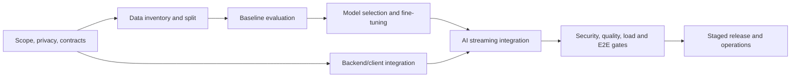

# 06. Project Management — Delivery Plan

## Purpose

Coordinate dependencies, ownership, estimates, milestones and risks across the STT workstreams. The dated plan and effort figures below are inherited planning material and **not approved commitments or actuals**.

## Scope and prerequisites

Coordinates phases 01–05. Before baseline scheduling, confirm staffing/capacity, product gates, corpus access, infrastructure availability and owners for AI, Backend, Frontend, QA, Security and Operations.

## Workstream ownership

| Workstream | Accountable scope | Reference |
|---|---|---|
| Product/Architecture | Scope, privacy policy, requirement priority, decision records and gate approval. | [Overview](../01-planning-design/overview.md), [requirements](../01-planning-design/requirements.md) |
| AI | Data pipeline, model evaluation/training, inference service and model quality. | [Data](../02-data-engineering/dataset-pipeline.md), [model development](../03-model-development/model-selection.md) |
| Backend | Authentication/meeting authorization, audio gateway, AI integration, event delivery, persistence/history. | [Backend ownership](../04-system-integration/backend-ownership.md) |
| Frontend | Capture lifecycle, meeting controls, transcript rendering and client recovery UX. | [Frontend ownership](../04-system-integration/frontend-ownership.md) |
| QA/Security | Requirement traceability, quality/security/load testing and release evidence. | [QA](../05-quality-delivery/quality-assurance.md) |
| Operations | Build/deploy, observability, capacity, migration coordination and rollback. | [Operations](../05-quality-delivery/operations.md) |

AI owns recognition decisions and model performance; Backend owns identity, authorization, transport orchestration and persistence; Frontend owns user consent/capture lifecycle and presentation. Shared interfaces require named reviewers from each affected workstream.

## Dependency sequence

Integration can proceed against versioned mock contracts while modeling continues, but model-dependent behavior and capacity remain provisional until measured.

## Milestones (proposed planning gates)

Earlier schedule listed the following dates; retain as a draft only pending re-baselining. Dates do not indicate completion.

| Milestone | Earlier date | Exit evidence |
|---|---:|---|
| M1 Dataset ready | 2026-11-27 | Reviewed manifests, data card, split isolation and data-policy sign-off. |
| M2 Baseline evaluated | 2026-12-04 | Reproducible candidate scorecard and model-selection decision. |
| M3 Fine-tuning validated | 2026-12-11 | Checkpoint/export evaluated against approved gates on held-out data. |
| M4 Attribution working | 2026-12-11 | Authenticated stream binding and security evidence. |
| M5 Core applications completed | 2026-12-16 | Contract-compatible backend/client flows integrated. |
| M6 Real-time transcription working | 2026-12-23 | End-to-end authorized streaming and final persistence demonstrated. |
| M7 Integration testing passed | 2026-12-30 | QA, security, load and resilience gates pass or approved exceptions exist. |
| M8 Production deployment | 2027-01-08 | Release approval, staging evidence, monitoring and rollback readiness. |

## Task register and original estimates

O/M/P are original optimistic/most-likely/pessimistic hour estimates. Expected effort uses `(O + 4M + P) / 6`; these estimates have not been revalidated. Status of all items in source planning was **To Do**; confirm current status with owners before using this register.

| ID | Task | Owner | O/M/P hours | Dependency |
|---|---|---|---:|---|
| AI-STT-001 | Dataset preparation and leak-free splits | AI | 12/18/28 | Data access/policy |
| AI-STT-002 | Candidate baseline and selection | AI | 10/16/26 | AI-STT-001 |
| AI-STT-003 | Fine-tuning and export | AI | 16/24/40 | AI-STT-001, 002 |
| BE-STT-001 | Persistence schema/migrations | Backend | 6/10/16 | Schema agreement |
| BE-STT-002 | Meeting lifecycle APIs/integration | Backend | 8/12/20 | BE-STT-001 or existing service |
| BE-STT-003 | Authenticated audio gateway | Backend | 12/18/28 | BE-STT-002, contract |
| BE-STT-004 | AI inference service/VAD | AI | 14/20/32 | Model/runtime decision |
| BE-STT-005 | Backend-to-AI forwarder | Backend | 10/16/24 | BE-STT-003, BE-STT-004 |
| BE-STT-006 | Transcript event delivery | Backend | 8/12/18 | BE-STT-005 |
| BE-STT-007 | Final persistence and history | Backend | 6/10/14 | BE-STT-001, BE-STT-006 |
| FE-STT-001 | Auth/session integration | Frontend | 10/14/22 | Existing identity flow |
| FE-STT-002 | Dashboard/create/join flow | Frontend | 8/12/18 | Meeting APIs |
| FE-STT-003 | Meeting room/control UX | Frontend | 12/16/26 | FE-STT-002 |
| FE-STT-004 | Audio capture/frame transport | Frontend | 12/18/28 | Contract/browser decision |
| FE-STT-005 | Live transcript and attribution UI | Frontend | 10/15/24 | FE-STT-004, event schema |
| FE-STT-006 | Network recovery/error UX | Frontend | 6/10/16 | Reconnect contract |
| QA-STT-001 | Audio streaming harness | QA | 8/12/18 | BE-STT-003 |
| QA-STT-002 | Concurrency/load testing | QA | 10/16/24 | Gateway and AI integration |
| QA-STT-003 | Attribution security tests | QA/Security | 6/10/16 | BE-STT-003, 006 |
| QA-STT-004 | Chunk boundary regression | QA/AI | 6/8/14 | AI streaming |
| QA-STT-005 | Network resilience tests | QA | 8/12/18 | Client recovery |
| QA-STT-006 | Multi-user E2E | QA | 12/18/28 | FE-STT-005, BE-STT-007 |
| OPS-STT-001 | GPU container/build setup | Operations | 8/12/20 | Runtime/model decision |
| OPS-STT-002 | Warmup and health probes | Operations/AI | 6/8/14 | OPS-STT-001 |
| OPS-STT-003 | Migration CI/CD process | Operations/Backend | 4/6/10 | BE-STT-001 |
| OPS-STT-004 | Telemetry/dashboards | Operations | 8/12/18 | Service metrics defined |
| OPS-STT-005 | Staging/release/rollback | Operations | 6/10/16 | QA gates, OPS-STT-001–004 |

The source timeline included a 6-week window, 7-person team and critical-path/person-hour calculations. These depend on unverified availability and estimates; re-calculate after owners validate task scope. Do not carry forward the prior aggregate hours as a commitment.

## Risk register

| Risk | Mitigation / contingency |
|---|---|
| Corpus lacks representative Egyptian Arabic/code-switch coverage | Audit coverage early; collect/label additional permitted material or revise supported scope. |
| Model misses quality/latency targets | Benchmark alternatives; profile end-to-end; adjust model/runtime or release scope based on evidence. |
| GPU capacity is insufficient | Load-test early; apply bounded admission/backpressure; size or scale infrastructure from measurements. |
| Chunking causes omissions/duplicates | Validate partial/final semantics and boundary regression against mixed-language references. |
| Browser capture formats vary | Define support matrix and test resampling/framing across actual devices. |
| Privacy/data access approval delays | Resolve provenance, consent and retention before corpus processing. |
| Dependency/runtime drift | Lock model/package/image versions and maintain reproducible artifact provenance. |

## Deliverables and acceptance criteria

Deliverables: owner-confirmed backlog, re-baselined milestones, decision log, risk/issue register, requirement traceability and gate evidence. Accept when every work item has a named owner/status; phase dependencies are reflected in schedule; dates/estimates are approved by responsible leads; and release readiness is based on evidence, not planned milestones.

## Tools and technologies

Markdown task register and Mermaid dependency diagram are used here. Project tracking system, meeting cadence, decision-record location and actual owner names are TBD.

## Open questions

Who approves product/privacy and model gates? Which dates and staffing remain current? Where are ADRs, test reports and artifact links stored? What is the external release authority and exception process?
