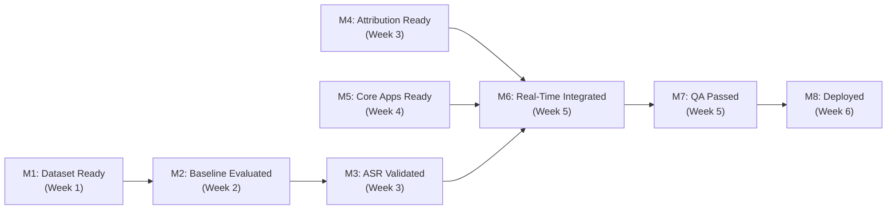

# Feature 01: Speech-to-Text, Speaker Diarization & Live Captions

**Turn live meeting conversations into speaker-attributed, synchronized, and searchable text.**

This directory contains the complete, implementation-ready engineering documentation and roadmap for **Feature 01: Speech-to-Text (ASR), Speaker Diarization, and Meeting Live Captions** for the AiraMeet platform.

---

## 1. Executive Summary

Feature 01 provides the core speech intelligence foundation for AiraMeet, enabling three complementary capabilities:
1. **Automatic Speech Recognition (ASR)**: Fine-tuned deep learning transcription supporting Egyptian Arabic (colloquial), English, and Arabic-English code-switching (including technical terms).
2. **Speaker Diarization**: Multi-speaker segmentation, turn detection, and timestamp synchronization to identify who spoke when.
3. **Meeting Live Captions (Optional)**: Real-time, progressive subtitle streaming rendering partial hypotheses and committed transcript segments directly in the meeting interface.

### Architectural Alignment
- **Frontend**: Angular 17+ (Standalone Components, Reactive Signals, Tailwind CSS, Web Audio API `AudioWorklet`).
- **Backend Core**: ASP.NET Core 8.0/9.0 Web API (Clean Architecture, EF Core 8, SQL Server, Redis, SignalR).
- **AI Intelligence**: Python 3.11+, PyTorch 2.2+, FastAPI, Whisper-Medium, CTranslate2 INT8, PyAnnote.audio 3.1, Silero VAD v5.
- **Inter-Service Transport**: gRPC over HTTP/2 (Backend $\leftrightarrow$ AI), WebSockets (Client $\rightarrow$ Backend audio capture), SignalR (Backend $\rightarrow$ Client live caption multicast).

---

## 2. Documentation Directory Map

Every document in this directory provides self-contained, actionable guidance for engineering execution without duplicated narratives.

| Subdirectory / Document | Purpose & Primary Contents | Owning Department |
| :--- | :--- | :--- |
| [**`01-planning-design/overview.md`**](01-planning-design/overview.md) | Feature vision, user outcomes, functional scope, boundaries, and governance. | Product & Architecture |
| [**`01-planning-design/requirements.md`**](01-planning-design/requirements.md) | Traceable Functional (FR-01–FR-12), Non-Functional (NFR-01–NFR-08) requirements, and edge cases. | Architecture & QA |
| [**`01-planning-design/system-architecture.md`**](01-planning-design/system-architecture.md) | End-to-end architecture diagrams, tier breakdowns, latency budget, and data flows. | System Architecture |
| [**`02-data-engineering/dataset-pipeline.md`**](02-data-engineering/dataset-pipeline.md) | Audio audit, Arabic/English normalization, code-switching protection, leak-free 80/10/10 split. | AI Engineering |
| [**`03-model-development/01-model-selection.md`**](03-model-development/01-model-selection.md) | ASR & Diarization benchmark evaluation matrix, trade-offs, and final selection ADR. | AI Engineering |
| [**`03-model-development/02-training-and-export.md`**](03-model-development/02-training-and-export.md) | Whisper fine-tuning lifecycle, hyperparameters, rolling checkpoints, CTranslate2 INT8 export. | AI Engineering |
| [**`03-model-development/03-speaker-diarization.md`**](03-model-development/03-speaker-diarization.md) | PyAnnote 3.1 setup, RTTM validation data, multi-speaker clustering, ASR timestamp alignment. | AI Engineering |
| [**`03-model-development/04-evaluation.md`**](03-model-development/04-evaluation.md) | WER/CER language benchmarks, RTF latency profiles, acceptance gates, and error taxonomy. | AI Engineering & QA |
| [**`04-system-integration/backend-ownership.md`**](04-system-integration/backend-ownership.md) | ASP.NET Core Clean Architecture, enterprise auth (Register, Login, 2FA, Password lifecycle, Email service, Room authorization), meeting management, audio gateway, persistence worker. | Backend Engineering |
| [**`04-system-integration/frontend-ownership.md`**](04-system-integration/frontend-ownership.md) | Angular 17+ components, AudioWorklet 16 kHz capture, SignalR caption component, RTL/LTR layout. | Frontend Engineering |
| [**`04-system-integration/speaker-attribution.md`**](04-system-integration/speaker-attribution.md) | Session-bound JWT identity binding vs acoustic diarization, anti-spoofing threat model. | Backend & Security |
| [**`04-system-integration/streaming-contract.md`**](04-system-integration/streaming-contract.md) | Protocol contracts: WebSocket binary PCM, gRPC Protobuf schema, SignalR JSON payloads. | Cross-Functional |
| [**`05-quality-delivery/operations.md`**](05-quality-delivery/operations.md) | AI folder structure, multi-stage GPU Dockerfile, Docker Compose, Prometheus telemetry, runbooks. | DevOps & AI |
| [**`05-quality-delivery/quality-assurance.md`**](05-quality-delivery/quality-assurance.md) | Audio streaming harness, 10-speaker load test, boundary regression, network drop recovery. | QA Engineering |
| [**`06-project-management/plan.md`**](06-project-management/plan.md) | Master WBS, PERT estimates, task dependencies, critical path, risk register, milestones M1–M8. | Project Management |

---

## 3. High-Level Delivery Milestones (M1 – M8)

| Gate | Title | Target Week | Exit Criteria |
| :--- | :--- | :---: | :--- |
| **M1** | **Dataset Ready** | Week 1 | Audio verified 16 kHz Mono; leak-free 80/10/10 split generated; code-switching preserved. |
| **M2** | **Baseline Evaluated** | Week 2 | Zero-shot Whisper-Medium benchmarked on test split; baseline scorecard logged. |
| **M3** | **Fine-Tuned ASR Validated** | Week 3 | Fine-tuned Whisper achieves $\ge 15\%$ relative WER drop over baseline; CTranslate2 export ready. |
| **M4** | **Attribution Gateway Ready**| Week 3 | ASP.NET Core gateway binds streams to verified JWT; client identity spoofing rejected. |
| **M5** | **Core Apps Ready** | Week 4 | Angular AudioWorklet captures 16 kHz PCM; meeting lifecycle and controls operational. |
| **M6** | **Real-Time Pipeline Working**| Week 5 | Speech to caption visible latency $\le 3.0\text{s}$; partial/final updates correctly rendered. |
| **M7** | **QA & Stress Testing Passed**| Week 5 | 10 concurrent streams tested; network disconnect recovery verified with zero duplicate words. |
| **M8** | **Production Deployed** | Week 6 | Multi-container GPU stack active in staging; health probes passing; monitoring enabled. |
