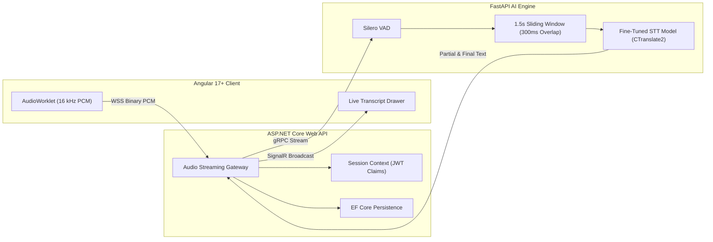

# Feature 01: Speech-to-Text & Speaker Attribution

## 1. Feature Mission & Hub

Welcome to the central engineering documentation for **Feature 01: Speech-to-Text & Speaker Attribution**. This feature delivers real-time deep learning transcription of multi-party meeting audio and deterministically attributes spoken utterances to authenticated participants.

---

## 2. Documentation Directory Index

| Document | Primary Focus | Key Stakeholders |
| :--- | :--- | :--- |
| [feature-overview.md](file:///home/abdelrahmanelhelbawy/Projects/AiraMeet/docs/03-features/01-speech-to-text/feature-overview.md) | Feature objectives, business value, user personas, and architecture. | All Engineers, Architects, PMs |
| [requirements.md](file:///home/abdelrahmanelhelbawy/Projects/AiraMeet/docs/03-features/01-speech-to-text/requirements.md) | Functional, non-functional, latency, and edge case specifications. | QA, Backend, Frontend, AI |
| [dataset-preparation.md](file:///home/abdelrahmanelhelbawy/Projects/AiraMeet/docs/03-features/01-speech-to-text/dataset-preparation.md) | Data cleaning, audio normalization, and leak-free split pipelines. | AI Research Engineers |
| [model-selection.md](file:///home/abdelrahmanelhelbawy/Projects/AiraMeet/docs/03-features/01-speech-to-text/model-selection.md) | Comparative analysis: Whisper vs. Wav2Vec 2.0 vs. NeMo Conformer. | AI Research Engineers, Architects |
| [model-training.md](file:///home/abdelrahmanelhelbawy/Projects/AiraMeet/docs/03-features/01-speech-to-text/model-training.md) | Fine-tuning pipelines, hyperparameters, checkpointing, and export. | AI Research & MLOps Engineers |
| [model-evaluation.md](file:///home/abdelrahmanelhelbawy/Projects/AiraMeet/docs/03-features/01-speech-to-text/model-evaluation.md) | WER/CER benchmarks, latency profiling, and acceptance gates. | AI Engineers, QA Specialists |
| [speaker-identification.md](file:///home/abdelrahmanelhelbawy/Projects/AiraMeet/docs/03-features/01-speech-to-text/speaker-identification.md) | Session-bound attribution vs. acoustic diarization comparison. | Backend & Security Architects |
| [real-time-transcription.md](file:///home/abdelrahmanelhelbawy/Projects/AiraMeet/docs/03-features/01-speech-to-text/real-time-transcription.md) | Prototype (Approach A) vs. Target Streaming Architecture (Approach B). | Full-Stack & AI Engineers |
| [backend-tasks.md](file:///home/abdelrahmanelhelbawy/Projects/AiraMeet/docs/03-features/01-speech-to-text/backend-tasks.md) | Work Breakdown Structure & PERT estimates for ASP.NET Core & FastAPI. | Backend Engineers |
| [frontend-tasks.md](file:///home/abdelrahmanelhelbawy/Projects/AiraMeet/docs/03-features/01-speech-to-text/frontend-tasks.md) | Work Breakdown Structure & PERT estimates for Angular 17+ client. | Frontend Engineers |
| [testing.md](file:///home/abdelrahmanelhelbawy/Projects/AiraMeet/docs/03-features/01-speech-to-text/testing.md) | Test catalog, streaming stress harness, and verification suites. | QA Engineers, Test Automation |
| [deployment.md](file:///home/abdelrahmanelhelbawy/Projects/AiraMeet/docs/03-features/01-speech-to-text/deployment.md) | GPU containerization, Docker configurations, and operational runbooks. | DevOps & Platform Engineers |
| [timeline.md](file:///home/abdelrahmanelhelbawy/Projects/AiraMeet/docs/03-features/01-speech-to-text/timeline.md) | 6-week schedule, milestone commitments (M1-M8), and critical path. | Project Managers & Team Leads |

---

## 3. Quick Architecture Overview

---

## 4. Key Architectural Decisions (ADR Summary)

1. **Deterministic Session Attribution (No AI Diarization in MVP)**:
   - Spoken audio is ingested on dedicated per-participant WebSocket streams authenticated via the participant's JWT.
   - The backend server associates the audio stream with the authenticated `ApplicationUser.Id`.
   - Acoustic diarization is unnecessary for single-source digital streams and eliminates heavy computational overhead.
2. **Dual-Track Audio Strategy**:
   - WebRTC SFU handles interactive conferencing audio/video.
   - A parallel uncompressed 16 kHz mono PCM track is captured via `AudioWorklet` and streamed to the backend for AI transcription.
3. **Sliding Window with Overlap Deduplication**:
   - Audio is buffered in 1.5-second chunks with 300ms overlap.
   - Algorithmic prefix string alignment prevents duplicated words across chunk boundaries.
