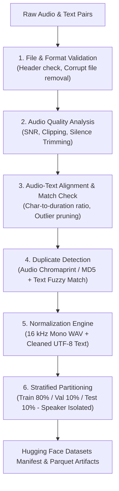

# Phase 1: Dataset Preparation & Validation Pipeline

## 1. Overview & Dataset Governance

AiraMeet possesses an existing corpus of paired meeting audio recordings and their verbatim text transcriptions. Before training or fine-tuning any deep learning acoustic model, this raw corpus must undergo a rigorous, automated, and reproducible **Dataset Preparation Pipeline**.

The primary objectives of Phase 1 are:
1. Guaranteeing acoustic integrity (sample rate, bit depth, SNR, lack of clipping).
2. Verifying precise temporal alignment between speech audio and transcript text.
3. Eliminating corrupted files, silence outliers, and duplicate recordings.
4. Implementing a leak-free partition into **Train (80%)**, **Validation (10%)**, and **Test (10%)** sets with **strict speaker isolation**.



---

## 2. Audio Quality & Format Validation

### 2.1 Corrupted Audio Detection
Audio files can suffer from truncated payloads, malformed RIFF/WAV headers, or unsupported codec compression. The pipeline validates readability using `soundfile` and `torchaudio`. If an audio file fails to decode completely to an EOF marker, it is immediately quarantined.

### 2.2 Audio Normalization Standard
All accepted audio files are converted to the unified project acoustic standard:
- **Encoding**: Linear PCM 16-bit Signed Integer (`pcm_s16le`).
- **Channels**: 1 (Single-channel Mono; stereo channels downmixed via $(L + R) / 2$).
- **Sample Rate**: **16,000 Hz (16 kHz)** (standard for Whisper, Wav2Vec 2.0, and NeMo).
- **Target Peak Loudness**: Normalized to **-20 dBFS** to prevent clipping and amplifier saturation.

### 2.3 Acoustic Quality Metrics
- **Signal-to-Noise Ratio (SNR)**: Calculated via WADA-SNR or energy-based voice/silence segmentation. Samples with $\text{SNR} < 8\text{ dB}$ are flagged for review or dropped.
- **Clipping Rate**: Samples exhibiting more than 0.5% samples at maximum amplitude ($|s| \ge 0.999$) are pruned.
- **Leading / Trailing Silence**: Trimmed using energy-based thresholding (frames below -45 dBFS trimmed, leaving a 100ms padding envelope).

---

## 3. Audio-Text Matching & Alignment Validation

To prevent model divergence, the pairing between audio length and transcript character count must follow natural human speech cadences:
1. **Duration Bounds**:
   - Minimum utterance duration: **1.0 second** (shorter segments often lack acoustic context).
   - Maximum utterance duration: **20.0 seconds** (longer segments exceed attention windows).
2. **Character-to-Duration Ratio**:
   - Spoken English/Arabic typically ranges between **8 to 22 characters per second**.
   - Utterances with $< 3\text{ char/sec}$ (long silence with single word) or $> 35\text{ char/sec}$ (mismatched long transcript on short audio) are discarded.
3. **Alignment Validation**:
   - Pre-trained alignment models (CTC forced aligner via `torchaudio.pipelines.MMS_FA`) verify that transcript words temporally map within the audio boundaries.

---

## 4. Duplicate Detection

Duplicates in training and evaluation data distort validation metrics and waste GPU compute. AiraMeet employs a dual duplicate detection strategy:
1. **Audio De-duplication**: Computes acoustic fingerprints using **Chromaprint / AcoustID** and raw hash comparison. Recordings sharing $\ge 98\%$ acoustic similarity are flagged.
2. **Text De-duplication**: Computes normalized Levenshtein string similarity across transcript strings. Identical sentences from the same speaker recorded in duplicate sessions are isolated.

---

## 5. Text Cleaning & Linguistic Normalization

Speech models are sensitive to casing, punctuation, and non-standard words. The pipeline applies standard linguistic normalization rules:
- **Unicode Normalization**: Convert all text to standard Unicode `NFC` format.
- **Whitespace Collapsing**: Replace tabs, newlines, and multi-spaces with single spaces; strip leading/trailing whitespace.
- **Number Expansion**: Convert digits into verbal forms (e.g., `"42"` $\rightarrow$ `"forty-two"` or `"اثنان وأربعون"` for Arabic).
- **Arabic Text Normalization (For Multilingual / Arabic Speech)**:
  - Normalize Hamzas: `أ, إ, آ` $\rightarrow$ `ا`.
  - Normalize Taa Marbuta: `ة` $\rightarrow$ `ه`.
  - Normalize Alif Maqsura: `ى` $\rightarrow$ `ي`.
  - Strip Arabic Tashkeel / Harakat (diacritics: Fatha, Damma, Kasra, Sukun, Tanwin).
- **Punctuation Filtering**: Filter non-grammatical symbols (`@`, `#`, `$`, `%`, `*`, `~`) while preserving sentence-ending punctuation (`.`, `,`, `?`) when punctuation-aware training is enabled.

---

## 6. Dataset Partitioning & Zero Data Leakage Standard

> [!CAUTION]
> **Zero Data Leakage Rule**: The Test dataset must remain completely independent of the Training dataset. Under NO circumstances may audio from the same speaker appear in both the training set and the test set.

### Partitioning Strategy
- **Train Set (80%)**: Used for model weight optimization.
- **Validation Set (10%)**: Used for checkpoint selection, learning rate decay, and early stopping.
- **Test Set (10%)**: Held-out unseen benchmark set used solely for final milestone evaluation (M2, M3).

### Stratified Speaker Isolation
Splitting is conducted at the **Speaker ID level**, not at the utterance level:
1. Calculate total audio duration per speaker.
2. Stratify speakers across Train, Validation, and Test partitions such that the target 80/10/10 duration ratio is satisfied.
3. Ensure balanced gender, accent, and acoustic environment distributions across all three partitions.

---

## 7. Dataset Statistics & Distribution Schema

Upon execution, the preparation pipeline generates a statistical manifest (`dataset_stats.json`):

```json
{
  "total_samples_raw": 14250,
  "total_samples_accepted": 12890,
  "pruned_samples": {
    "corrupted_header": 42,
    "low_snr": 310,
    "audio_text_mismatch": 485,
    "duplicates": 523
  },
  "total_audio_hours": 38.5,
  "average_utterance_duration_sec": 4.82,
  "total_unique_speakers": 64,
  "vocabulary_size": 8420,
  "splits": {
    "train": { "samples": 10312, "hours": 30.8, "speakers": 51 },
    "validation": { "samples": 1289, "hours": 3.85, "speakers": 6 },
    "test": { "samples": 1289, "hours": 3.85, "speakers": 7 }
  }
}
```

---

## 8. Reproducible Preparation Pipeline Script

The pipeline is implemented as a standalone, reproducible CLI script located at `ai-services/scripts/prepare_dataset.py`:

```python
"""
AiraMeet Dataset Preparation & Validation Pipeline
Usage:
    python prepare_dataset.py \
        --raw_audio_dir /data/raw/audio \
        --raw_transcripts /data/raw/transcripts.jsonl \
        --output_dir /data/processed/splits
"""

import os
import re
import json
import logging
import argparse
from pathlib import Path
import soundfile as sf
import librosa
import numpy as np
import pandas as pd
from sklearn.model_selection import GroupShuffleSplit

logging.basicConfig(level=logging.INFO, format="%(asctime)s [%(levelname)s] %(message)s")
logger = logging.getLogger("DatasetPrep")

def normalize_text(text: str) -> str:
    """Cleans and standardizes transcript text."""
    text = text.strip()
    text = re.sub(r"\s+", " ", text)
    # Remove prohibited symbols while keeping alphanumerics and basic punctuation
    text = re.sub(r"[^\w\s\.\,\?\']", "", text)
    return text.strip()

def validate_and_resample_audio(file_path: Path, target_sr=16000) -> tuple[np.ndarray, bool]:
    """Validates audio file and resamples to 16 kHz mono PCM."""
    try:
        # soundfile test read
        audio, sr = librosa.load(str(file_path), sr=target_sr, mono=True)
        # Check for NaN / Inf
        if not np.isfinite(audio).all():
            return None, False
        # Normalize volume
        max_val = np.max(np.abs(audio))
        if max_val > 0:
            audio = audio / max_val * 0.95
        return audio, True
    except Exception as e:
        logger.warning(f"Corrupted audio file {file_path}: {e}")
        return None, False

def run_pipeline(audio_dir: str, transcript_file: str, output_dir: str):
    logger.info("Initializing AiraMeet Dataset Preparation Pipeline...")
    out_path = Path(output_dir)
    out_path.mkdir(parents=True, exist_ok=True)
    
    # Load raw manifest
    with open(transcript_file, "r", encoding="utf-8") as f:
        records = [json.loads(line) for line in f]
    
    validated_records = []
    logger.info(f"Loaded {len(records)} raw transcript records. Beginning acoustic validation...")

    for item in records:
        audio_file = Path(audio_dir) / item["audio_filename"]
        if not audio_file.exists():
            continue
            
        audio, is_valid = validate_and_resample_audio(audio_file)
        if not is_valid:
            continue
            
        duration = len(audio) / 16000.0
        if duration < 1.0 or duration > 20.0:
            continue
            
        cleaned_text = normalize_text(item["text"])
        char_rate = len(cleaned_text) / duration
        if char_rate < 3.0 or char_rate > 35.0:
            continue

        # Save normalized WAV
        target_wav = out_path / "wavs" / item["audio_filename"]
        target_wav.parent.mkdir(parents=True, exist_ok=True)
        sf.write(str(target_wav), audio, 16000, subtype="PCM_16")

        validated_records.append({
            "audio_path": str(target_wav),
            "text": cleaned_text,
            "speaker_id": item.get("speaker_id", "unknown"),
            "duration": duration
        })

    logger.info(f"Validation complete: {len(validated_records)} accepted samples.")
    df = pd.DataFrame(validated_records)

    # Perform Leak-Free Speaker Stratified Splitting (80/10/10)
    gss = GroupShuffleSplit(n_splits=1, train_size=0.8, random_state=42)
    train_idx, temp_idx = next(gss.split(df, groups=df["speaker_id"]))
    
    train_df = df.iloc[train_idx]
    temp_df = df.iloc[temp_idx]

    gss_val = GroupShuffleSplit(n_splits=1, train_size=0.5, random_state=42)
    val_idx, test_idx = next(gss_val.split(temp_df, groups=temp_df["speaker_id"]))
    
    val_df = temp_df.iloc[val_idx]
    test_df = temp_df.iloc[test_idx]

    # Save Split Manifests
    train_df.to_json(out_path / "train.jsonl", orient="records", lines=True)
    val_df.to_json(out_path / "validation.jsonl", orient="records", lines=True)
    test_df.to_json(out_path / "test.jsonl", orient="records", lines=True)
    
    logger.info("Dataset Preparation Successfully Finished.")
    logger.info(f"Train: {len(train_df)} | Val: {len(val_df)} | Test: {len(test_df)}")

if __name__ == "__main__":
    parser = argparse.ArgumentParser()
    parser.add_argument("--raw_audio_dir", required=True)
    parser.add_argument("--raw_transcripts", required=True)
    parser.add_argument("--output_dir", required=True)
    args = parser.parse_args()
    run_pipeline(args.raw_audio_dir, args.raw_transcripts, args.output_dir)
```

---

## 9. Task Specification: `AI-STT-001`

### `AI-STT-001`: Dataset Inspection, Cleaning & Leak-Free Splitting
- **Task ID**: `AI-STT-001`
- **Task Name**: Implement Dataset Preparation & Validation Pipeline
- **Description**: Inspect existing paired audio-transcript recordings, validate acoustic parameters (SNR, clipping, silence envelope), eliminate corrupted and duplicate files, normalize audio to 16 kHz Mono WAV and clean text, and perform stratified 80/10/10 split with strict speaker isolation to prevent data leakage.
- **Priority**: Critical
- **Responsible Department**: AI & Machine Learning
- **Dependencies**: None
- **Implementation Steps**:
  1. Inspect raw dataset directory structure and format compliance.
  2. Implement corrupted audio detection and audio-text length ratio validation.
  3. Implement audio normalization pipeline (16 kHz, mono, 16-bit PCM WAV, -20 dBFS).
  4. Implement linguistic text normalization (Unicode NFC, whitespace, digits, punctuation, Arabic normalization).
  5. Perform speaker-grouped stratified train/val/test split (80/10/10).
  6. Generate statistical dataset manifest (`dataset_stats.json`).
- **Time Estimates**:
  - Optimistic ($O$): 12h
  - Most Likely ($M$): 18h
  - Pessimistic ($P$): 28h
  - Expected ($E$): $\frac{12 + 4(18) + 28}{6} = 18.67\text{h}$
  - Risk Buffer: 3.0h
- **Acceptance Criteria**: Pipeline runs idempotently; produces clean splits with 0% speaker overlap between Train and Test; all audio conforms to 16 kHz mono WAV.
- **Deliverable**: `ai-services/scripts/prepare_dataset.py`, split manifest files, and statistical report.
- **Status**: `To Do`
