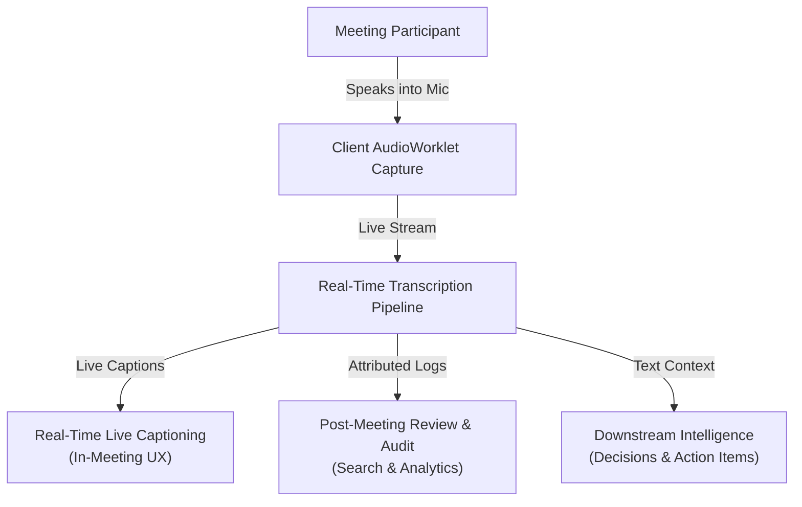

# Feature Overview: Speech-to-Text & Speaker Attribution

## 1. Executive Summary

The **Speech-to-Text & Speaker Attribution** feature is the cornerstone intelligence capability of AiraMeet. It converts spoken audio streams from multi-party virtual meetings into synchronized, timestamped, and speaker-attributed text transcripts in real time. 

By capturing each participant's audio stream directly at the client and routing it through authenticated backend gateways to an optimized deep learning inference engine, AiraMeet delivers live transcriptions with visible latency under 3 seconds while deterministically attributing each utterance to the verified participant.

---

## 2. Business Objectives & Strategic Impact

1. **Foundational Layer for Downstream AI**: All subsequent AiraMeet AI features (Decision Extraction, Action Item Detection, Knowledge Graph construction, and Semantic Search) rely directly on the accuracy, timeliness, and speaker attribution of this feature.
2. **Accessibility & Clarity**: Provides real-time live captions for team members who are hard of hearing or participating in noisy environments.
3. **Auditability & Legal Record**: Creates a verifiable, permanent meeting transcript where every statement is cryptographically tied to an authenticated meeting attendee and millisecond-accurate timestamp.
4. **Meeting Inclusivity**: Facilitates cross-functional collaboration across multilingual teams and diverse accents.

---

## 3. User Personas & Use Cases

### Persona 1: Meeting Attendee / Software Developer
- **Scenario**: Attending a rapid architecture planning meeting.
- **Pain Point**: Missing complex variable names or rapid-fire design agreements while taking manual notes.
- **Outcome**: Follows the live transcript drawer on screen; sees exactly who made specific statements in real time.

### Persona 2: Project Manager / Scrum Master
- **Scenario**: Reviewing a sprint retrospective or backlog grooming session.
- **Pain Point**: Spending 30–45 minutes drafting meeting minutes and verifying task assignments.
- **Outcome**: Accesses the completed meeting transcript immediately upon room closure, filtered by speaker.

### Persona 3: Compliance & Security Officer
- **Scenario**: Auditing organizational governance and verbal agreements.
- **Pain Point**: Inability to verify who verbally authorized a critical production change.
- **Outcome**: Queries SQL Server transcript records with authenticated user IDs and verified timestamps.

---

## 4. End-to-End Conceptual Flow

1. **Authentication**: The participant logs into AiraMeet, receiving an authenticated JWT token containing their unique `sub` (`UserId`).
2. **Room Admission**: The participant joins an active meeting room (`MeetingId`).
3. **Audio Capture**: The browser's Web Audio API taps the local microphone track via an `AudioWorkletProcessor`, downsampling the raw audio to 16 kHz 16-bit linear PCM.
4. **Secure Ingestion**: The client opens an authenticated WebSocket connection to `/ws/meetings/{meetingId}/audio-stream`. The ASP.NET Core backend validates the JWT and creates an in-memory session pipeline binding the audio stream directly to `UserId`.
5. **VAD & Buffering**: The incoming audio is buffered in a 1.5-second sliding window with 300ms overlap. Non-speech frames are discarded by Silero Voice Activity Detection.
6. **Inference**: The buffered audio chunk is passed to the optimized STT model (FastAPI worker with CTranslate2 / PyTorch).
7. **Deduplication**: The emitted tokens are compared against the prior chunk's trailing words using longest common substring alignment to eliminate duplicates.
8. **Live Broadcast**: The ASP.NET Core SignalR hub broadcasts the recognized text (partial and final) to all meeting attendees.
9. **Persistence**: When a segment is finalized (`is_final = true`), the backend writes the `TranscriptSegment` to Microsoft SQL Server.

---

## 5. Architectural Boundaries & Dependencies

- **Depends On**:
  - ASP.NET Core Identity & JWT Authentication (`AiraMeet.Infrastructure`).
  - Meeting Room lifecycle management (`MeetingController`, `MeetingParticipant`).
  - Client microphone access (`navigator.mediaDevices.getUserMedia`).
  - Dedicated GPU compute instance for inference.
- **Required By**:
  - Feature 02: Meeting Timeline & Decision Extraction.
  - Feature 03: Task & Action Item Follow-up Engine.
  - Feature 04: AI Copilot with Evidence.
