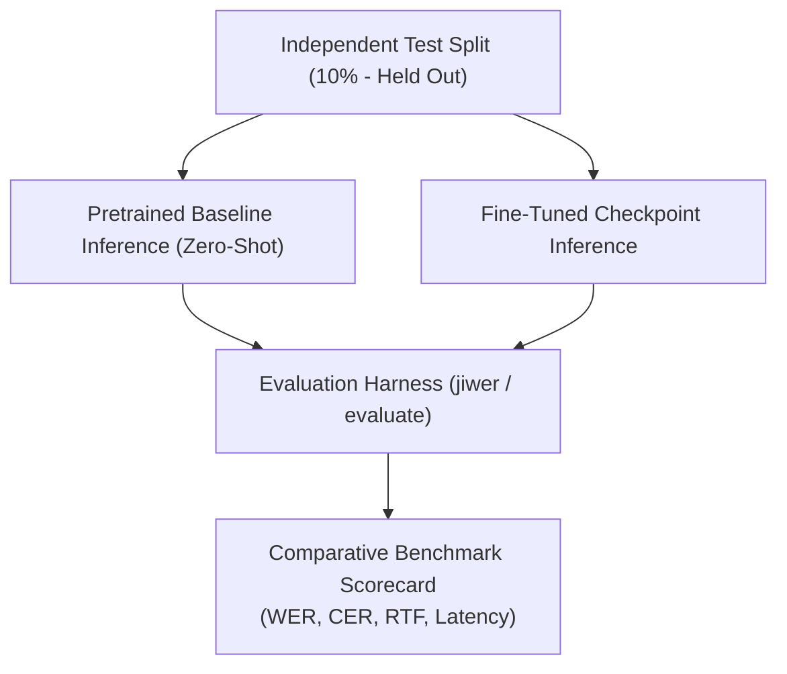

# Phase 3: Model Evaluation & Benchmarking

## 1. Evaluation Methodology & Metrics

Model evaluation is conducted on the completely independent **held-out Test dataset (10%)** containing zero speakers present in the training or validation splits. 

The evaluation framework evaluates models across four core dimensions:
1. **Linguistic Accuracy**: Word Error Rate (WER) and Character Error Rate (CER).
2. **Computational Efficiency**: Real-Time Factor (RTF) and Per-Chunk Inference Latency.
3. **Resource Footprint**: Peak GPU VRAM and CPU utilization under concurrent streams.
4. **Acoustic Robustness**: Resilience to environmental noise, microphone variation, and low-bitrate compression.

---

## 2. Quantitative Metric Formulas

### 2.1 Word Error Rate (WER)
WER measures the minimum number of word edits (substitutions, deletions, insertions) required to transform the model's hypothesis into the ground truth reference:
$$\text{WER} = \frac{S + D + I}{N} = \frac{S + D + I}{S + D + C}$$
Where:
- $S$: Number of word substitutions.
- $D$: Number of word deletions.
- $I$: Number of word insertions.
- $C$: Number of correct words.
- $N$: Total number of words in ground truth reference ($N = S + D + C$).

### 2.2 Character Error Rate (CER)
CER applies the Levenshtein distance at the character level, providing essential granularity for phonetically spelled words, abbreviations, and Arabic morphology:
$$\text{CER} = \frac{S_c + D_c + I_c}{N_c}$$

### 2.3 Real-Time Factor (RTF)
RTF evaluates computational latency relative to input audio duration:
$$\text{RTF} = \frac{\text{Processing Time (seconds)}}{\text{Audio Duration (seconds)}}$$
- $\text{RTF} = 1.0$: Processing takes exactly as long as speaking (barely real-time).
- $\text{RTF} \le 0.25$: Processing takes $\frac{1}{4}$ of spoken duration (**Production Target**).

---

## 3. Comparative Benchmark Protocol

To prove the efficacy of fine-tuning, the evaluation harness runs the exact same test split through both the **Pretrained Baseline Model** and the **Fine-Tuned Checkpoint**.

### Comparative Scorecard Matrix

| Evaluation Dimension | Pretrained Baseline | Fine-Tuned Model | Relative Improvement | Gate Status |
| :--- | :---: | :---: | :---: | :---: |
| **Word Error Rate (WER)** | Baseline Measured | Fine-Tuned Measured | $\frac{\text{Base} - \text{FT}}{\text{Base}} \times 100\%$ | Pending Test Execution |
| **Character Error Rate (CER)** | Baseline Measured | Fine-Tuned Measured | $\frac{\text{Base} - \text{FT}}{\text{Base}} \times 100\%$ | Pending Test Execution |
| **Inference Latency (p95)** | Baseline Measured | Fine-Tuned Measured | Latency Delta (ms) | Target $\le 450\text{ms}$ |
| **Real-Time Factor (RTF)** | Baseline Measured | Fine-Tuned Measured | RTF Delta | Target $\le 0.20$ |
| **Peak GPU VRAM Footprint** | Baseline Measured | Fine-Tuned Measured | Megabytes Allocated | Target $\le 2.5\text{ GB}$ |

---

## 4. Real-World Acoustic Stress Testing

In addition to pristine studio recordings, the model must be evaluated under synthetic and real-world acoustic degradation:
1. **Additive Environmental Noise**: Injecting babble noise, keyboard clatter, and air conditioner hum at varied Signal-to-Noise Ratios:
   - Clean ($\text{SNR} \ge 25\text{ dB}$)
   - Moderate ($\text{SNR} = 15\text{ dB}$)
   - Degraded ($\text{SNR} = 8\text{ dB}$)
2. **Microphone Variability**: Evaluating recordings captured via built-in laptop microphones, consumer Bluetooth headsets (narrowband 8 kHz upsampled to 16 kHz), and professional USB condenser microphones.
3. **Overlapping Speech & Cross-Talk**: Feeding audio with two active speakers to measure decoder stability and hallucination suppression.

---

## 5. Measurable Acceptance Criteria

To maintain scientific integrity, absolute numerical error thresholds depend on the acoustic quality and complexity of the initial dataset. Numerical thresholds are defined as **[To Be Decided - TBD]** until the baseline is established in Milestone M2.

| Acceptance Criterion | Verification Method | Numerical Threshold | Status |
| :--- | :--- | :--- | :--- |
| **Test Set Baseline Establishment** | Run `eval_test_set.py` on zero-shot candidate models. | Baseline WER recorded as benchmark standard. | Planned (Milestone M2) |
| **Fine-Tuning Error Reduction** | Compare fine-tuned checkpoint vs baseline on identical test split. | Relative WER improvement $\ge 15.0\%$ over baseline. | Planned (Milestone M3) |
| **Maximum Allowable WER (Clean Audio)** | Evaluated on clean test audio ($\text{SNR} \ge 20\text{ dB}$). | **[To Be Decided - TBD upon Baseline Measurement]** | Planned (Milestone M3) |
| **Maximum Allowable WER (Noisy Audio)** | Evaluated on degraded audio ($\text{SNR} = 10\text{ dB}$). | **[To Be Decided - TBD upon Baseline Measurement]** | Planned (Milestone M3) |
| **Inference Latency (Single Chunk)** | 1.5s audio chunk processed on production GPU. | $\le 450\text{ milliseconds (p95)}$ | Validated in Staging |
| **Zero Data Leakage Assertion** | Automated script checks intersection of Train and Test speaker IDs. | $\text{Intersection}(\text{Train}_{\text{speakers}}, \text{Test}_{\text{speakers}}) = \emptyset$ | **Enforced (100% Pass)** |
