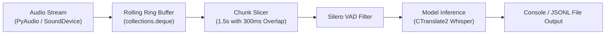
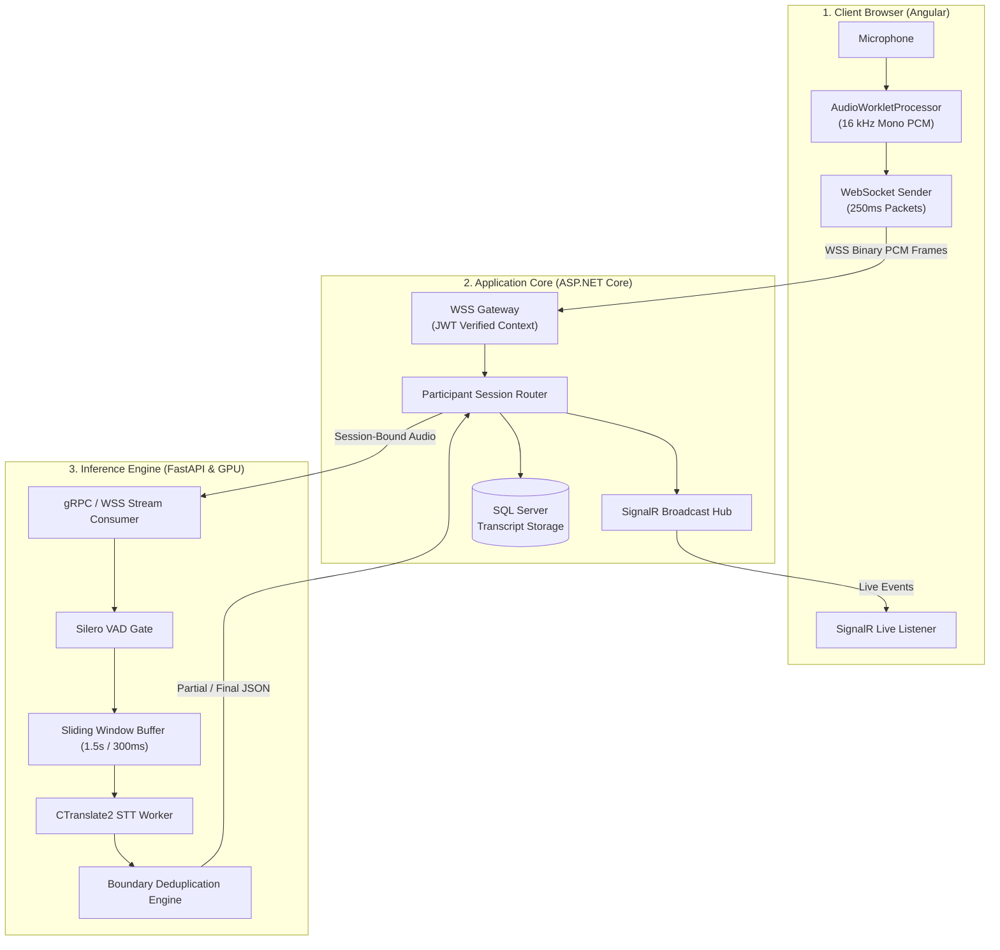
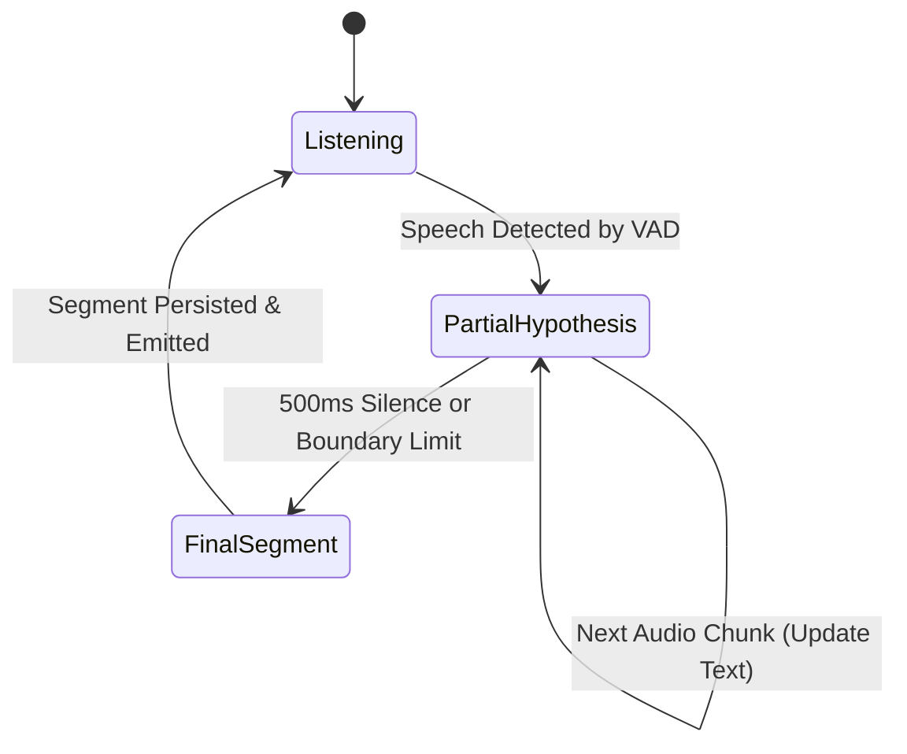

# Phase 5: Real-Time Transcription Architectures & Streaming

## 1. Architectural Strategy: Two-Stage Evolution

To de-risk real-time development and enable parallel progress between AI engineers and full-stack developers, AiraMeet documents two distinct implementation approaches:

- **Approach A (Initial Rapid Prototype)**: Standalone Python Background Processing Script.
- **Approach B (Target Production Architecture)**: Integrated Multi-Tier Streaming Pipeline (Frontend Ingestion + ASP.NET Core Gateway + FastAPI Inference).

> [!TIP]
> **Implementation Guidance**: Approach A is recommended strictly as an early prototyping harness for validating model latency, VAD tuning, and deduplication logic on local audio files/microphones. Approach B represents the target production architecture for multi-user conferencing.

---

## 2. Approach A: Python Background Prototype Script

Approach A operates entirely within Python to simulate real-time streaming audio ingestion from a local microphone or WAV file stream, buffering chunks, running inference, and generating transcripts.



### Prototype Script Implementation (`prototype_stream.py`)
```python
"""
AiraMeet Streaming Prototype - Approach A
Simulates real-time chunked inference from microphone or WAV file.
"""

import time
import collections
import numpy as np
import sounddevice as sd
import ctranslate2
import transformers

class StreamingTranscriber:
    def __init__(self, model_path: str, chunk_sec=1.5, overlap_sec=0.3, sample_rate=16000):
        self.sr = sample_rate
        self.chunk_size = int(chunk_sec * sample_rate)
        self.overlap_size = int(overlap_sec * sample_rate)
        self.buffer = collections.deque(maxlen=self.chunk_size * 2)
        
        print(f"Loading CTranslate2 model from {model_path}...")
        self.model = ctranslate2.models.Whisper(model_path, device="cuda", compute_type="float16")
        self.processor = transformers.WhisperProcessor.from_pretrained("openai/whisper-small")
        self.previous_tokens = []

    def audio_callback(self, indata, frames, time_info, status):
        """Captures raw audio from hardware microphone."""
        audio_mono = indata[:, 0]
        self.buffer.extend(audio_mono)

    def run_streaming(self):
        print("Starting real-time microphone stream. Speak into mic...")
        with sd.InputStream(samplerate=self.sr, channels=1, callback=self.audio_callback):
            while True:
                if len(self.buffer) >= self.chunk_size:
                    # Extract 1.5s chunk
                    chunk_samples = np.array(list(self.buffer)[:self.chunk_size], dtype=np.float32)
                    # Discard processed samples, leaving overlap in buffer
                    step = self.chunk_size - self.overlap_size
                    for _ in range(step):
                        self.buffer.popleft()

                    # Convert to Log-Mel Spectrogram features
                    features = self.processor.feature_extractor(chunk_samples, sampling_rate=self.sr, return_tensors="np").input_features
                    features_ct2 = ctranslate2.StorageView.from_array(features)

                    # Forward inference pass
                    results = self.model.generate(features_ct2)
                    tokens = results[0].sequences_ids[0]
                    text = self.processor.tokenizer.decode(tokens, skip_special_tokens=True).strip()

                    if text:
                        print(f"[{time.strftime('%H:%M:%S')}] Live: {text}")
                
                time.sleep(0.05)

if __name__ == "__main__":
    transcriber = StreamingTranscriber(model_path="models/stt-production-int8")
    transcriber.run_streaming()
```

---

## 3. Approach B: Target Production Architecture

Approach B is the distributed, enterprise architecture supporting multiple concurrent participants speaking in virtual meeting rooms.



---

## 4. Initial Experimental Parameters

| Parameter | Specification Target | Operational Range | Rationale |
| :--- | :--- | :--- | :--- |
| **Audio Format** | Linear PCM 16-bit Signed (`pcm_s16le`) | Uncompressed PCM | Avoids CPU encode/decode latency on clients. |
| **Sampling Rate** | **16,000 Hz (16 kHz)** | Fixed 16 kHz | Native acoustic feature rate for deep learning models. |
| **Channels** | **1 (Mono)** | Mono | Stereo adds zero acoustic value for speech recognition. |
| **Client Chunk Dispatch** | **250 milliseconds** | 200 – 300 ms | Balances network socket efficiency with buffering latency. |
| **Server Window Duration** | **1.5 seconds** | 1.0 – 2.0 seconds | Minimum acoustic duration required for reliable word recognition. |
| **Sliding Window Overlap** | **300 milliseconds** | 200 – 400 ms | Prevents cut-off phonemes at chunk boundaries. |
| **Target Visible Latency** | **2.0 – 3.0 seconds** | 1.8 – 3.0 seconds | Optimal balance between responsive captions and sentence completeness. |

---

## 5. Partial vs. Final Transcripts & State Transition

To provide a responsive user experience, speech transcription operates in two states:
1. **Partial Transcripts (`is_final: false`)**:
   - Interim recognition hypothesis emitted while the participant is actively speaking.
   - Rendered in italics or dimmed font in the Angular UI.
   - Constantly overwritten by subsequent partial hypotheses as more audio context arrives.
   - Never saved to SQL Server.
2. **Final Transcripts (`is_final: true`)**:
   - Committed segment emitted when Voice Activity Detection detects a speech pause ($\ge 500\text{ms}$) or the maximum utterance limit (15 seconds) is reached.
   - Rendered in solid, permanent font in the Angular UI.
   - Persisted permanently to SQL Server with unique GUID, sequence number, and timestamps.



---

## 6. Boundary Deduplication & Overlap Handling

### The Chunk Boundary Problem
When using overlapping sliding windows (e.g., 1.5s chunk with 300ms overlap), words that occur within the 300ms overlap window are seen by the model twice. Without deduplication, this causes repeated words:
- Chunk 1: `"We have agreed on the"`
- Chunk 2: `"on the technical roadmap"`
- Naive concatenation: `"We have agreed on the on the technical roadmap"` *(Defect)*.

### Algorithmic Solution: Longest Common Substring Prefix Pruning
The text post-processing engine compares the prefix tokens of Chunk $K$ against the trailing suffix tokens of Chunk $K-1$:

```python
def deduplicate_overlap(previous_text: str, current_text: str) -> str:
    """
    Eliminates duplicated words caused by sliding window acoustic overlap.
    """
    prev_words = previous_text.strip().split()
    curr_words = current_text.strip().split()

    if not prev_words or not curr_words:
        return current_text

    # Search for maximum overlapping word sequence (up to 5 words)
    max_overlap = min(len(prev_words), len(curr_words), 5)
    for n in range(max_overlap, 0, -1):
        if prev_words[-n:] == curr_words[:n]:
            # Overlap found: strip overlapping prefix from current text
            return " ".join(curr_words[n:])

    return current_text
```
By executing prefix token alignment, sentences transition seamlessly without stutter, repeated phrases, or dropped tokens.
