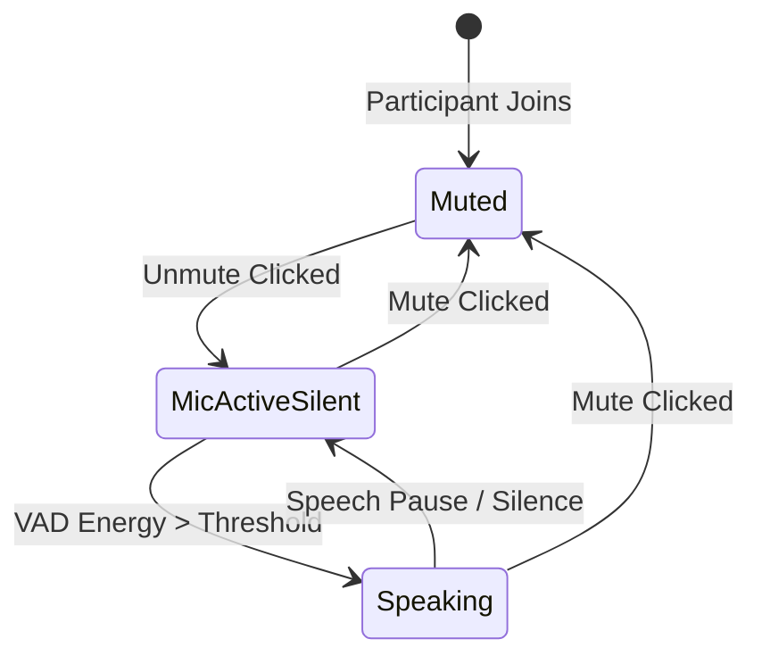
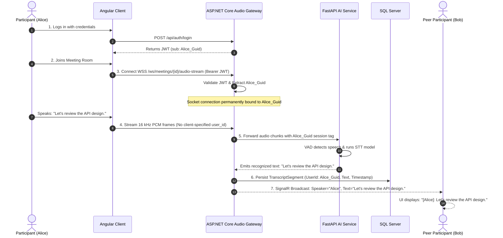

# Phase 4: Speaker Identification & Identity Attribution

## 1. Architectural Strategy: Session-Bound Attribution

A critical architectural decision governs speaker attribution in AiraMeet:

> [!IMPORTANT]
> **Architectural Decision**: AiraMeet identifies speakers through their **authenticated meeting participant identities**, **NOT** through a separate acoustic speaker-recognition or AI diarization model.

In physical conference rooms with a single shared table microphone, machine learning speaker diarization (*"who spoke when"*) is necessary to cluster voice embeddings. However, in digital conferencing platforms where each user participates via their own personal device, each participant's audio originates from an isolated hardware microphone. 

By binding each participant's audio stream directly to their authenticated user session on the backend server, we achieve **100% deterministic speaker attribution** with **zero AI model overhead, zero speaker training, and zero voiceprint privacy liabilities**.

---

## 2. Participant State Taxonomy: Mic vs. Voice vs. Identity

To prevent state confusion in real-time UI components and backend event dispatchers, the system strictly separates three distinct concepts:



1. **Microphone State (Hardware / Client Control)**:
   - **`Muted`**: The client software stops capturing audio frames. No WebSocket packets are transmitted to the server.
   - **`Microphone Active (Unmuted)`**: The client `AudioWorklet` captures microphone samples and continuously transmits binary frames over the WebSocket.
2. **Speech State (Acoustic / VAD Detection)**:
   - **`Speaking`**: Voice Activity Detection (VAD) confirms the unmuted audio contains human speech phonemes exceeding the energy/probability threshold.
   - **`Silent / Background Noise`**: The microphone is open, but the user is not actively talking (e.g., breathing, keyboard typing). Non-speech frames are discarded before AI inference.
3. **Speaker Identity (Cryptographic / Server Context)**:
   - The verified `ApplicationUser.Id`, first name, last name, and profile picture derived from the server-validated JWT. Identity is entirely independent of whether the user is speaking or muted.

---

## 3. End-to-End Speaker Attribution Workflow



---

## 4. Security Enforcement: Deriving vs. Trusting Identity

### The Client Spoofing Vulnerability
In poorly architected systems, the client application passes a JSON metadata header with every audio frame:
```json
// VULNERABLE CLIENT PAYLOAD - DO NOT IMPLEMENT
{
  "user_id": "3fa85f64-5717-4562-b3fc-2c963f66afa6",
  "audio_chunk": "..."
}
```
A malicious participant could intercept the WebSocket or modify client memory to transmit another participant's `user_id`, maliciously attributing defamatory or falsified verbal statements to a colleague.

### The AiraMeet Security Standard
1. **Zero Client Trust**: Incoming binary WebSocket frames contain **strictly raw PCM audio bytes**. No metadata fields indicating user identity are accepted from the client payload.
2. **Connection-Level Binding**:
   - During the initial WebSocket HTTP upgrade handshake, ASP.NET Core validates the `Authorization: Bearer <JWT>` header using the server's private HMAC secret.
   - The user's verified identity is extracted from the `ClaimTypes.NameIdentifier` / `sub` claim.
   - ASP.NET Core creates a scoped session state object (`ParticipantAudioChannel`) stored in memory, permanently binding the TCP socket connection ID to the verified `UserId`.
3. **Internal Forwarding**: When the backend forwards the audio chunk to the FastAPI AI service, the server attaches the cryptographically verified `user_id` inside an internal, non-routable gRPC envelope.

---

## 5. Architectural Comparison: Session Attribution vs. AI Diarization

| Architectural Dimension | Session-Bound Identity (AiraMeet Strategy) | AI Speaker Diarization (Post-Processing) |
| :--- | :--- | :--- |
| **Primary Mechanism** | Binds isolated audio stream to authenticated WebSocket session. | Extracts acoustic embeddings (x-vectors) and clusters audio segments. |
| **Computational Overhead** | **Near Zero** ($O(1)$ dictionary lookup in server memory). | **Extremely Heavy** (additional deep neural network running clustering). |
| **Attribution Accuracy** | **100% Deterministic** (zero confusion between speakers). | **Probabilistic** (85–95% accuracy; frequently swaps similar voices). |
| **Real-Time Latency** | Instantaneous ($< 1\text{ms}$ lookup). | High (requires multi-second temporal context for clustering). |
| **Privacy / Biometric Liability** | Zero biometric voiceprints collected or stored. | High (requires storing acoustic voice embedding profiles). |
| **Failure Modes** | Network drop (handled by reconnect). | Voice similarity confusion, background voices in room. |

### When Would AI Diarization Be Required in the Future?
A separate AI diarization model will only be considered in post-MVP phases if AiraMeet introduces **Physical Conference Room Hardware** (where multiple physical individuals sit in a single meeting room sharing one physical tabletop conference microphone). For all personal computer and mobile web participants, Session-Bound Attribution is architecturally superior in speed, cost, and reliability.
