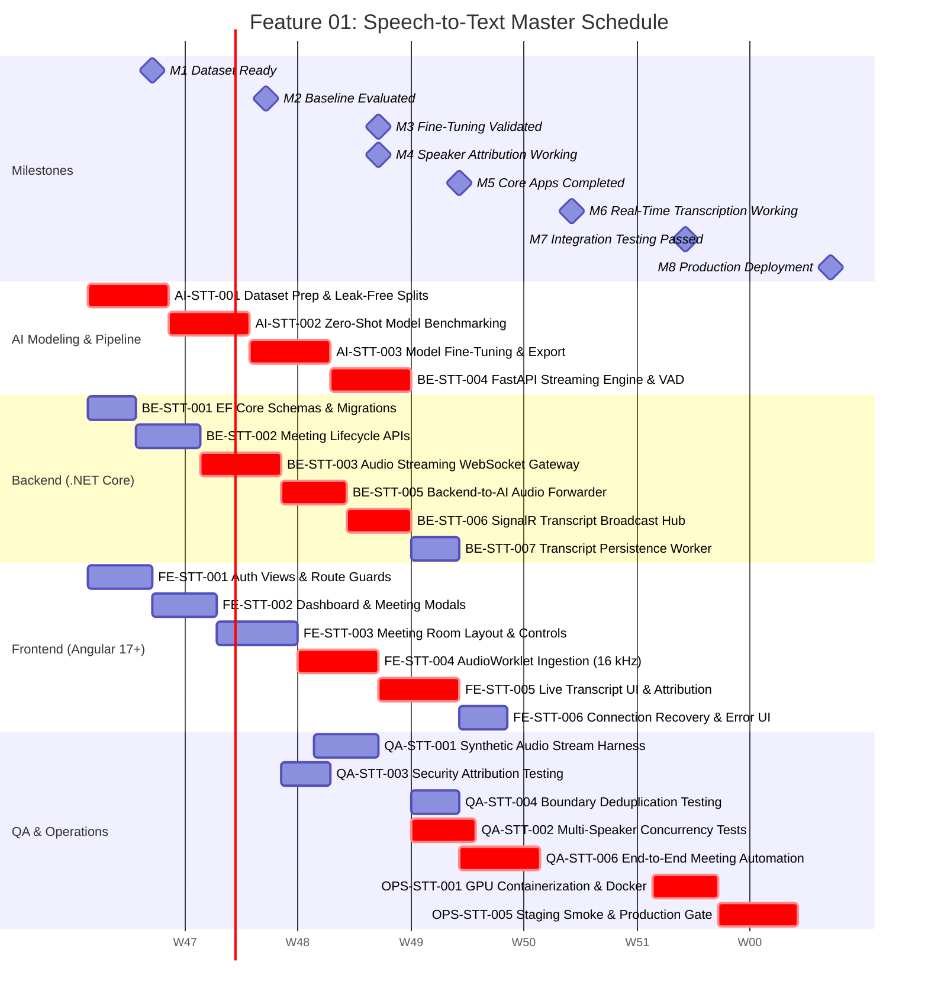
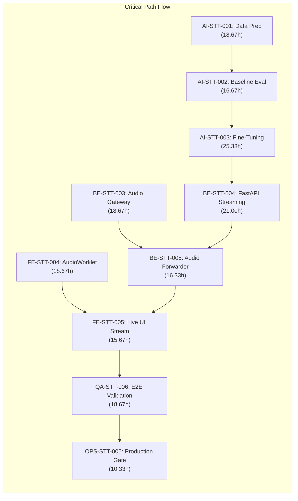

# Feature Timeline, PERT Estimates & Critical Path: Speech-to-Text

## 1. Master Workstream Schedule (6-Week Calendar)

The delivery of Feature 01 (Speech-to-Text & Speaker Attribution) is organized into three parallel engineering tracks synchronized through weekly milestone gates (**M1 through M8**).

---

## 2. Comprehensive PERT Work Breakdown & Estimations

The following table summarizes all 22 tasks across the four project disciplines.
- **Optimistic ($O$)**, **Most Likely ($M$)**, **Pessimistic ($P$)** in hours.
- **Expected Duration**: $E = \frac{O + 4M + P}{6}$.
- **Variance**: $V = \left(\frac{P - O}{6}\right)^2$.

| Task ID | Task Name | Workstream | $O$ | $M$ | $P$ | Expected ($E$) | Risk Buffer | Status |
| :--- | :--- | :---: | :---: | :---: | :---: | :---: | :---: | :---: |
| **`AI-STT-001`** | Dataset Prep & Leak-Free Splits | AI / ML | 12h | 18h | 28h | **18.67h** | 3.0h | To Do |
| **`AI-STT-002`** | Zero-Shot Benchmarking & Gate | AI / ML | 10h | 16h | 26h | **16.67h** | 3.0h | To Do |
| **`AI-STT-003`** | Model Fine-Tuning & CTranslate2 | AI / ML | 16h | 24h | 40h | **25.33h** | 4.0h | To Do |
| **`BE-STT-001`** | EF Core Schemas & Migrations | Backend | 6h | 10h | 16h | **10.33h** | 2.0h | To Do |
| **`BE-STT-002`** | Meeting Lifecycle REST APIs | Backend | 8h | 12h | 20h | **12.67h** | 2.0h | To Do |
| **`BE-STT-003`** | Audio WebSocket Gateway & Auth | Backend | 12h | 18h | 28h | **18.67h** | 3.0h | To Do |
| **`BE-STT-004`** | FastAPI Streaming Engine & VAD | AI / ML | 14h | 20h | 32h | **21.00h** | 4.0h | To Do |
| **`BE-STT-005`** | Backend-to-AI Audio Forwarder | Backend | 10h | 16h | 24h | **16.33h** | 3.0h | To Do |
| **`BE-STT-006`** | SignalR Transcript Broadcast Hub | Backend | 8h | 12h | 18h | **12.33h** | 2.0h | To Do |
| **`BE-STT-007`** | Transcript Persistence Worker | Backend | 6h | 10h | 14h | **10.00h** | 2.0h | To Do |
| **`FE-STT-001`** | Auth Views, Validation & Guards | Frontend | 10h | 14h | 22h | **14.67h** | 2.0h | To Do |
| **`FE-STT-002`** | Dashboard & Meeting Modals | Frontend | 8h | 12h | 18h | **12.33h** | 2.0h | To Do |
| **`FE-STT-003`** | Meeting Room Layout & Controls | Frontend | 12h | 16h | 26h | **17.00h** | 3.0h | To Do |
| **`FE-STT-004`** | AudioWorklet 16 kHz Ingestion | Frontend | 12h | 18h | 28h | **18.67h** | 3.0h | To Do |
| **`FE-STT-005`** | Live Transcript UI & Attribution | Frontend | 10h | 15h | 24h | **15.67h** | 2.0h | To Do |
| **`FE-STT-006`** | Connection Recovery & Error UI | Frontend | 6h | 10h | 16h | **10.33h** | 2.0h | To Do |
| **`QA-STT-001`** | Synthetic Audio Stream Harness | QA | 8h | 12h | 18h | **12.33h** | 2.0h | To Do |
| **`QA-STT-002`** | Multi-Speaker Concurrency Tests | QA | 10h | 16h | 24h | **16.33h** | 3.0h | To Do |
| **`QA-STT-003`** | Attribution Security Testing | QA | 6h | 10h | 16h | **10.33h** | 2.0h | To Do |
| **`QA-STT-004`** | Boundary Deduplication Tests | QA | 6h | 8h | 14h | **8.67h** | 1.5h | To Do |
| **`QA-STT-005`** | Jitter & Network Chaos Testing | QA | 8h | 12h | 18h | **12.33h** | 2.0h | To Do |
| **`QA-STT-006`** | E2E Meeting Scenario Testing | QA | 12h | 18h | 28h | **18.67h** | 3.0h | To Do |
| **`OPS-STT-001`** | GPU Docker & Compose Setup | DevOps | 8h | 12h | 20h | **12.67h** | 2.0h | To Do |
| **`OPS-STT-002`** | GPU Warm-Up & Health Probes | DevOps | 6h | 8h | 14h | **8.67h** | 1.5h | To Do |
| **`OPS-STT-003`** | DB Migration CI/CD Integration | DevOps | 4h | 6h | 10h | **6.33h** | 1.0h | To Do |
| **`OPS-STT-004`** | OpenTelemetry & Prometheus | DevOps | 8h | 12h | 18h | **12.33h** | 2.0h | To Do |
| **`OPS-STT-005`** | Staging Verification & Rollback | DevOps | 6h | 10h | 16h | **10.33h** | 2.0h | To Do |

---

## 3. Workstream Concurrency & Critical Path Analysis

### Development Effort vs. Calendar Duration
- **Total Cumulative Engineering Effort**: $\sum E \approx \mathbf{368\text{ Person-Hours}}$ (~46 Person-Days).
- **Team Size**: 7 dedicated engineers working across synchronized departments.
- **Calendar Elapsed Duration**: **6.0 Calendar Weeks** (30 working days).

### Critical Path Duration Calculation
The critical path links the longest sequential sequence of dependent tasks:
$$\text{Critical Duration} = 18.67 + 16.67 + 25.33 + 21.00 + 16.33 + 15.67 + 18.67 + 10.33 = \mathbf{142.67\text{ Net Critical Hours}}$$
At 30 focused engineering hours per week per critical resource, this sequence occupies **4.75 Calendar Weeks**, perfectly fitting within the **6.0-Week Target Window** with an allocated **1.25-Week Risk Buffer**.

---

## 4. Risk Analysis & Mitigation Strategies

| Risk Identifier | Severity | Likelihood | Mitigation Strategy | Contingency Plan |
| :--- | :---: | :---: | :--- | :--- |
| **GPU VRAM Exhaustion** | High | Medium | Use CTranslate2 INT8 quantization; limit batch sizes to 16 concurrent audio streams per GPU worker. | Deploy a second GPU node or scale horizontally across multi-worker clusters. |
| **Model Boundary Hallucination** | Medium | Medium | Silero VAD gate discards silence before inference; enforce hard 15-second utterance limits. | Tighten VAD sensitivity threshold from 0.5 to 0.65 to discard low-energy background murmurs. |
| **Client Audio Drift / Desync** | Medium | Low | AudioWorklet downsampler operates on raw hardware sample clock with linear interpolation. | Server re-aligns audio timestamps based on monotonic packet sequence numbers. |
| **Third-Party Dependency Drift** | Low | Low | Pin all Python dependencies in `requirements.txt` with exact hashes; lock .NET NuGet package versions. | Use pre-built Docker base images with cached CUDA layers. |
