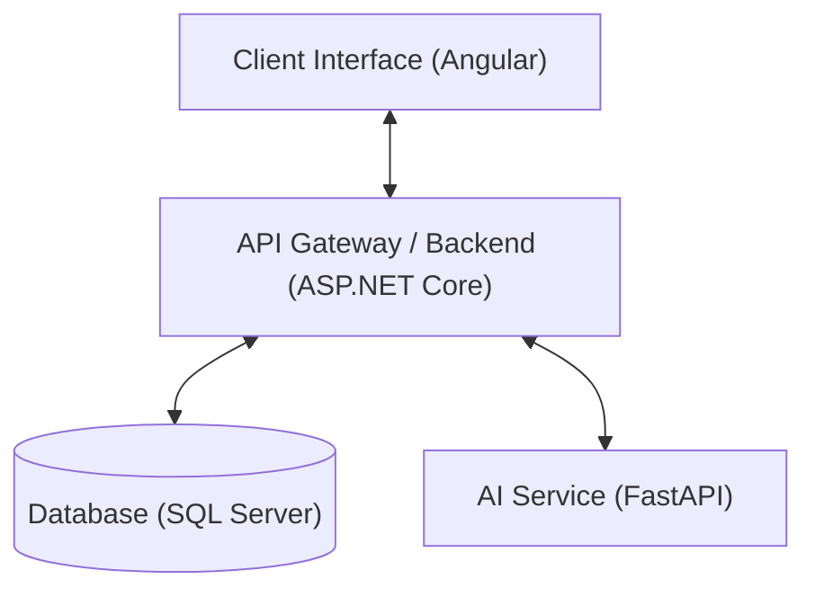
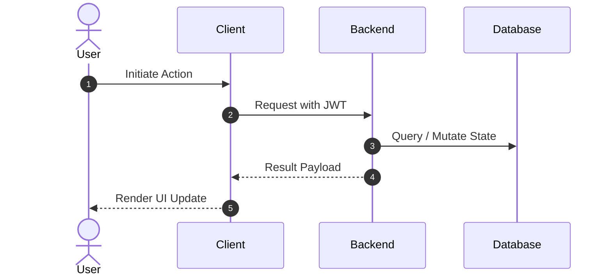

# Technical Design: [Feature Name]

## 1. High-Level Architecture & Flow

Provide a narrative overview of how this feature integrates into the AiraMeet architecture.



---

## 2. Sequence Diagram



---

## 3. Data Schema Modifications

Detail any Entity Framework Core migrations or table schema changes required.

```sql
-- Schema DDL additions if applicable
```

---

## 4. API & Communication Contracts

Specify REST routes, request/response JSON schemas, and WebSocket message formats.
