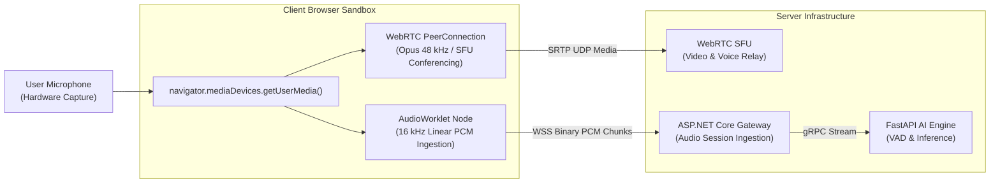
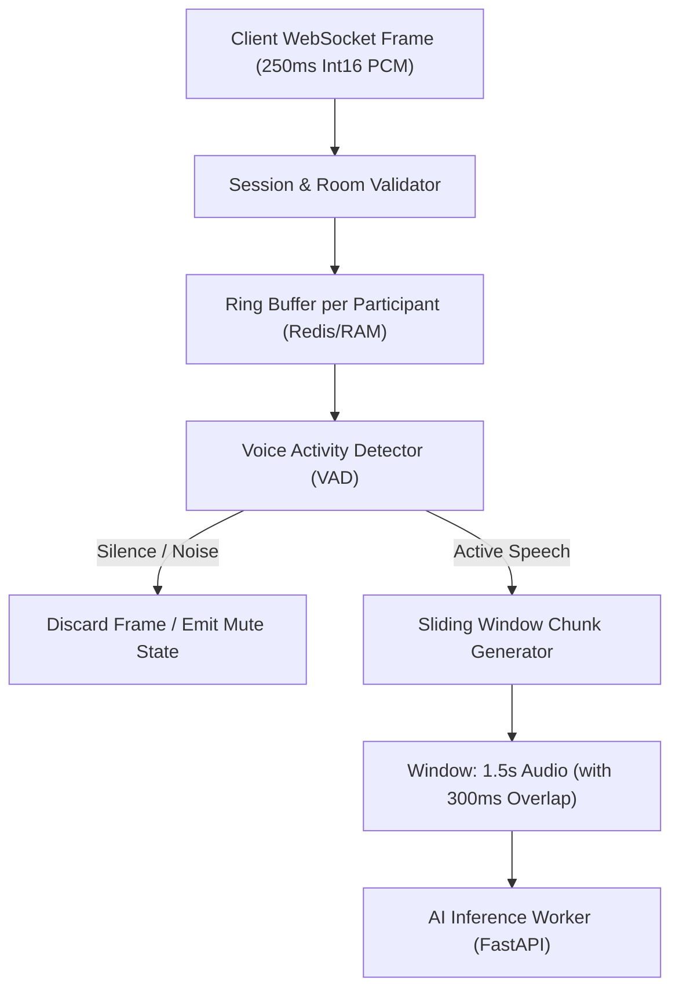

# Audio Streaming & Ingestion Architecture

## 1. Architectural Strategy: Dual-Track Audio Pipeline

In AiraMeet, meeting audio serves two fundamentally distinct requirements:
1. **Interactive Human-to-Human Conferencing**: Requires ultra-low latency (< 150ms) using dynamic bitrates and peer-to-peer or SFU WebRTC routing (Opus codec, 48 kHz stereo/mono).
2. **Speech-to-Text Deep Learning Ingestion**: Requires pristine, uncompressed, deterministic acoustic features (16 kHz mono linear PCM) delivered continuously to deep learning models.

To achieve optimal quality without overloading the conferencing SFU, AiraMeet implements a **Dual-Track Audio Pipeline**:



---

## 2. Client-Side Audio Ingestion (Angular & Web Audio API)

### 2.1 AudioWorklet Implementation
To prevent audio frame drops caused by UI rendering or DOM updates on the main thread, audio downsampling and buffer chunking are handled strictly inside a dedicated **`AudioWorkletProcessor`**.

#### Configuration Parameters
- **Input Sample Rate**: Native browser hardware rate (typically 44,100 Hz or 48,000 Hz).
- **Target Sample Rate**: **16,000 Hz (16 kHz)**.
- **Channels**: 1 (Single-channel Mono).
- **Encoding**: 16-bit Signed Integer Little-Endian Linear PCM (`Int16Array`).
- **Chunk Dispatch Interval**: 250 milliseconds (4,000 samples = 8,000 bytes per packet).

#### AudioWorklet Processor Script (`audio-stream-processor.js`)
```javascript
class AudioStreamProcessor extends AudioWorkletProcessor {
  constructor() {
    super();
    this.buffer = [];
    this.targetSampleRate = 16000;
  }

  process(inputs, outputs, parameters) {
    const input = inputs[0];
    if (!input || !input[0]) return true;

    const channelData = input[0]; // Mono channel Float32Array (-1.0 to 1.0)
    
    // Downsample input to 16 kHz using linear interpolation
    const downsampled = this.downsample(channelData, currentFrameRate, this.targetSampleRate);
    
    // Convert Float32 to Int16 PCM
    const pcmData = new Int16Array(downsampled.length);
    for (let i = 0; i < downsampled.length; i++) {
      const s = Math.max(-1, Math.min(1, downsampled[i]));
      pcmData[i] = s < 0 ? s * 0x8000 : s * 0x7FFF;
    }

    // Post buffered PCM chunk to main thread
    this.port.postMessage(pcmData.buffer, [pcmData.buffer]);
    return true;
  }

  downsample(buffer, inputRate, outputRate) {
    if (inputRate === outputRate) return buffer;
    const ratio = inputRate / outputRate;
    const newLength = Math.round(buffer.length / ratio);
    const result = new Float32Array(newLength);
    let offsetResult = 0;
    let offsetBuffer = 0;

    while (offsetResult < result.length) {
      const nextOffsetBuffer = Math.round((offsetResult + 1) * ratio);
      let accum = 0, count = 0;
      for (let i = offsetBuffer; i < nextOffsetBuffer && i < buffer.length; i++) {
        accum += buffer[i];
        count++;
      }
      result[offsetResult] = count > 0 ? accum / count : 0;
      offsetResult++;
      offsetBuffer = nextOffsetBuffer;
    }
    return result;
  }
}

registerProcessor('audio-stream-processor', AudioStreamProcessor);
```

---

## 3. Server-Side Audio Ingestion & Buffering Pipeline

When binary audio frames arrive at the ASP.NET Core streaming hub, they pass through a four-stage ingestion pipeline:



### 3.1 Streaming Parameters
- **Chunk Duration**: 1.0 to 2.0 seconds (Default target: **1.5 seconds**).
- **Chunk Overlap**: 200 to 400 milliseconds (Default target: **300 milliseconds**).
- **Silence Threshold**: 500 milliseconds of contiguous silence triggers an automatic segment commitment (`is_final = true`).
- **Maximum Utterance Limit**: 15 seconds without a pause forces a segment boundary to prevent model drift and hallucination.

---

## 4. End-to-End Latency Budget

To deliver responsive real-time transcription, the total visible transcription latency must remain strictly within **2.0 to 3.0 seconds**.

| Processing Stage | Nominal Latency | Upper Bound (p95) | Optimization Technique |
| :--- | :--- | :--- | :--- |
| **Audio Capture & AudioWorklet** | 250 ms | 300 ms | 250ms periodic buffer dispatch in worker thread. |
| **Client-to-Server Network Transit** | 40 ms | 120 ms | WSS over optimized TCP/TLS socket. |
| **Server Ingestion & VAD Analysis** | 30 ms | 60 ms | Silero VAD running in C++ / TorchScript ONNX. |
| **Sliding Window Accumulation** | 1,200 ms | 1,500 ms | Target window duration for phoneme recognition. |
| **Deep Learning Forward Pass** | 200 ms | 450 ms | CTranslate2 INT8 quantization on NVIDIA GPU. |
| **Deduplication & Post-Processing** | 15 ms | 35 ms | Longest common substring prefix pruning in Python. |
| **Server-to-Client Broadcast** | 40 ms | 100 ms | ASP.NET Core SignalR hub broadcasting JSON. |
| **Client UI Render & Virtual Scroll** | 10 ms | 30 ms | Angular Reactive Signals with `OnPush` change detection. |
| **Total Cumulative Latency** | **1,785 ms (~1.8s)** | **2,595 ms (~2.6s)** | **Within 3.0s SLA Budget** |

---

## 5. Network Resiliency & Backpressure Management

1. **Jitter & Out-of-Order Frames**: Audio chunks carry a monotonically increasing 64-bit sequence number. If a frame arrives out of sequence, the server reorders frames within a 500ms sliding queue before dispatching to VAD.
2. **Client Disconnections & Reconnection**: If the WebSocket connection drops, the Angular client initiates an exponential backoff reconnect (`1s, 2s, 4s, 8s`). Upon reconnect, the client resumes streaming with a new sequence tag; past transcripts remain safely persisted on the server.
3. **Server Backpressure**: If the GPU inference worker queues exceed 5 seconds of pending audio, the server sheds interim partial recognition steps and processes only final chunks to catch up to real-time.
