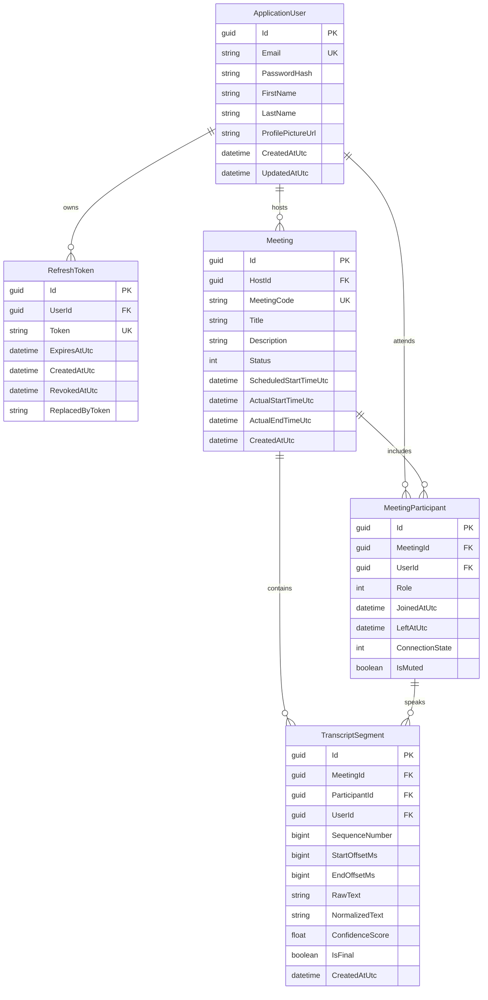

# Database Schema Specification

## 1. Overview & Data Architecture

AiraMeet utilizes **Microsoft SQL Server** as its primary relational data store, accessed via **Entity Framework Core 8.0+** using Code-First migrations. The schema is organized to provide strict relational integrity, high-throughput writes for timestamped transcript segments, and audit trails.

The database is divided into three logical domains:
1. **Identity & Authentication Domain**: User accounts, credentials, claims, and rotating refresh tokens (already partially established in `backend/AiraMeet.Infrastructure`).
2. **Meeting Domain**: Meeting rooms, unique session codes, scheduled windows, and participant session records.
3. **Transcript & Speech Domain**: Timestamped, speaker-attributed transcript segments, confidence scores, and speech events.

---

## 2. Entity-Relationship Diagram (ERD)



---

## 3. Detailed Table Specifications

### 3.1 `AspNetUsers` (`ApplicationUser`)
*Extends ASP.NET Core IdentityUser<Guid>*

| Column Name | Data Type | Nullable | Constraints / Defaults | Description |
| :--- | :--- | :---: | :--- | :--- |
| `Id` | `UNIQUEIDENTIFIER` | No | PK, `NEWID()` | Unique identifier for the user account. |
| `FirstName` | `NVARCHAR(100)` | No | - | User's given name. |
| `LastName` | `NVARCHAR(100)` | No | - | User's family/surname. |
| `Email` | `NVARCHAR(256)` | No | Unique Index | Normalized email address used for login. |
| `PasswordHash` | `NVARCHAR(MAX)` | Yes | - | PBKDF2/Argon2 password hash generated by Identity. |
| `ProfilePictureUrl` | `NVARCHAR(1024)` | Yes | Null | URL pointing to stored avatar asset. |
| `CreatedAtUtc` | `DATETIME2(7)` | No | `SYSUTCDATETIME()` | Account creation timestamp. |

---

### 3.2 `RefreshTokens`
*Stores rotating refresh tokens for JWT session management.*

| Column Name | Data Type | Nullable | Constraints / Defaults | Description |
| :--- | :--- | :---: | :--- | :--- |
| `Id` | `UNIQUEIDENTIFIER` | No | PK, `NEWID()` | Primary key. |
| `UserId` | `UNIQUEIDENTIFIER` | No | FK $\rightarrow$ `AspNetUsers.Id` | User to whom this token belongs. |
| `Token` | `NVARCHAR(256)` | No | Unique Index | Cryptographically secure random token string. |
| `ExpiresAtUtc` | `DATETIME2(7)` | No | - | Absolute expiration time (typically 7 days). |
| `CreatedAtUtc` | `DATETIME2(7)` | No | `SYSUTCDATETIME()` | Issuance timestamp. |
| `RevokedAtUtc` | `DATETIME2(7)` | Yes | Null | Timestamp if explicitly revoked during logout. |
| `ReplacedByToken` | `NVARCHAR(256)` | Yes | Null | Pointer to successor token upon rotation. |

---

### 3.3 `Meetings`
*Defines meeting instances and lifecycle states.*

| Column Name | Data Type | Nullable | Constraints / Defaults | Description |
| :--- | :--- | :---: | :--- | :--- |
| `Id` | `UNIQUEIDENTIFIER` | No | PK, `NEWID()` | Unique meeting identifier. |
| `HostId` | `UNIQUEIDENTIFIER` | No | FK $\rightarrow$ `AspNetUsers.Id` | User who created and governs the meeting. |
| `MeetingCode` | `VARCHAR(12)` | No | Unique Index | Human-readable join code (e.g., `air-982-xyz`). |
| `Title` | `NVARCHAR(200)` | No | - | Name or topic of the meeting. |
| `Description` | `NVARCHAR(MAX)` | Yes | Null | Detailed meeting agenda or description. |
| `Status` | `INT` | No | Default: 0 | `0`: Scheduled, `1`: Active, `2`: Completed, `3`: Cancelled. |
| `ScheduledStartTimeUtc` | `DATETIME2(7)` | Yes | Null | Planned start time. |
| `ActualStartTimeUtc` | `DATETIME2(7)` | Yes | Null | Timestamp when host launched the room. |
| `ActualEndTimeUtc` | `DATETIME2(7)` | Yes | Null | Timestamp when meeting concluded. |
| `CreatedAtUtc` | `DATETIME2(7)` | No | `SYSUTCDATETIME()` | Creation timestamp. |

---

### 3.4 `MeetingParticipants`
*Tracks participant attendance sessions and live meeting states.*

| Column Name | Data Type | Nullable | Constraints / Defaults | Description |
| :--- | :--- | :---: | :--- | :--- |
| `Id` | `UNIQUEIDENTIFIER` | No | PK, `NEWID()` | Unique attendance session ID. |
| `MeetingId` | `UNIQUEIDENTIFIER` | No | FK $\rightarrow$ `Meetings.Id` (Cascade) | Associated meeting. |
| `UserId` | `UNIQUEIDENTIFIER` | No | FK $\rightarrow$ `AspNetUsers.Id` | Authenticated user profile. |
| `Role` | `INT` | No | Default: 0 | `0`: Participant, `1`: CoHost, `2`: Host. |
| `JoinedAtUtc` | `DATETIME2(7)` | No | `SYSUTCDATETIME()` | Connection join timestamp. |
| `LeftAtUtc` | `DATETIME2(7)` | Yes | Null | Disconnection timestamp. |
| `ConnectionState` | `INT` | No | Default: 0 | `0`: Connected, `1`: Disconnected, `2`: Reconnecting. |
| `IsMuted` | `BIT` | No | Default: 0 | Live client-reported microphone mute state. |

---

### 3.5 `TranscriptSegments`
*Stores final and historical speech-to-text utterances.*

| Column Name | Data Type | Nullable | Constraints / Defaults | Description |
| :--- | :--- | :---: | :--- | :--- |
| `Id` | `UNIQUEIDENTIFIER` | No | PK, `NEWID()` | Unique transcript record identifier. |
| `MeetingId` | `UNIQUEIDENTIFIER` | No | FK $\rightarrow$ `Meetings.Id` (Cascade) | Target meeting session. |
| `ParticipantId` | `UNIQUEIDENTIFIER` | No | FK $\rightarrow$ `MeetingParticipants.Id` | Specific participant connection session. |
| `UserId` | `UNIQUEIDENTIFIER` | No | FK $\rightarrow$ `AspNetUsers.Id` | Denormalized user ID for fast speaker querying. |
| `SequenceNumber` | `BIGINT` | No | Indexed | Monotonically increasing sequence within meeting. |
| `StartOffsetMs` | `BIGINT` | No | - | Audio offset in milliseconds from meeting start. |
| `EndOffsetMs` | `BIGINT` | No | - | Segment completion offset in milliseconds. |
| `RawText` | `NVARCHAR(MAX)` | No | - | Verbatim text emitted by deep learning model. |
| `NormalizedText` | `NVARCHAR(MAX)` | No | - | Cleaned text (capitalized, punctuated, formatted). |
| `ConfidenceScore` | `REAL` | No | Range [0.0, 1.0] | Model acoustic/language confidence score. |
| `IsFinal` | `BIT` | No | Default: 1 | `1` for committed segment, `0` for interim hypothesis. |
| `CreatedAtUtc` | `DATETIME2(7)` | No | `SYSUTCDATETIME()` | Server receipt and persistence timestamp. |

---

## 4. Performance Indexes

```sql
-- Fast lookup of all transcripts in chronological sequence for a meeting
CREATE NONCLUSTERED INDEX IX_TranscriptSegments_MeetingId_SequenceNumber
ON dbo.TranscriptSegments (MeetingId, SequenceNumber ASC)
INCLUDE (UserId, StartOffsetMs, EndOffsetMs, NormalizedText);

-- Fast lookup of user attendance across meetings
CREATE NONCLUSTERED INDEX IX_MeetingParticipants_UserId_JoinedAtUtc
ON dbo.MeetingParticipants (UserId, JoinedAtUtc DESC);

-- Fast lookup for meeting join by code
CREATE UNIQUE NONCLUSTERED INDEX IX_Meetings_MeetingCode
ON dbo.Meetings (MeetingCode);
```

---

## 5. Entity Framework Core Configuration Example

```csharp
public class TranscriptSegmentConfiguration : IEntityTypeConfiguration<TranscriptSegment>
{
    public void Configure(EntityTypeBuilder<TranscriptSegment> builder)
    {
        builder.ToTable("TranscriptSegments");

        builder.HasKey(t => t.Id);

        builder.Property(t => t.RawText)
            .IsRequired();

        builder.Property(t => t.NormalizedText)
            .IsRequired();

        builder.Property(t => t.ConfidenceScore)
            .HasPrecision(5, 4);

        builder.HasOne<Meeting>()
            .WithMany()
            .HasForeignKey(t => t.MeetingId)
            .OnDelete(DeleteBehavior.Cascade);

        builder.HasOne<ApplicationUser>()
            .WithMany()
            .HasForeignKey(t => t.UserId)
            .OnDelete(DeleteBehavior.Restrict);

        builder.HasIndex(t => new { t.MeetingId, t.SequenceNumber });
    }
}
```
