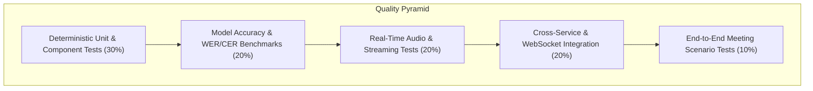

# Quality Assurance & Test Strategy

## 1. Test Strategy Overview

The AiraMeet Speech-to-Text and Speaker Attribution platform combines distributed real-time media ingestion, high-speed networking, and deep learning inference. Consequently, our quality assurance framework spans five rigorous test levels to guarantee correctness, security, latency SLA adherence, and audio transcription accuracy.

---

## 2. Testing Levels & Scope

### 2.1 Level 1: Deterministic Unit Testing
- **Backend (.NET / C#)**: xUnit, FluentAssertions, Moq. Tests domain models, JWT validation logic, entity configurations, and session context derivation.
- **Frontend (Angular / TypeScript)**: Jasmine / Karma or Vitest. Tests UI components, reactive signals, audio worklet downsampling algorithms, and route guards.
- **AI Services (Python)**: PyTest. Tests text normalizers, sliding window slicing, VAD filters, and deduplication logic.

### 2.2 Level 2: Model Accuracy & Acoustic Benchmarking
- **Dataset Partition Isolation**: Verifies 0% data leakage between train and test splits (speaker IDs must never overlap).
- **Acoustic Accuracy**: Measures Word Error Rate (WER) and Character Error Rate (CER) on the independent test dataset using `evaluate` and `jiwer`.
- **Acoustic Robustness**: Tests model transcription accuracy under simulated acoustic degradation (additive background noise, reverberation, variable SNR from +20dB down to 0dB).

### 2.3 Level 3: Real-Time Audio Streaming & Network Resilience
- **Frame Serialization**: Verifies 16 kHz 16-bit linear PCM byte ordering and chunk packetization.
- **Boundary Deduplication**: Verifies that words spoken across 300ms overlapping chunk boundaries are recognized exactly once without duplication or dropped tokens.
- **Jitter & Network Loss**: Emulates 5% to 20% packet loss and 100ms jitter using Linux traffic control (`tc netem`) to confirm WebSocket reconnects and graceful degradation.

### 2.4 Level 4: Speaker Attribution & Security Testing
- **Session Identity Binding**: Asserts that client attempts to transmit spoofed `user_id` fields in WebSocket payloads are completely ignored or rejected by the server.
- **Cross-Room Leakage**: Validates that audio frames and transcript segments emitted in Meeting Room A are strictly isolated from Meeting Room B.

### 2.5 Level 5: End-to-End System Performance & Concurrency
- **Multi-Participant Meeting Simulation**: Simulates meetings with 2, 5, 10, and 20 concurrent participants speaking sequentially and simultaneously.
- **Latency Benchmarks**: Validates that p95 visible transcription latency does not exceed 3.0 seconds under continuous load.
- **GPU Resource Utilization**: Monitors VRAM and GPU compute saturation under increasing concurrent audio streams.

---

## 3. Quality Gates & Release Thresholds

To merge code into release branches or advance through milestone gates, the following quantitative criteria must be satisfied:

| Quality Gate | Metric | Target Threshold | Enforcement Mechanism |
| :--- | :--- | :--- | :--- |
| **Unit Test Coverage** | Line Coverage | $\ge 85\%$ on Backend & Frontend Core | GitHub Actions CI Gate |
| **Model Accuracy** | Test Set Relative WER Improvement | $\ge 15\%$ improvement over Pretrained Baseline | AI Evaluation Report |
| **Latency SLA** | p95 End-to-End Latency | $\le 3,000$ milliseconds | Automated Streaming Benchmark |
| **Real-Time Factor (RTF)** | Execution Time / Audio Duration | $\le 0.25$ on production GPU | Benchmark Test Suite |
| **Deduplication Rate** | Boundary Word Duplication | $0.0\%$ in synthetic benchmark | PyTest Boundary Suite |
| **Security Gate** | Identity Spoofing Vulnerability | 0 occurrences | Penetration Unit Test Suite |
| **Critical Defects** | Open Severity 1 / 2 Bugs | 0 open defects | Jira / GitHub Issue Gate |

---

## 4. Test Environments & Tooling

- **Local Mock Environment**: Docker Compose spinning up SQL Server, Redis, ASP.NET Core API, and FastAPI with CPU-based mock models.
- **GPU Staging Testbed**: Dedicated server with NVIDIA GPU (16 GB VRAM) running full CTranslate2 / PyTorch models for realistic latency and WER validation.
- **Audio Test Harness**: Python CLI test runner (`tests/audio_harness.py`) that feeds pre-recorded multi-speaker audio files through WebSockets to simulate realistic meeting dialogues.
