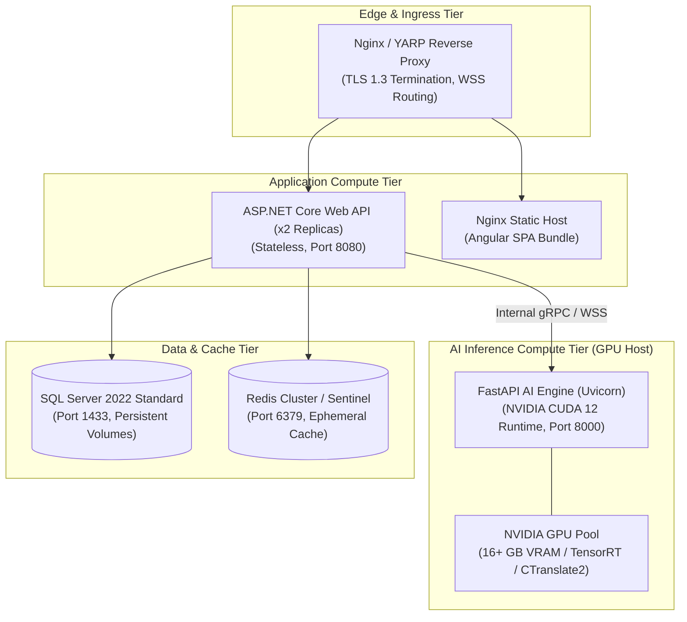

# Production Deployment & Operations Guide

## 1. Deployment Topology & Architecture

AiraMeet is deployed as a multi-tier containerized system. The production environment orchestrates the Angular frontend, ASP.NET Core backend cluster, Python FastAPI AI engine with dedicated GPU pass-through, Microsoft SQL Server, and Redis.



---

## 2. Infrastructure Prerequisites

| Component | Minimum Specification | Recommended Production Spec |
| :--- | :--- | :--- |
| **Backend / Web Host** | 4 vCPU, 8 GB RAM | 8 vCPU, 16 GB RAM |
| **AI Inference Host** | 8 vCPU, 16 GB RAM, 1x NVIDIA T4 (16 GB) | 16 vCPU, 32 GB RAM, 1x NVIDIA A10G / RTX 4090 (24 GB) |
| **GPU Drivers** | NVIDIA Driver $\ge 535$, CUDA 12.2 | NVIDIA Driver $\ge 550$, CUDA 12.4 |
| **Container Engine** | Docker Engine 25.0+ | Docker Engine with `nvidia-container-toolkit` |
| **Storage Tier** | 100 GB SSD (Database & Checkpoints) | 500 GB NVMe SSD with automated snapshots |

---

## 3. Environment Variables Reference

### 3.1 Backend Service (`AiraMeet.Api`)

| Variable Name | Required | Default / Example | Purpose |
| :--- | :---: | :--- | :--- |
| `ASPNETCORE_ENVIRONMENT` | Yes | `Production` | ASP.NET runtime environment mode. |
| `ConnectionStrings__DefaultConnection` | Yes | `Server=sql-server;Database=AiraMeetDb;User Id=sa;Password=...;TrustServerCertificate=True;` | Primary SQL Server connection string. |
| `ConnectionStrings__Redis` | Yes | `redis:6379,abortConnect=false` | Redis cache and SignalR backplane connection string. |
| `Jwt__Issuer` | Yes | `https://api.airameet.com` | Expected JWT issuer claim. |
| `Jwt__Audience` | Yes | `https://app.airameet.com` | Expected JWT audience claim. |
| `Jwt__SecretKey` | Yes | *Cryptographically secure 64-char key* | HMAC-SHA256 signing secret key. |
| `Jwt__AccessTokenExpirationMinutes` | No | `15` | Lifetime of access token before refresh required. |
| `AiServices__SttServiceEndpoint` | Yes | `http://ai-service:8000` | Internal URL for the Python STT inference engine. |

### 3.2 AI Service (`ai-services`)

| Variable Name | Required | Default / Example | Purpose |
| :--- | :---: | :--- | :--- |
| `MODEL_PATH` | Yes | `/app/models/stt-finetuned-best` | Local path to exported fine-tuned model checkpoint. |
| `DEVICE` | Yes | `cuda` (fallback: `cpu`) | PyTorch compute device. |
| `COMPUTE_TYPE` | Yes | `float16` or `int8` | Precision mode for inference engine. |
| `MAX_CONCURRENT_STREAMS` | No | `16` | Maximum concurrent audio streams per GPU worker. |
| `VAD_THRESHOLD` | No | `0.5` | Sensitivity threshold for Silero Voice Activity Detector. |
| `CHUNK_DURATION_SEC` | No | `1.5` | Sliding window chunk length. |
| `OVERLAP_DURATION_SEC` | No | `0.3` | Overlap between consecutive sliding windows. |

---

## 4. Model Loading, GPU Warm-Up & Resource Management

### 4.1 Cold-Start Mitigation & Warm-Up
Deep learning models suffer from significant first-inference latency while CUDA kernels compile and memory allocates. The FastAPI service executes a startup event hook to warm up the model before traffic ingress:

```python
# app/core/lifespan.py
@asynccontextmanager
async def lifespan(app: FastAPI):
    logger.info("Initializing STT model and allocating GPU buffers...")
    # Load model into VRAM
    app.state.stt_model = load_optimized_model(settings.MODEL_PATH, device=settings.DEVICE)
    
    # Warm-up pass with synthetic 16 kHz silence
    dummy_audio = np.zeros(16000 * 2, dtype=np.float32)
    app.state.stt_model.transcribe(dummy_audio)
    logger.info("GPU warm-up completed successfully. Ready for live traffic.")
    yield
    logger.info("Flushing GPU memory buffers...")
    del app.state.stt_model
    torch.cuda.empty_cache()
```

---

## 5. Database Migration Execution Strategy

Database migrations must execute safely without causing downtime or schema race conditions.
1. **Never Run Migrations Automatically on Application Startup in Multi-Instance Production**.
2. **Dedicated Migration Job**: Execute migrations via an isolated CI/CD deployment step or one-off container before launching new backend replicas:

```bash
# Execute EF Core Migration Runner
dotnet ef database update \
  --project backend/AiraMeet.Infrastructure \
  --startup-project backend/AiraMeet.Api \
  --connection "$PROD_CONNECTION_STRING"
```

---

## 6. Observability, Logging & Health Checks

- **Health Checks**:
  - Backend: `GET /health` returns `200 OK` when SQL Server and Redis are reachable.
  - AI Service: `GET /health/ready` returns `200 OK` when model weights are in VRAM and GPU temperatures are within safe operating limits.
- **Metrics (Prometheus)**:
  - `airameet_stt_inference_duration_seconds`: Histogram measuring inference time per audio chunk.
  - `airameet_stt_active_audio_streams`: Gauge tracking simultaneous meeting speakers.
  - `airameet_stt_wer_evaluation_score`: Periodic tracking score on synthetic test samples.

---

## 7. Rollback Strategy

In the event of a critical failure during a deployment:
1. **Backend / API Rollback**: Revert Docker image tag to previous stable digest. EF Core migrations are backward-compatible (expand-and-contract schema pattern).
2. **AI Model Rollback**: The FastAPI engine supports hot-swapping models via the `MODEL_PATH` environment variable. If the fine-tuned model exhibits unexpected hallucinations, point `MODEL_PATH` back to the validated baseline checkpoint and restart the container (`< 15 seconds downtime`).
