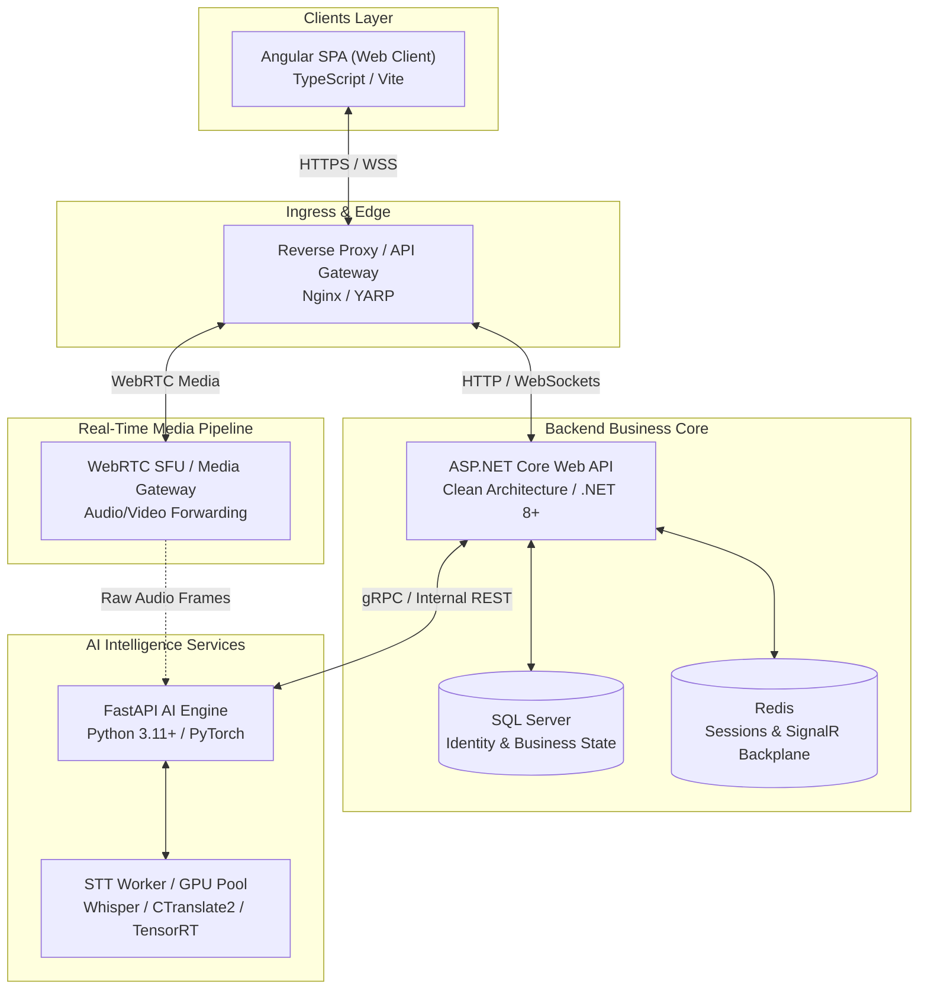

# AiraMeet Technical Documentation System

Welcome to the central technical documentation repository for **AiraMeet**, an enterprise-grade AI-powered video conferencing platform that transforms live conversations into structured knowledge, verifiable decisions, and actionable outcomes.

This documentation serves as the single source of truth for software architects, backend engineers, frontend developers, AI/ML researchers, QA specialists, and DevOps engineers.

---

## Documentation Map & Navigation Index

```
docs/
├── README.md                                 # Documentation Hub (This file)
│
├── 01-project-overview/                      # System Context & Architecture
│   ├── project-overview.md                   # Vision, Business Goals & MVP Scope
│   ├── technology-stack.md                   # Confirmed & Planned Tech Stack
│   └── system-architecture.md                # Component Architecture & Communication
│
├── 02-planning/                              # Program Management & Execution
│   ├── master-roadmap.md                     # Milestones (M1-M8) & Critical Path
│   ├── project-timeline.md                   # 6-Week Iteration Schedule & PERT Model
│   └── team-assignments.md                   # Team Responsibilities & RACI Matrix
│
├── 03-features/                              # Feature Specifications & Task Breakdowns
│   ├── 01-speech-to-text/                    # [FEATURE] Speech-to-Text & Speaker Attribution
│   │   ├── README.md                         # STT Feature Hub & Quick Start
│   │   ├── feature-overview.md               # Scope, Objectives & Architecture
│   │   ├── requirements.md                   # Functional, Non-Functional & Edge Cases
│   │   ├── dataset-preparation.md            # Data Pipeline, Cleaning & Split Isolation
│   │   ├── model-selection.md                # Whisper vs Wav2Vec2 vs NeMo Comparison
│   │   ├── model-training.md                 # Fine-Tuning Pipeline, Hyperparams & Checkpointing
│   │   ├── model-evaluation.md               # WER/CER Benchmark, Latency & Acceptance Criteria
│   │   ├── speaker-identification.md         # Session-Based Attribution vs Diarization
│   │   ├── real-time-transcription.md        # Streaming Architectures (Prototype vs Target)
│   │   ├── backend-tasks.md                  # ASP.NET Core & FastAPI Engineering Tasks
│   │   ├── frontend-tasks.md                 # Angular 17+ Frontend Engineering Tasks
│   │   ├── testing.md                        # Verification Matrix & Streaming Test Suite
│   │   ├── deployment.md                     # Containerization, GPU Serving & Scalability
│   │   └── timeline.md                       # STT 6-Week Workstream & Critical Path
│   │
│   └── feature-template/                     # Standardized Template for Future Features
│       ├── README.md                         # Template Guidance
│       ├── requirements.md                   # Requirements Specification Template
│       ├── technical-design.md               # Technical Design & Diagrams Template
│       ├── tasks.md                          # Work Breakdown Structure (WBS) Template
│       ├── testing.md                        # Test Suite Specification Template
│       └── timeline.md                       # PERT Estimation & Schedule Template
│
├── 04-architecture/                          # Platform Deep Dives & Contracts
│   ├── database-schema.md                    # Entity-Relationship Diagrams & EF Core Mappings
│   ├── api-documentation.md                  # REST Contracts & WebSocket Protocols
│   └── audio-streaming.md                    # WebRTC Media Flow & Audio Ingestion Specs
│
├── 05-testing/                               # Quality Assurance Framework
│   ├── test-strategy.md                      # Quality Gates, Test Levels & Automation
│   └── test-cases.md                         # Test Catalog (Functional, Audio, Network, Load)
│
└── 06-deployment/                            # Infrastructure & Operations
    ├── deployment-guide.md                   # Docker, Kubernetes, GPU Runtime & CI/CD
    └── release-notes.md                      # Versioning, Migrations & Rollback Plans
```

---

## Architecture At A Glance

AiraMeet employs a modular, microservice-ready architecture that cleanly separates client interaction, business governance, real-time media forwarding, and compute-intensive AI inference:



---

## Document Status & Governance

| Section | Lead Owner | Current Status | Last Verified |
| :--- | :--- | :--- | :--- |
| **01-Project Overview** | Software Architect | `Approved` | November 2026 |
| **02-Planning** | Technical Project Manager | `Approved` | November 2026 |
| **03-Features (Speech-to-Text)** | AI & Full-Stack Lead | `Approved` | November 2026 |
| **04-Architecture** | Principal Architect | `Approved` | November 2026 |
| **05-Testing** | QA Automation Lead | `Approved` | November 2026 |
| **06-Deployment** | DevOps Engineer | `Approved` | November 2026 |

---

## Documentation Standards

Every feature specification and engineering plan inside `docs/` must strictly adhere to the following principles:
1. **Explicit Traceability**: Link requirements to architectural designs, task IDs, and automated test cases.
2. **Deterministic Estimates**: Use the 3-point PERT estimation formula ($E = \frac{O + 4M + P}{6}$) with explicit risk buffers.
3. **No Hidden Assumptions**: Label unverified parameters as `[Assumption]` or `[To Be Decided - TBD]`.
4. **Reproducible Pipelines**: Code snippets and bash workflows must be syntactically valid and production-hardened.
