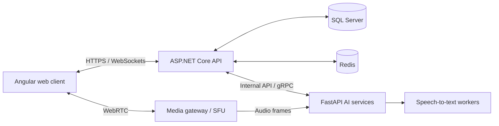

# AiraMeet

Technical documentation for AiraMeet, an AI-powered video conferencing platform that turns live conversations into searchable transcripts, decisions, and follow-up actions.

## About

AiraMeet brings real-time meetings and AI-assisted understanding together. This repository is the project’s documentation hub for product scope, architecture, planning, feature specifications, testing, and deployment.

The platform is designed around a web client, a business API, a real-time media pipeline, and AI services for transcription and other meeting intelligence capabilities.

## Documentation

| What you’re looking for | Documentation |
| --- | --- |
| Product vision, goals, and MVP scope | [Project overview](01-project-overview/project-overview.md) |
| System components and architecture | [System architecture](01-project-overview/system-architecture.md) |
| Technologies in use and under consideration | [Technology stack](01-project-overview/technology-stack.md) |
| Milestones and delivery plan | [Master roadmap](02-planning/master-roadmap.md) |
| Team responsibilities | [Team assignments](02-planning/team-assignments.md) |
| Speech-to-text feature | [Speech-to-text documentation](03-features/01-speech-to-text/README.md) |
| API and WebSocket contracts | [API documentation](04-architecture/api-documentation.md) |
| Database design | [Database schema](04-architecture/database-schema.md) |
| Quality strategy and test cases | [Test strategy](05-testing/test-strategy.md) · [Test cases](05-testing/test-cases.md) |
| Deployment and operations | [Deployment guide](06-deployment/deployment-guide.md) |

## Architecture

The system separates the browser experience, business logic, media forwarding, and AI inference. The web client communicates with the API over HTTPS and WebSockets, while the media gateway carries WebRTC streams. Backend and AI services exchange meeting data and audio for transcription.

See the [system architecture](01-project-overview/system-architecture.md) and [technology stack](01-project-overview/technology-stack.md) for details and implementation decisions.

## Project documentation

- [Project overview](01-project-overview/project-overview.md)
- [Planning and roadmap](02-planning/master-roadmap.md)
- [Feature specifications](03-features/)
- [Architecture and interfaces](04-architecture/)
- [Testing](05-testing/)
- [Deployment](06-deployment/)

Feature folders contain the requirements, design, tasks, testing approach, and delivery timeline for each feature. Use the [feature template](03-features/feature-template/README.md) when documenting a new one.

## Documentation standards

- Link requirements to designs, task IDs, and test cases.
- Estimate work with the three-point PERT formula: `E = (O + 4M + P) / 6`, including risk buffers.
- Mark unverified details as `[Assumption]` or `[To Be Decided - TBD]`.
- Keep examples and workflows reproducible and syntactically valid.
